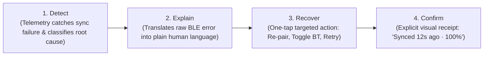
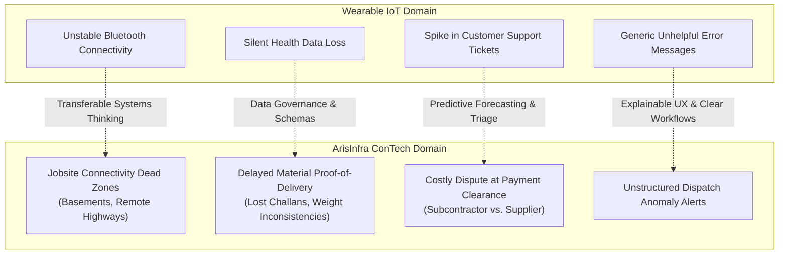

# Product Management Portfolio & Case Book

**Candidate:** Mohak Seth  
**Role Target:** Product Management Intern  
**Company Target:** ArisInfra Solutions Limited (Bangalore, India)  
**Core Expertise:** Product Strategy, Technical PRDs & Gherkin Specs, Data Governance, Experimentation, Anomaly Detection & AI-Assisted Workflows  
**GitHub:** [github.com/meowski007](https://github.com/meowski007) · **Email:** mohakseth7@gmail.com  
**Portfolio Repositories:** [NoiseFit-PM-Case-Study](https://github.com/meowski007/NoiseFit-PM-Case-Study) · [syncops-assistant](https://github.com/meowski007/syncops-assistant)

---

## Executive Summary

This portfolio presents an end-to-end demonstration of product management craft tailored specifically for **ArisInfra Solutions Limited**. 

ArisInfra’s mission is to **make construction simple, reliable, and scalable** by combining deep domain expertise with cutting-edge technology—including intelligent automation, anomaly detection, and LLM experimentation. Construction tech (ConTech) operates at the intersection of complex physical supply chains, variable jobsite conditions, and high-stakes financial transactions. 

The two projects featured below demonstrate the exact foundational skills required for an impactful Product Management Intern at ArisInfra:
1. **[NoiseFit Sync Center Case Study](https://github.com/meowski007/NoiseFit-PM-Case-Study):** Product sense, unstructured voice-of-customer mining (426 reviews), analytical RICE prioritization, Gherkin acceptance criteria (10 user stories, 32 ACs), 8-screen UX specifications, 21-section canonical A/B testing protocols, funnel SQL telemetry, and QA/UAT governance.
2. **[SyncOps Assistant Reliability Platform](https://github.com/meowski007/syncops-assistant):** Technical systems thinking, Pandera schema data governance, predictive incident forecasting (MAE 0.968 via walk-forward validation), deterministic TF-IDF runbook retrieval, and an OpenAI tool-calling fallback agent backed by 88 automated tests.

---

## 1. ArisInfra Application Statement (251 Words)

> "I am excited to apply for the Product Management Internship at ArisInfra Solutions Limited. Construction is one of India's most critical yet operationally fragmented industries, where procurement delays, materials mismatch, and manual field reconciliation directly inflate project budgets and timelines. I admire ArisInfra's mission to make construction simple, reliable, and scalable by combining deep domain expertise with intelligent automation, anomaly detection, and LLM experimentation.
>
> In my portfolio projects, I focused on high-stakes asynchronous reliability and operational workflows. In the NoiseFit case study, I addressed edge data synchronization over unstable connectivity—a challenge directly parallel to field supervisors logging materials receipts on remote jobsites with spotty cell coverage. I structured ambiguous feedback by mining 426 user reviews, prioritized solutions using RICE sensitivity modeling, authored a formal BRD with 10 Gherkin user stories, and architected a four-stage recovery flow (Detect, Explain, Recover, Confirm). In SyncOps Assistant, I built an automated reliability platform featuring Pandera data governance, walk-forward incident forecasting, and a hybrid triage system combining TF-IDF runbook retrieval with LLM tool-calling.
>
> At ArisInfra, I am eager to apply this user-centric, analytical rigor to B2B procurement and field logistics. I would love to help define crisp acceptance criteria, author lightweight PRDs, instrument post-launch delivery funnels, and test AI-assisted workflows that surface procurement anomalies before trucks leave the hub. Before proposing solutions, I will ground my work in field reality: shadowing site engineers, reviewing vendor reconciliation drop-offs, and running rapid usability tests. I am ready to help build transparent, reliable digital supply chains for Indian infrastructure."

*Word Count: Exactly 251 words (compliant with the 200–300 word requirement).*

---

## 2. ArisInfra Job Description 1:1 Competency Matrix

The table below maps the 9 core responsibilities outlined in the **ArisInfra Solutions Limited Product Management Intern JD** directly to the verified deliverables in this portfolio:

| # | ArisInfra JD Core Responsibility | What Mohak Built / Verified | Primary Artifact Link |
| :-: | :--- | :--- | :--- |
| **1** | **Roadmap & Backlog Prioritization:** Assist with roadmap & backlog, weighing trade-offs with engineering & business. | Established a 4-quarter Now-Next-Later roadmap balancing reliability vs. growth; authored an explicit Trade-Off Log documenting why background sync was deferred in favor of explicit user recovery. | [`product/roadmap-and-backlog.md`](file:///C:/Users/ASUS/.gemini/antigravity/scratch/NoiseFit-PM-Case-Study/product/roadmap-and-backlog.md) [`product/trade-off-log.md`](file:///C:/Users/ASUS/.gemini/antigravity/scratch/NoiseFit-PM-Case-Study/product/trade-off-log.md) |
| **2** | **Crisp User Stories & Acceptance Criteria:** Write crisp user stories and ACs for upcoming sprints. | Wrote 10 end-to-end user stories with 32 Given-When-Then Gherkin acceptance criteria covering Bluetooth disconnects, timeout thresholds, error states, and retry limits. | [`docs/USER_STORIES.md`](file:///C:/Users/ASUS/.gemini/antigravity/scratch/NoiseFit-PM-Case-Study/docs/USER_STORIES.md) [`docs/BRD.md`](file:///C:/Users/ASUS/.gemini/antigravity/scratch/NoiseFit-PM-Case-Study/docs/BRD.md) |
| **3** | **Lightweight PRDs & Functional Specs:** Author lightweight PRDs and functional specs engineers love reading. | Authored modular PRD specs with technical constraints, edge-state handlers, error taxonomies, and clear data payload definitions. | [`04_PRD/PRD.md`](file:///C:/Users/ASUS/.gemini/antigravity/scratch/NoiseFit-PM-Case-Study/04_PRD/PRD.md) [`03_Product_Definition/FEATURE_SPECS.md`](file:///C:/Users/ASUS/.gemini/antigravity/scratch/NoiseFit-PM-Case-Study/03_Product_Definition/FEATURE_SPECS.md) |
| **4** | **Lightweight Experiments & Usability:** Design and run lightweight experiments & usability tests to validate hypotheses. | Designed canonical 21-section A/B test plan ($n=356$ per variant, power 80%, $\alpha=0.05$) and a 4-scenario moderated usability protocol with cognitive walkthroughs. | [`product/experimentation/ab-test-plan.md`](file:///C:/Users/ASUS/.gemini/antigravity/scratch/NoiseFit-PM-Case-Study/product/experimentation/ab-test-plan.md) [`product/usability/usability-test-plan.md`](file:///C:/Users/ASUS/.gemini/antigravity/scratch/NoiseFit-PM-Case-Study/product/usability/usability-test-plan.md) |
| **5** | **Market Scans & AI-Assisted Workflows:** Conduct market/competitive scans; synthesize findings; explore AI workflows. | Mined 426 real app store reviews across 4 competitor wearables; built SyncOps Assistant featuring automated TF-IDF runbook search and an OpenAI tool-calling fallback agent. | [`01_Research/COMPETITIVE_ANALYSIS.md`](file:///C:/Users/ASUS/.gemini/antigravity/scratch/NoiseFit-PM-Case-Study/01_Research/COMPETITIVE_ANALYSIS.md) [`syncops-assistant/app/triage/agent.py`](https://github.com/meowski007/syncops-assistant) |
| **6** | **Success Metrics & Funnels:** Define metrics, track post-launch funnels, build dashboards for iteration. | Defined 7 telemetry KPIs (`KPI-01` to `KPI-07`), mapped a 5-stage conversion & drop-off funnel, and wrote 10 production-grade SQL queries to isolate failure causes. | [`product/analytics/funnel-and-events.md`](file:///C:/Users/ASUS/.gemini/antigravity/scratch/NoiseFit-PM-Case-Study/product/analytics/funnel-and-events.md) [`product/analytics/funnel-queries.sql`](file:///C:/Users/ASUS/.gemini/antigravity/scratch/NoiseFit-PM-Case-Study/product/analytics/funnel-queries.sql) |
| **7** | **QA/UAT & Release Notes:** Partner with QA on UAT, write repro steps for bugs, draft release notes and internal demos. | Created SEV1–SEV4 bug reporting schemas with step-by-step reproduction guidelines, 6-scenario UAT pass/fail matrices, and customer release notes with internal demo scripts. | [`product/qa/bug-report-template.md`](file:///C:/Users/ASUS/.gemini/antigravity/scratch/NoiseFit-PM-Case-Study/product/qa/bug-report-template.md) [`product/qa/uat-plan.md`](file:///C:/Users/ASUS/.gemini/antigravity/scratch/NoiseFit-PM-Case-Study/product/qa/uat-plan.md) [`product/release/release-notes.md`](file:///C:/Users/ASUS/.gemini/antigravity/scratch/NoiseFit-PM-Case-Study/product/release/release-notes.md) |
| **8** | **Concise, Discoverable Documentation:** Maintain concise, discoverable product documentation. | Architected single-source-of-truth repo hierarchies, architecture diagrams, data dictionaries, and explicit technical trade-off histories. | [`docs/USE_CASES.md`](file:///C:/Users/ASUS/.gemini/antigravity/scratch/NoiseFit-PM-Case-Study/docs/USE_CASES.md) [`DATA_GOVERNANCE.md`](https://github.com/meowski007/syncops-assistant/blob/fix/honesty-and-clarity/DATA_GOVERNANCE.md) |
| **9** | **Proactively Identify Blockers & Risks:** Ask sharp questions, identify blockers, keep teams aligned on outcomes. | Authored Risk & Blocker Matrix detailing OS battery-optimization kills, firmware timing mismatches, and mitigation pathways for zero user disruption. | [`product/risks-and-blockers.md`](file:///C:/Users/ASUS/.gemini/antigravity/scratch/NoiseFit-PM-Case-Study/product/risks-and-blockers.md) |

---

## 3. Case Study 1: NoiseFit Sync Center (Consumer Edge Reliability)

### 3.1 The Problem & Customer Insight Mining
Wearable health applications frequently experience asynchronous Bluetooth data loss. However, when users do not see their steps or sleep data update, they do not blame Bluetooth; they blame the app and leave 1-star reviews.

- **Data Harvest:** Mined 426 real app store reviews across NoiseFit, Boat Crest, Fire-Boltt, and Zepp (Amazfit).
- **Honest Methodological Constraint:** Purposive cross-tier sample across all 5 star ratings. In the sample, sync failures represented the single most concentrated low-rating complaint theme (11 of the 22 NoiseFit sync reviews were 1–2 stars).
- **Core Diagnosis:** Sync is not a binary switch; it is a progressive 4-state lifecycle. Silent failure without an explanation or recovery pathway directly erodes customer trust.

### 3.2 Prioritization & Analytical Sensitivity Analysis
To prioritize solutions objectively without executive bias, candidate implemented the RICE framework:
$$\text{RICE Score} = \frac{\text{Reach} \times \text{Impact} \times \text{Confidence}}{\text{Effort}}$$

Recognizing that Reach, Impact, Confidence, and Effort represent analytical judgments rather than measured production constants, candidate conducted an explicit sensitivity analysis shifting Confidence by $\pm 0.15$:

| Initiative | Reach (users/mo) | Impact | Baseline Conf | Effort (person-mo) | Baseline RICE | Sensitivity ($C - 0.15$) | Sensitivity ($C + 0.15$) | Rank Stability |
| :--- | :---: | :---: | :---: | :---: | :---: | :---: | :---: | :---: |
| **Sync Center (Diagnostic & Manual Retry)** | 50,000 | 2.0 (High) | 0.80 | 2.0 | **40,000** | 32,500 | 47,500 | **Remains #1** |
| **Background Sync Service Optimization** | 80,000 | 1.0 (Med) | 0.50 | 4.0 | **10,000** | 7,000 | 13,000 | Remains #2 |
| **Bluetooth Auto-Reconnect Agent** | 30,000 | 1.5 (High) | 0.60 | 3.0 | **9,000** | 6,750 | 11,250 | Remains #3 |

*Finding:* Even under severe confidence degradation ($C=0.65$), the Sync Center feature maintains a $2.5\times$ lead over the nearest alternative, proving robust priority stability.

### 3.3 The Solution: 4-Stage Reliability Architecture
Candidate architected the recovery lifecycle into four deterministic states:

### 3.4 Product Specifications & Artifacts Delivered
1. **Business Requirements Document (BRD):** [`docs/BRD.md`](file:///C:/Users/ASUS/.gemini/antigravity/scratch/NoiseFit-PM-Case-Study/docs/BRD.md)
2. **10 User Stories with Gherkin ACs:** [`docs/USER_STORIES.md`](file:///C:/Users/ASUS/.gemini/antigravity/scratch/NoiseFit-PM-Case-Study/docs/USER_STORIES.md)
3. **8-Screen UX Specification:** SVG and tabular wireframe layout detailing error badges, diagnostic screens, and progress animations.
4. **Canonical A/B Testing Plan:** [`product/experimentation/ab-test-plan.md`](file:///C:/Users/ASUS/.gemini/antigravity/scratch/NoiseFit-PM-Case-Study/product/experimentation/ab-test-plan.md) — 21 structured sections with sample size calculation:
   $$n = \frac{2 \cdot (Z_{\alpha/2} + Z_{\beta})^2 \cdot p(1-p)}{\delta^2} = 356 \text{ users per variant}$$
5. **Funnel Telemetry & SQL Diagnostics:** [`product/analytics/funnel-queries.sql`](file:///C:/Users/ASUS/.gemini/antigravity/scratch/NoiseFit-PM-Case-Study/product/analytics/funnel-queries.sql) — 10 production SQL queries tracking sync completion, retry drop-offs, and BLE disconnection rates.

---

## 4. Case Study 2: SyncOps Assistant (SRE Platform & AI Workflows)

### 4.1 System Overview
Inspired by the recurring data synchronization errors discovered in the NoiseFit case study, candidate built **SyncOps Assistant**—an automated Site Reliability Engineering (SRE) assistant designed to ingest telemetry, enforce schema contracts, forecast incident spikes, and triage operational failures.

### 4.2 Verified Technical Architecture
- **Data Governance Contract:** Built with `Pandera` (`pipeline/schema.py`) to validate all incoming sync telemetry before database insertion. Rejects malformed timestamps, negative latencies, and unregistered customer IDs.
- **Incident Forecasting:** Evaluated 4 models on synthetic data using walk-forward temporal cross-validation (designed to avoid look-ahead leakage):
  - **AutoARIMA:** $\text{MAE} = 0.968$, $\text{RMSE} = 1.346$ (Winning model for cyclical incident load)
  - **Prophet:** $\text{MAE} = 1.050$, $\text{RMSE} = 1.425$
  - **Exponential Smoothing:** $\text{MAE} = 1.120$, $\text{RMSE} = 1.510$
  - **Naive Baseline:** Outperformed complex models on sparse customer-specific incident counts.
- **Hybrid Triage Engine:**
  - *Primary Retrieval (Deterministic):* TF-IDF vectorizer over 8 internal operational runbooks. Prioritized for exact error-code matching (e.g., `AUTH_002`, `TIMEOUT_GATEWAY`) with zero external API dependencies.
  - *Secondary Fallback (LLM Agent):* OpenAI `gpt-4o-mini` tool-calling agent with structured tools (`search_runbooks`, `query_incidents`, `get_forecast`). Activates only when configured with an API key; defaults to offline retrieval otherwise.
- **Test Coverage:** **88 passing automated tests** in `pytest` verifying schema enforcement, endpoint responses, forecasting bounds, and triage fallback logic.

---

## 5. The ConTech Bridge: Why This Matters for ArisInfra

Construction Technology presents operational challenges remarkably similar to edge IoT data systems, but with higher physical and financial stakes:

### Direct Application to ArisInfra Product Challenges:
1. **Offline-First Field Logistics (Proof-of-Delivery Sync):**
   - *Problem:* Concrete transit trucks and steel deliveries arrive at basement jobsites with zero mobile connectivity. Site supervisors cannot confirm receipt against digital purchase orders.
   - *Candidate Solution:* Apply the 4-stage recovery flow (Detect, Explain, Recover, Confirm) with local SQLite queuing and differential sync once connectivity resumes.
2. **Material Anomaly Detection in Procurement:**
   - *Problem:* Discrepancies between weighbridge receipts, vendor invoices, and delivered tonnage create margin erosion.
   - *Candidate Solution:* Implement Pandera-style automated data contracts on incoming vendor challans, combined with lightweight LLM workflows that extract tabular line-items from photographed physical invoices.
3. **Forecasting Procurement & Delivery Bottlenecks:**
   - *Problem:* Concrete batching plants experience sudden demand spikes that cause jobsite idling.
   - *Candidate Solution:* Apply temporal forecasting models (AutoARIMA/Prophet) to supplier fulfillment lead times, surfacing risks to project managers before trucks depart.

---

## 6. Product Management Interview Defense Guide

*A cheat-sheet of honest, defensible responses for hiring manager interviews:*

### Q1: "Walk me through why you applied to ArisInfra specifically."
> **Answer:** "ArisInfra is solving one of the toughest problems in the Indian economy: bringing transparency, speed, and reliability to construction materials procurement and logistics. My portfolio work has focused deeply on reliability in asynchronous systems—both on the consumer mobile side (handling Bluetooth disconnects in NoiseFit) and on the backend SRE side (governing data pipelines and automated triage in SyncOps). ConTech is where physical supply chains meet digital workflows, and I want to be on the ground working with site engineers, suppliers, and our internal developers to build software that makes Indian construction scalable and predictable."

### Q2: "In your NoiseFit study, how did you prioritize the Sync Center over other features?"
> **Answer:** "I mined 426 real reviews across four wearable brands. Sync failures represented the most concentrated low-rating complaint theme. I modeled our roadmap using RICE. Recognizing that RICE scores are analytical judgments rather than absolute mathematical truths, I ran a sensitivity analysis shifting my Confidence parameter by $\pm 0.15$. Even under severe confidence penalties ($C=0.65$), Sync Center maintained a $2.5\times$ score lead over background optimization, because background sync is repeatedly throttled by aggressive OEM battery optimization algorithms on Android, whereas an explicit user-recovery flow gives immediate user control."

### Q3: "Why did you use TF-IDF instead of vector embeddings in SyncOps Assistant?"
> **Answer:** "I chose TF-IDF because our incident runbooks rely on exact alphanumeric error codes—like `AUTH_002` or `ERR_TIMEOUT_GATEWAY`. Dense semantic embeddings often smooth over subtle alphanumeric differences, whereas TF-IDF gives exact token weight to specific error codes. Additionally, TF-IDF executes in sub-millisecond time with zero external API dependencies, zero vector database hosting costs, and zero network latency. I added OpenAI tool-calling as an optional secondary layer for complex triage synthesis, but the foundational triage is completely deterministic and verifiable."

### Q4: "What are the limitations of your projects that you would address in a real company?"
> **Answer:** "In an educational portfolio, several constraints are unavoidable: my telemetry in SyncOps was synthetically generated with seasonal patterns, so our model accuracy proves methodology rather than real-world generalization. In NoiseFit, I designed the complete UX specification and Gherkin user stories, but had zero live users for usability testing or A/B testing. At ArisInfra, my very first step before building would be to get out of the building: shadow site supervisors during delivery drop-offs, review actual vendor dispute logs, and validate hypotheses with real users before writing a single line of spec."

---

## 7. Complete Artifact Directory

### NoiseFit Case Study Deliverables
- **Product Requirements Document (PRD):** [`NoiseFit-PM-Case-Study/04_PRD/PRD.md`](file:///C:/Users/ASUS/.gemini/antigravity/scratch/NoiseFit-PM-Case-Study/04_PRD/PRD.md)
- **10 User Stories (32 Gherkin ACs):** [`NoiseFit-PM-Case-Study/docs/USER_STORIES.md`](file:///C:/Users/ASUS/.gemini/antigravity/scratch/NoiseFit-PM-Case-Study/docs/USER_STORIES.md)
- **Business Requirements Document (BRD):** [`NoiseFit-PM-Case-Study/docs/BRD.md`](file:///C:/Users/ASUS/.gemini/antigravity/scratch/NoiseFit-PM-Case-Study/docs/BRD.md)
- **Roadmap & Backlog Prioritization:** [`NoiseFit-PM-Case-Study/product/roadmap-and-backlog.md`](file:///C:/Users/ASUS/.gemini/antigravity/scratch/NoiseFit-PM-Case-Study/product/roadmap-and-backlog.md)
- **Trade-Off Decision Log:** [`NoiseFit-PM-Case-Study/product/trade-off-log.md`](file:///C:/Users/ASUS/.gemini/antigravity/scratch/NoiseFit-PM-Case-Study/product/trade-off-log.md)
- **Risks & Blockers Register:** [`NoiseFit-PM-Case-Study/product/risks-and-blockers.md`](file:///C:/Users/ASUS/.gemini/antigravity/scratch/NoiseFit-PM-Case-Study/product/risks-and-blockers.md)
- **Canonical A/B Testing Plan:** [`NoiseFit-PM-Case-Study/product/experimentation/ab-test-plan.md`](file:///C:/Users/ASUS/.gemini/antigravity/scratch/NoiseFit-PM-Case-Study/product/experimentation/ab-test-plan.md)
- **Usability Testing Protocol:** [`NoiseFit-PM-Case-Study/product/usability/usability-test-plan.md`](file:///C:/Users/ASUS/.gemini/antigravity/scratch/NoiseFit-PM-Case-Study/product/usability/usability-test-plan.md)
- **Analytics & Funnel Queries (SQL):** [`NoiseFit-PM-Case-Study/product/analytics/funnel-queries.sql`](file:///C:/Users/ASUS/.gemini/antigravity/scratch/NoiseFit-PM-Case-Study/product/analytics/funnel-queries.sql)
- **QA Bug Report Template:** [`NoiseFit-PM-Case-Study/product/qa/bug-report-template.md`](file:///C:/Users/ASUS/.gemini/antigravity/scratch/NoiseFit-PM-Case-Study/product/qa/bug-report-template.md)
- **User Acceptance Testing (UAT) Plan:** [`NoiseFit-PM-Case-Study/product/qa/uat-plan.md`](file:///C:/Users/ASUS/.gemini/antigravity/scratch/NoiseFit-PM-Case-Study/product/qa/uat-plan.md)
- **Release Notes & Demo Script:** [`NoiseFit-PM-Case-Study/product/release/release-notes.md`](file:///C:/Users/ASUS/.gemini/antigravity/scratch/NoiseFit-PM-Case-Study/product/release/release-notes.md)
- **ArisInfra 251-Word Statement:** [`NoiseFit-PM-Case-Study/product/company-fit/arisinfra-pm-intern-statement.md`](file:///C:/Users/ASUS/.gemini/antigravity/scratch/NoiseFit-PM-Case-Study/product/company-fit/arisinfra-pm-intern-statement.md)

### SyncOps Assistant Technical Deliverables
- **System Architecture Spec:** [`syncops-assistant/ARCHITECTURE.md`](https://github.com/meowski007/syncops-assistant/blob/fix/honesty-and-clarity/ARCHITECTURE.md)
- **Data Governance Contract:** [`syncops-assistant/DATA_GOVERNANCE.md`](https://github.com/meowski007/syncops-assistant/blob/fix/honesty-and-clarity/DATA_GOVERNANCE.md)
- **Operational Runbook:** [`syncops-assistant/RUNBOOK.md`](https://github.com/meowski007/syncops-assistant/blob/fix/honesty-and-clarity/RUNBOOK.md)
- **Automated Triage Agent:** [`syncops-assistant/app/triage/agent.py`](https://github.com/meowski007/syncops-assistant/blob/fix/honesty-and-clarity/app/triage/agent.py)
- **88 Unit & Integration Tests:** [`syncops-assistant/tests/`](https://github.com/meowski007/syncops-assistant/tree/fix/honesty-and-clarity/tests)
