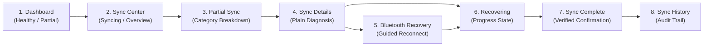

# NoiseFit Sync Reliability — Sync Center
### Product Management & Business Analysis Case Study

> **IMPORTANT PORTFOLIO DISCLOSURE**  
> **This is an independent product and business analysis case study, not a real client engagement.** The KPI dataset is synthetic and is used to demonstrate analytical and measurement methods. Sync Center is a proposed feature, and the A/B test plan does not establish a completed experiment or measured business impact. Never infer that this project represents an official engagement or communication from Noise (Nexxbase Technologies), boAt, Google/Fitbit, or Samsung.

---

## Executive Summary

Wearable fitness trackers depend entirely on dependable data synchronization. When users complete workouts or record sleep, they expect seamless data availability on their mobile companion app. This independent case study investigates synchronization reliability across wearable ecosystems, identifies synchronization failure as the primary driver of customer churn, and engineers a comprehensive business analysis and product requirements specification for **NoiseFit Sync Center**.

Sync Center replaces silent failure with a deterministic, transparent four-stage recovery engine:

$$\textbf{Detect} \longrightarrow \textbf{Explain} \longrightarrow \textbf{Recover} \longrightarrow \textbf{Confirm}$$

This repository contains the complete, recruiter-ready **Business Analysis & Product Management documentation suite**, complete with qualitative review coding, RICE prioritization, a formal BRD, 10 Gherkin user stories, a detailed use case, process maps, a mathematical KPI framework, a bidirectional traceability matrix, synthetic SQL analytics, and an experimentation plan.

---

## Business Analysis Documentation Suite

| Deliverable | File Path | Scope & Focus |
|---|---|---|
| **Business Requirements Document (BRD)** | [`docs/BRD.md`](./docs/BRD.md) | Business problem, objectives, scope boundaries, stakeholder RACI, `BR-01` to `BR-06`, `FR-01` to `FR-10`, and `NFR-01` to `NFR-05`. |
| **User Stories & Acceptance Criteria** | [`docs/USER_STORIES.md`](./docs/USER_STORIES.md) | 10 user stories for persona *Aarav* with MoSCoW priorities, FR/KPI mappings, and 32 Given/When/Then Gherkin criteria. |
| **Detailed Use Case (UC-01)** | [`docs/USE_CASES.md`](./docs/USE_CASES.md) | Comprehensive primary use case: *Recover from a Failed Sync* with happy path, 3 alternate flows, 6 exception flows, and 5 business rules. |
| **Process Maps & Workflows** | [`docs/PROCESS_MAPS.md`](./docs/PROCESS_MAPS.md) | Visual state transitions, decision logic, cross-functional swimlanes, and step-by-step Miro / Lucidchart reconstruction guide. |
| **KPI & Metrics Framework** | [`docs/KPI_AND_METRICS.md`](./docs/KPI_AND_METRICS.md) | Mathematical formulas, operational definitions, and target benchmarks (`[ASSUMPTION]`) for 7 core synchronization KPIs. |
| **Requirements Traceability Matrix** | [`docs/TRACEABILITY_MATRIX.md`](./docs/TRACEABILITY_MATRIX.md) | Bidirectional forward/backward traceability linking customer review evidence to BRs, FRs, stories, ACs, KPIs, and validation methods. |
| **Interview Preparation & Defense** | [`docs/INTERVIEW_PREPARATION.md`](./docs/INTERVIEW_PREPARATION.md) | 5 core interview questions with deep BA model answers, disclaimers, and Junior BA (AI/GenAI) skill alignment. |
| **Assumptions & Open Questions** | [`docs/ASSUMPTIONS_AND_OPEN_QUESTIONS.md`](./docs/ASSUMPTIONS_AND_OPEN_QUESTIONS.md) | 9-part governance register separating verified facts, proposed decisions, explicit assumptions, missing data, and stakeholder questions. |

### Supporting Repository Deliverables
- **Evidence Register:** [`research/evidence_register.csv`](./research/evidence_register.csv) — 426 coded Google Play reviews.
- **Traceability Matrix CSV:** [`requirements/requirements_traceability.csv`](./requirements/requirements_traceability.csv) — Structured CSV matrix.
- **Standalone Process Maps:**
  - Flowchart: [`process-maps/sync_center_flow.mmd`](./process-maps/sync_center_flow.mmd)
  - Swimlanes: [`process-maps/sync_center_swimlanes.mmd`](./process-maps/sync_center_swimlanes.mmd)
- **KPI Data Dictionary:** [`metrics/KPI_data_dictionary.md`](./metrics/KPI_data_dictionary.md) — Telemetry schema and derived metric dictionary.
- **A/B Experimentation Plan:** [`experimentation/AB_TEST_PLAN.md`](./experimentation/AB_TEST_PLAN.md) — Statistical hypothesis testing and rollout protocol.
- **Prototype Screen Reference:** [`prototype/prototype_reference.md`](./prototype/prototype_reference.md) — 8 SVG prototype screen specifications.
- **SQL Analytics Script:** [`sql/analysis_queries.sql`](./sql/analysis_queries.sql) — 10 SQL queries analyzing synthetic telemetry.

---

## Resume-Ready CV Bullets

> **For Junior Business Analyst, Junior BA (AI/GenAI), and Product Analyst Applications:**

- **Analyzed 426 competitor Google Play reviews using sentiment analysis and RICE prioritization to identify wearable synchronization failure as the primary user churn driver.**
- **Authored comprehensive BRD, FRD, 10 user stories with Gherkin acceptance criteria, and bidirectional traceability matrix mapping user pain points to functional requirements.**
- **Designed 4-stage Sync Center workflow, A/B test validation plan, and synthetic SQL telemetry schema to model sync recovery and support burden KPIs.**

---

## 01 — Research & Problem Framing

### Objective
Understand recurring user pain points in NoiseFit and benchmark them against competing wearable companion applications.

### Review Dataset (426 Google Play Reviews)
The empirical research dataset contains **426 coded Google Play reviews** sampled across four products and all five rating tiers:
- **NoiseFit:** 96 reviews (22 × 1★, 20 × 2★, 20 × 3★, 15 × 4★, 19 × 5★)
- **boAt Crest:** 131 reviews (23 × 1★, 20 × 2★, 20 × 3★, 20 × 4★, 48 × 5★)
- **Google Health (Fitbit):** 101 reviews (27 × 1★, 15 × 2★, 19 × 3★, 20 × 4★, 20 × 5★)
- **Samsung Health:** 98 reviews (25 × 1★, 20 × 2★, 19 × 3★, 15 × 4★, 19 × 5★)

### NoiseFit Thematic Coding & Key Signals
- **Sync / Data:** **22 reviews (22.9%)** — 11 rated 1–2★ (50.0% severe dissatisfaction).
- **Features / Functionality:** 21 reviews (21.9%) — Only 1 rated 1–2★ (primarily feature requests).
- **Connectivity (Bluetooth):** 16 reviews (16.7%) — 7 rated 1–2★ (disconnection and unpairing friction).
- **Accuracy:** 10 reviews (10.4%) — 4 rated 1–2★.
- **Tracking:** 8 reviews (8.3%) — 4 rated 1–2★.

**Key Analytical Finding:** While "Features/Functionality" generated high volume, low-rating complaints were overwhelmingly concentrated in **Sync/Data and Connectivity (42.9% of all 1–2★ reviews)**. This proved that synchronization unreliability is the primary driver of negative reviews and app abandonment.

*Original Research Files:* See [`01_Research/`](./01_Research/) and [`research/evidence_register.csv`](./research/evidence_register.csv).

---

## 02 — Opportunity Prioritization (RICE)

Multiple candidate opportunity areas were evaluated using an auditable RICE framework:

$$\text{RICE Score} = \frac{\text{Reach} \times \text{Impact} \times \text{Confidence}}{\text{Effort}}$$

| Opportunity Area | Reach (1–10) | Impact (0.25–3) | Confidence (0–1) | Effort (1–10) | RICE Score | Rank |
|---|---|---|---|---|---|---|
| **Reliable Sync & Recovery** | **8** | **3 (Massive)** | **0.85** | **5** | **4.08** | **#1** |
| **Bluetooth Connection Recovery** | 7 | 3 (Massive) | 0.80 | 5 | 3.36 | #2 |
| **App Performance & Stability** | 7 | 2 (High) | 0.75 | 6 | 1.75 | #3 |
| **Health / Workout Data Accuracy** | 6 | 3 (Massive) | 0.65 | 7 | 1.67 | #4 |
| **Workout Tracking Depth** | 6 | 2 (High) | 0.65 | 6 | 1.30 | #5 |
| **Pricing Transparency** | 4 | 1 (Medium) | 0.80 | 3 | 1.07 | #6 |
| **Customization & Watch Faces** | 7 | 1 (Medium) | 0.60 | 7 | 0.60 | #7 |

*Note: RICE scores reflect portfolio analytical assumptions to structure prioritization, not internal company metrics.*

*Original Prioritization Files:* See [`02_Prioritization/`](./02_Prioritization/).

---

## 03 — Product Definition & User Persona

### Target User Persona
- **Persona Name:** *Aarav — The Everyday Wearable User*
- **Profile:** Young, smartphone-dependent Noise smartwatch user who checks steps, sleep, and workouts daily.
- **Primary Goal:** Dependably track health routines without having to repeatedly troubleshoot Bluetooth or unpair the watch.
- **Frustration Trigger:** Opening the companion app to find broken step streaks or missing sleep logs without any explanation.

### Jobs-to-be-Done (JTBD)
> *"When I use my Noise wearable throughout the day, I want my data to reliably appear in NoiseFit and clearly know when something has failed, so that I can trust my activity and health records."*

### User Journey
$$\text{Wear} \longrightarrow \text{Connect} \longrightarrow \text{Sync} \longrightarrow \text{Discover Problem} \longrightarrow \text{Recover} \longrightarrow \text{Confirm} \longrightarrow \text{Continue}$$

*Original Definition Files:* See [`03_Product_Definition/`](./03_Product_Definition/).

---

## 04 — Product Requirements Document (PRD)

The proposed MVP provides:
1. Real-time sync status card on the home dashboard.
2. Last successful sync timestamp.
3. Category-level completeness breakdown (Steps, Sleep, Heart Rate, Workouts).
4. Plain-language root-cause explanations (BLE disconnect, OS background kill, timeout).
5. One-tap targeted retry (differential packet recovery).
6. Guided Bluetooth reconnection flow.
7. Explicit confirmation screen showing restored categories and timestamp.
8. Automated customer support escalation with pre-packaged diagnostic logs after 3 failures.

*Original PRD Files:* See [`04_PRD/`](./04_PRD/) and [`docs/BRD.md`](./docs/BRD.md).

---

## 05 — UX Prototype & Screen Specifications

The UX prototype models an 8-screen recovery flow following the 4-stage model:



- **Vector SVG Screens:** [`05_UX/SVG_Screens/`](./05_UX/SVG_Screens/)
- **Visual Mockup:** [`05_UX/NoiseFit_Sync_Center_Prototype_Visual.png`](./05_UX/NoiseFit_Sync_Center_Prototype_Visual.png)
- **Editable Prototype Slides:** [`05_UX/NoiseFit_Sync_Center_Editable_Prototype.pptx`](./05_UX/NoiseFit_Sync_Center_Editable_Prototype.pptx)
- **Figma Wireframe Specifications:** [`05_UX/Figma_Wireframe_Spec.xlsx`](./05_UX/Figma_Wireframe_Spec.xlsx)
- **Prototype Documentation:** [`prototype/prototype_reference.md`](./prototype/prototype_reference.md)

---

## 06 — Synthetic SQL Analytics

A synthetic relational database (`noisefit_synthetic.db`) with 8,307 sync events and 900 support tickets was constructed to simulate product telemetry analysis:

### Key Analytical Insights (Synthetic Data)
- **Overall Sync Outcome (Q1):** 70.93% success (5,892), 16.11% failed (1,338), 12.96% partial (1,077). Total problem rate is **29.07%**.
- **Model Distribution (Q2):** Failure rate is evenly distributed (~27%–30%) across models (Voyage: 30.08%, Pulse 2: 29.99%, Force Plus: 29.77%), indicating app/OS-level rather than single-hardware failure.
- **Root Causes (Q3):** Firmware mismatch (21.45%), background restriction (20.41%), Bluetooth disconnected (19.79%), timeout (19.75%), server timeout (18.59%).
- **Support Burden (Q6):** Sync (319 tickets) and Connectivity (215 tickets) represent **59.3% of total customer support volume** (534/900).

*Original SQL Files:* Preserved in [`06_SQL/`](./06_SQL/) and query catalog in [`sql/README.md`](./sql/README.md).

---

## 07 — Experimentation & A/B Validation

- **Experiment Design:** Control ($A$ — Existing sync experience) vs. Treatment ($B$ — Sync Center MVP).
- **Primary Metric:** Sync Recovery Rate within 15 minutes (Target: $\ge 60\%$, $+30\text{pp lift}$ `[ASSUMPTION]`).
- **Secondary Metrics:** Median Time to Recover ($<60\text{s}$ `[ASSUMPTION]`), Missing-data session rate, Support contact rate.
- **Guardrail Metrics:** App crash rate ($\le +0.05\%$), 24h battery drain ($<1.0\%$).
- **Experimentation Protocol:** See [`experimentation/AB_TEST_PLAN.md`](./experimentation/AB_TEST_PLAN.md).
- **Case Study Presentation Deck:** See [`07_Presentation/NoiseFit_PM_Case_Study.pptx`](./07_Presentation/NoiseFit_PM_Case_Study.pptx).

---

## 08 — Go-to-Market (GTM) & Rollout Strategy

- **Target Segment:** Active Noise wearable users experiencing delayed or missing activity data.
- **Positioning:** *A clearer, more dependable way to understand and recover from wearable sync problems.*
- **Core Message:** *Know when your data is synced. Recover when it isn't.*
- **Value Pillars:** Reliable · Simple · Transparent.
- **Launch Touchpoints:** In-app educational cards, contextual failure notifications, self-service Help Center guides.

*Original Finalization Files:* See [`08_Finalization/`](./08_Finalization/).

---

## Skills Demonstrated

| Competency Area | Tools & Frameworks Applied | Concrete Portfolio Evidence |
|---|---|---|
| **Requirements Elicitation** | Qualitative Review Mining, Coded Taxonomies | 426 Google Play reviews categorized across 10 themes in [`research/evidence_register.csv`](./research/evidence_register.csv). |
| **Requirements Documentation** | Formal BRD, Functional Specs, NFRs | Complete BRD (`BR-01`–`BR-06`, `FR-01`–`FR-10`, `NFR-01`–`NFR-05`) in [`docs/BRD.md`](./docs/BRD.md). |
| **Agile User Stories** | MoSCoW Prioritization, Gherkin (Given/When/Then) | 10 user stories with 32 testable Gherkin scenarios in [`docs/USER_STORIES.md`](./docs/USER_STORIES.md). |
| **Use Case Modeling** | Detailed Behavioral Specifications, Business Rules | End-to-end `UC-01` specification with 6 exception flows in [`docs/USE_CASES.md`](./docs/USE_CASES.md). |
| **Process Modeling** | Flowcharts, Cross-Functional Swimlanes, Miro Guide | Valid Mermaid diagrams and Miro reproduction guide in [`docs/PROCESS_MAPS.md`](./docs/PROCESS_MAPS.md). |
| **KPI & Metric Design** | Mathematical Formulations, Attribution Windows | 7 rigorous KPI specifications and SQL derivations in [`docs/KPI_AND_METRICS.md`](./docs/KPI_AND_METRICS.md). |
| **Traceability & Governance** | Bidirectional RTM, Forward/Backward Orphan Checks | Unbroken matrix and risk register in [`docs/TRACEABILITY_MATRIX.md`](./docs/TRACEABILITY_MATRIX.md). |
| **Product Analytics (SQL)** | SQLite, Window Functions, Cohort Segmentation | 10 analysis queries on 8,307 events in [`sql/analysis_queries.sql`](./sql/analysis_queries.sql). |
| **Experimentation** | A/B Test Design, Power Analysis, Sample Sizing | Statistical protocol and phased rollout plan in [`experimentation/AB_TEST_PLAN.md`](./experimentation/AB_TEST_PLAN.md). |
| **UI/UX Wireframing** | Information Architecture, Design Systems | 8 vector SVG screens and Figma spec in [`prototype/prototype_reference.md`](./prototype/prototype_reference.md). |

---

## Repository Structure

```text
NoiseFit-PM-Case-Study/
│
├── README.md                                  # Executive summary & portfolio master index
│
├── docs/                                      # Comprehensive Business Analysis documentation
│   ├── README.md                              # BA documentation index & recruiter guide
│   ├── BRD.md                                 # Business Requirements Document (BRD-NF-001)
│   ├── USER_STORIES.md                        # 10 User Stories with Gherkin Acceptance Criteria
│   ├── USE_CASES.md                           # Detailed Use Case Specification (UC-01)
│   ├── PROCESS_MAPS.md                        # Process modeling & Miro/Lucidchart guide
│   ├── KPI_AND_METRICS.md                     # KPI framework & mathematical formulations
│   ├── TRACEABILITY_MATRIX.md                 # Bidirectional traceability & orphan audits
│   ├── INTERVIEW_PREPARATION.md               # 5 defense questions & Junior BA (AI) alignment
│   └── ASSUMPTIONS_AND_OPEN_QUESTIONS.md      # 9-part governance register & risk log
│
├── research/
│   └── evidence_register.csv                  # 426 coded Google Play reviews
│
├── requirements/
│   └── requirements_traceability.csv          # Structured CSV traceability matrix
│
├── process-maps/
│   ├── sync_center_flow.mmd                   # Standalone Mermaid flowchart (Detect->Confirm)
│   └── sync_center_swimlanes.mmd              # Standalone Mermaid cross-functional swimlanes
│
├── metrics/
│   └── KPI_data_dictionary.md                 # Telemetry relational schema & derived metrics
│
├── experimentation/
│   └── AB_TEST_PLAN.md                        # Statistical A/B testing plan & rollout protocol
│
├── prototype/
│   └── prototype_reference.md                 # Prototype screen specifications & UI asset index
│
├── sql/
│   ├── README.md                              # Query catalog & schema documentation
│   └── analysis_queries.sql                   # 10 standalone SQL analysis queries
│
├── 01_Research/                               # Original qualitative research & reviews
├── 02_Prioritization/                         # Original RICE opportunity prioritization
├── 03_Product_Definition/                     # Original persona, journey & concept
├── 04_PRD/                                    # Original Product Requirements Document
├── 05_UX/                                     # Original Figma wireframe spec, PPTX & SVG screens
├── 06_SQL/                                    # Original synthetic SQLite database & ZIP
├── 07_Presentation/                           # Original 15-slide executive presentation
└── 08_Finalization/                           # Original GTM strategy & quality control
```
