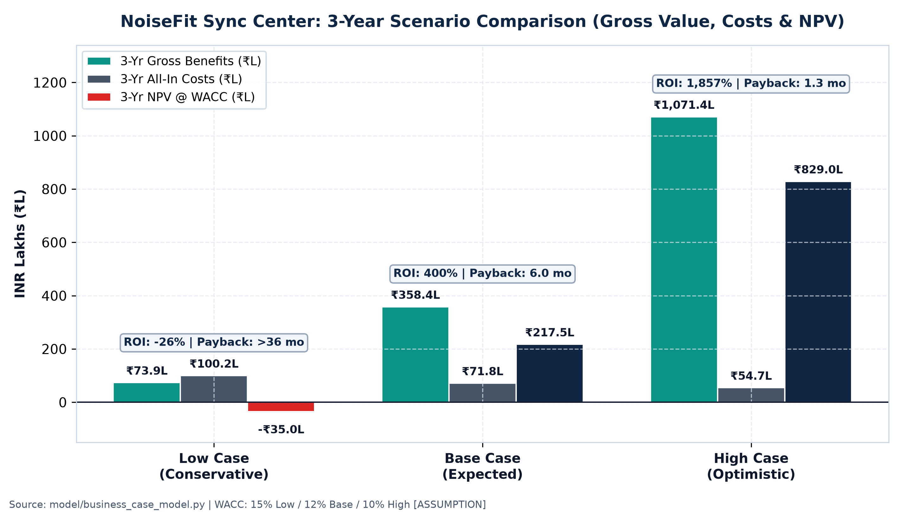
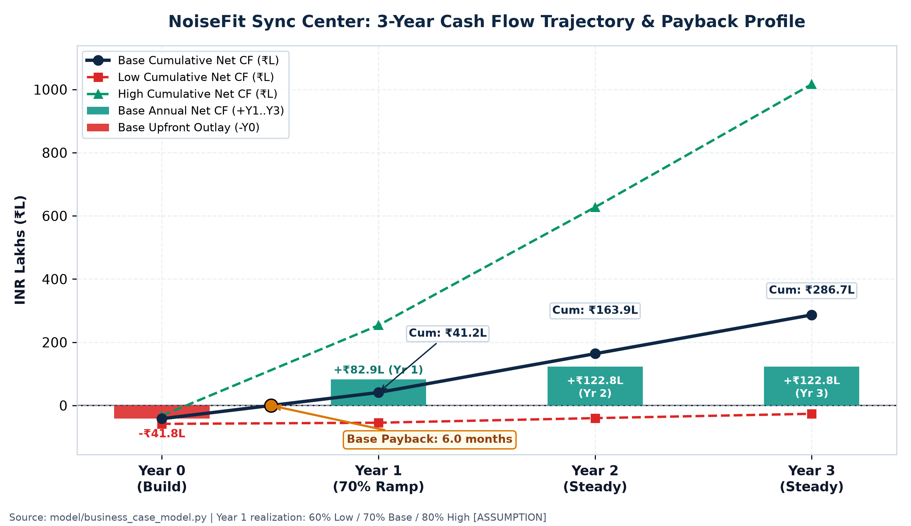
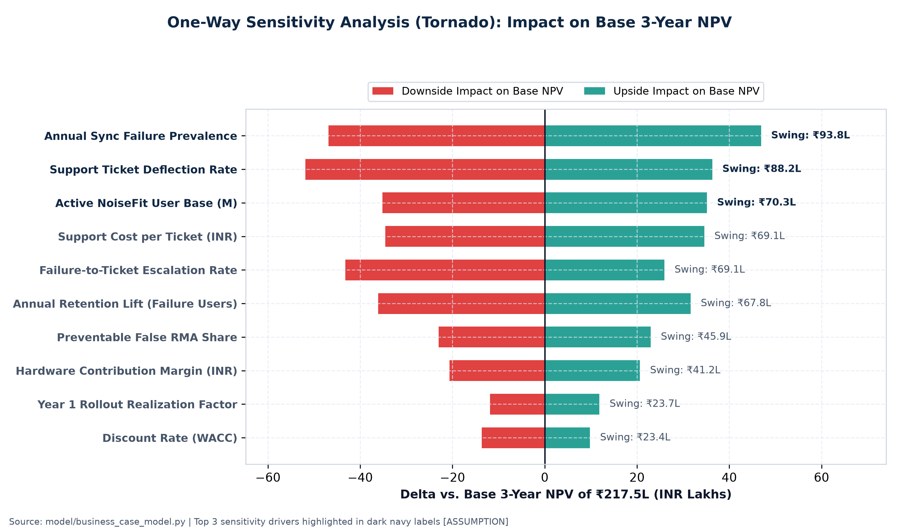

# Business Case: NoiseFit Sync Center

**Document ID:** `BC-NF-001` | **Feature:** NoiseFit Sync Center (`Detect -> Explain -> Recover -> Confirm`)
**Related Artifacts:** [BRD-NF-001](./BRD.md) · [PRD](../04_PRD/README.md) · [User Stories](./USER_STORIES.md) · [KPI Framework](./KPI_AND_METRICS.md) · [A/B Test Plan (`EXP-NF-001`)](../experimentation/AB_TEST_PLAN.md)
**Financial Model:** [`model/business_case_model.xlsx`](../model/business_case_model.xlsx) · [`model/business_case_model.py`](../model/business_case_model.py) · [`model/assumptions.yaml`](../model/assumptions.yaml)
**Currency & Horizon:** INR Lakhs (`₹L`; `₹100L = ₹1.00 Crore`) | 3-Year Evaluation Horizon (`Y0` Build + `Y1–Y3` Operations)

---

## a. Executive Summary

- **Problem:** Noise leads India's smartwatch market with **26.6% share** (~7.69M units in CY25) inside a contracting category (**-17.6% YoY** in CY25), yet FY25 operating revenue declined **-24% YoY to ₹1,048 Cr** with thin **1.67% EBITDA (₹18 Cr)** — while in our repo's **426-review evidence base**, **39.6% of NoiseFit reviews** (`38/96`) and **42.9% of all 1–2★ ratings** (`18/42`) cite Sync/Data or Connectivity failures that fuel support costs, 7-day replacements, and churn away from repeat upgrades.
- **Solution:** Launch **NoiseFit Sync Center** — a unified **free** in-app synchronization reliability hub (`Status Banner`, `Sync Center Modal`, `Plain-English Diagnostics`, `Guided Troubleshooting`, `One-Click 3-Attempt Retry`, `Partial Sync Badges`, `OEM BLE Troubleshooting Card`, and `Zero-PII Support Escalation Package`) defined in [`BRD-NF-001`](./BRD.md) and validated via [`EXP-NF-001`](../experimentation/AB_TEST_PLAN.md).
- **Expected Impact (3-Year Horizon):** In the **Base Case**, Sync Center delivers **₹358.45L** in 3-year gross benefits (**45.8%** support ticket deflection, **28.7%** repeat-upgrade retention, **20.3%** avoided false RMAs, **5.3%** store rating defense), yielding **₹286.70L** net undiscounted benefit, **399.6% lifecycle ROI** (**686.7%** CapEx ROI), **6.0-month payback**, and **₹217.53L (₹2.18 Cr) NPV** at a `12.0%` hurdle rate (`[ASSUMPTION]`). Downside **Low Case** yields **-26.2% ROI / -₹34.98L NPV**; upside **High Case** yields **1,856.9% ROI / ₹829.01L NPV**.
- **Investment Required:** **₹41.75L Year 0 build** (`45.0 person-weeks` across PM, Android, iOS, Firmware/BLE, UX, QA/OEM lab, Analytics, and Support/Legal at `₹0.75L/pw` loaded rate + `₹8.00L` device lab, usability, and privacy counsel `[ASSUMPTION]`), plus **₹10.00L/year** ongoing maintenance & telemetry/compliance OpEx (`₹71.75L` total 3-year all-in cost — `<0.4%` of Noise's ₹180 Cr FY25 marketing spend).
- **Recommendation:** **Approve and fund Phase 0–4 execution**, ship Sync Center **100% free for all users** (avoiding paywall backlash documented in Play Store reviews), enforce strict **DPDP Act 2023 / Android & iOS permission compliance** pre-Canary, and gate GA rollout on [`EXP-NF-001`](../experimentation/AB_TEST_PLAN.md) achieving `>= +10pp` 15-minute sync recovery lift (`KPI-02`) with zero guardrail regressions.

---

## b. Problem & Evidence

### 1. Customer Voice Evidence (426-Review Repository Audit)
Our primary qualitative dataset ([`research/evidence_register.csv`](../research/evidence_register.csv)) codes **426 public Google Play reviews** across four companion wearable apps (boAt Crest `131`, Google Health/Fitbit `101`, Samsung Health `98`, and NoiseFit `96`). Within the purposive **96-review NoiseFit sample** (`22x1★, 20x2★, 20x3★, 15x4★, 19x5★`):

| Review Theme | Sample Count | Share of NoiseFit (`n=96`) | 1–2★ Count (`n=42`) | Share of All 1–2★ Complaints |
|---|---|---|---|---|
| **Sync/Data** (missing steps, failed/partial sync) | 22 | 22.9% | 11 (`50.0%` negative) | **26.2%** |
| **Connectivity** (BLE drops, pairing failure) | 16 | 16.7% | 7 (`43.8%` negative) | **16.7%** |
| **Combined Sync + Connectivity** | **38** | **39.6%** | **18** | **42.9%** |
| Features/Functionality | 21 | 21.9% | 7 | 16.7% |
| Other Themes (Pricing, Battery, UI, Tracking) | 37 | 38.5% | 17 | 40.5% |

Qualitative excerpts (`REV-022`, `REV-116`) illustrate how unguided BLE disconnects trigger multi-symptom damage: users assume the hardware is defective within weeks of purchase, call customer care without resolution, and abandon the ecosystem or leave 1★ Play Store warnings.

### 2. Behavioral & Support Mechanics (SYNTHETIC Dataset)
To model operational funnel mechanics where proprietary Noise production logs are non-public, the repo's SQL database (`noisefit_synthetic.db` inside `06_SQL/` — **clearly labelled SYNTHETIC DATASET**) tracks `1,200` users, `1,500` devices, `8,307` sync events, and `900` support tickets ([`sql/analysis_queries.sql`](../sql/analysis_queries.sql)):
- **Synthetic Sync Reliability (`KPI-01`):** Only **70.93%** (`5,892/8,307`) of sync attempts succeeded; **16.11%** (`1,338`) failed outright and **12.96%** (`1,077`) ended in silent partial syncs (**29.07%** combined problem rate).
- **Synthetic Repeat Pain Concentration:** **66.6%** of users (`799/1,200`) experienced `>= 1` sync incident, and **399 users** suffered `>= 3` failures.
- **Synthetic Support Load (`KPI-05`):** Sync (`319`) and connectivity (`215`) accounted for **534 / 900 (59.3%)** support tickets, yet barely **~51–52%** were marked resolved (`52.35%` sync, `51.16%` connectivity) because agents lacked standardized BLE diagnostics.

> **Honesty Guardrail (Synthetic-to-Production Attenuation):** Because `noisefit_synthetic.db` stress-tests failure states, our financial model does **not** project a `66.6%` failure rate or `44.5%` annual ticket rate onto production. Instead, we conservatively attenuate annual production sync failure prevalence to **`18.0%` Base (`14.0%` Low / `22.0%` High) `[ASSUMPTION]`** and annual ticket escalation among failure-affected users to **`15.0%` Base (`10.0%` Low / `18.0%` High) `[ASSUMPTION]`**.

### 3. External Market & Financial Urgency for Noise
Public industry trackers and statutory RoC filings explain why reliability is now Noise's highest-leverage profit driver:
- **Category Contraction & Replacement Caution:** Per IDC India (via [FoneArena, Mar 6, 2026](https://www.fonearena.com/blog/476987/indian-wearable-shipments-2025.html)), India smartwatch shipments dropped **-17.6% YoY to 28.9M units in CY25** (following a **-34.4% drop to 35.0M in CY24**, [Business Standard, Feb 14, 2025](https://www.business-standard.com/industry/news/indian-wearable-device-shipments-fall-11-3-to-119-mn-units-for-cy24-idc-125021401496_1.html)). Counterpoint Research ([Sep 1, 2025](https://counterpointresearch.com/en/insights/india-smartwatch-market-q2-2025)) explicitly attributes India's 5-quarter smartwatch slowdown to *"customers' reluctance to upgrade due to poor experiences during initial purchases"* and highlights *"building trust in health features."*
- **Thin Operating Margins & Shrinking Ad Budgets:** Noise (Nexxbase Marketing Pvt. Ltd.) posted **₹1,048 Cr operating revenue in FY25 (-24% YoY vs. ₹1,384 Cr)** with wearables as the sole operating revenue source, cut **marketing spend -37% (₹286 Cr -> ₹180 Cr)**, generated **₹18 Cr EBITDA (1.67% margin)**, and spent **₹1.02 per rupee earned** pre-tax (net profit ₹3.2 Cr relied on a ₹47 Cr deferred tax gain; [Entrackr, Feb 10, 2026](https://entrackr.com/fintrackr/bose-funded-noise-revenue-declines-24-to-rs-1048-cr-in-fy25-11092127)). When paid acquisition is down 37%, **each avoided support ticket, prevented false RMA, and retained repeat buyer drops nearly 100% to operating margin.**

---

## c. Market Sizing (TAM / SAM / SOM — Top-Down & Bottom-Up)

India's digital foundation is massive: **958 million active internet users** (`57%` rural, IAMAI-Kantar via [The Hindu, Jan 29, 2026](https://www.thehindu.com/sci-tech/technology/india-now-has-958-million-active-internet-users-57-of-these-are-from-rural-areas/article70566646.ece)), **85.5% household smartphone ownership** ([GoI MoSPI NSS 80th Round, PIB](https://www.pib.gov.in/PressReleasePage.aspx?PRID=2132330&reg=48&lang=2)), and **740+ million active smartphones** (2nd largest globally; Counterpoint via [Business Standard, Feb 12, 2026](https://www.business-standard.com/industry/news/india-second-largest-active-installed-base-of-smartphones-globally-126021201572_1.html)). We reconcile the relevant user base using both **Top-Down** and **Bottom-Up** methods:

| Approach & Tier | Calculation & Inputs | Estimate | Grounding / Verification |
|---|---|---|---|
| **Top-Down TAM** | `740.0M` active India smartphones × `25.0%` wearable/fitness companion propensity `[ASSUMPTION]` | **185.0M users** | Smartphone base cited (Counterpoint Feb 2026); adoption propensity `[ASSUMPTION]` (macro ceiling ~193M multi-device IAMAI users). |
| **Top-Down SAM** | `35.0M` (CY24) + `28.9M` (CY25) = `63.9M` 2-yr India smartwatch shipments × `0.939` active survival + 2023 tail adj. `[ASSUMPTION]` | **60.0M active users** *(52M–68M)* | IDC CY24/CY25 shipments cited; survival net of dormancy/upgrades `[ASSUMPTION]`. |
| **Bottom-Up Noise Shipments** | CY24: `35.0M × 27.0% = 9.45M` (Counterpoint) + CY25: `28.9M × 26.6% = 7.69M` (IDC) | **17.14M Noise watches** *(2-yr cohort)* | 100% verified IDC & Counterpoint India smartwatch shares. |
| **Bottom-Up SOM (Active NoiseFit Base)** | `17.14M` CY24–25 watches × `~60%` active synced survival + `~1.7M` 2023 residual cohort `[ASSUMPTION]` | **12.0M active users** *(Low `10.0M` / High `14.0M`)* | Cross-checked vs. live **50M+ Google Play downloads** (`4.4★`, `25.6L` reviews) + **App Store `4.50★` (`123.1K` ratings)** -> `~22.6%` active survival across `~53M+` multi-year installs. |
| **Unit Economics Cross-Check** | `₹1,048 Cr FY25 Noise Revenue / 7.69M CY25 Smartwatches` vs. IDC `US$26.5` ASP (`₹2,253` @ `₹85/USD [ASSUMPTION]`) | **₹1,363 realized rev/watch** | Excludes 18% GST & channel take rates; justifies conservative **`₹350` gross contribution/watch `[ASSUMPTION]`** (`~25.7%` of net realization, consistent with RoC `68%` material cost ratio). |

---

## d. Target Segments & User Value

Sync Center directly serves the core persona **Aarav** defined in [`USER_STORIES.md`](./USER_STORIES.md), segmented into four high-impact operational cohorts:

1. **Android OEM Background-Kill Cohort (Primary Ticket & Churn Driver):** Users on Xiaomi (MIUI/HyperOS), Vivo (Funtouch OS), Oppo/Realme (ColorOS), and OnePlus (OxygenOS) where aggressive Doze/AutoStart throttling silently kills NoiseFit's BLE daemon (`FR-04` OEM BLE Troubleshooting Card). *User value:* step-by-step OS-specific whitelisting removes repeat manual re-pairing (`KPI-04 < 15%`).
2. **Day-1–7 Unboxing & Setup Cohort (`~7.69M` new devices/yr):** New smartwatch buyers hitting Android 11 vs. 12+ permission confusion or initial pairing timeouts. *User value:* immediate, trustworthy first sync prevents "watch is broken" panic and 7-day replacement returns.
3. **Silent Partial-Sync Health Trackers (*Aarav* Core Quantified-Self Cohort):** Daily step, heart rate, and workout trackers whose workouts sit stranded in `WatchBuffer` without warning. *User value:* transparent sync state (`Status Banner` + `Partial Sync Badges` `FR-07`) and `<60s` recovery (`KPI-03`).
4. **iOS CoreBluetooth Base (`123,122` App Store ratings at `4.50★`):** Slightly higher-ASP users expecting seamless Apple Health/background state restoration. *User value:* protects Noise's `4.5★` premium rating headroom and upgrades toward higher-margin Noise ColorFit/Halo tiers.

---

## e. Value Drivers (Modeled Separately, Zero Double-Counting)

Each value driver runs on a distinct non-overlapping mechanism inside [`model/business_case_model.xlsx`](../model/business_case_model.xlsx). Year 1 reflects a **`70.0%` Base (`60%` Low / `80%` High) rollout realization factor `[ASSUMPTION]`** accounting for Phase 0–3 (`EXP-NF-001` ~4 weeks) and staggered OTA auto-update propagation; Years 2–3 scale with **`0.0%` Base (`-3.0%` Low / `+4.0%` High) annual installed-base growth `[ASSUMPTION]`**.

| Value Driver | Mechanism & Mathematical Formula | Low 3-Yr (`₹L`) | Base 3-Yr (`₹L`) | High 3-Yr (`₹L`) | Base Share |
|---|---|---|---|---|---|
| **3. Support Ticket Deflection** | `Failure Users × Escalation Rate × Deflection Rate × Cost/Ticket` | ₹29.00L | **₹164.03L** | ₹492.40L | **45.8%** |
| **1. Retention & Repeat Upgrades** | `Failure Users × Annual Churn Reduction × Upgrade Rate × Watch Margin` | ₹21.27L | **₹102.88L** | ₹315.51L | **28.7%** |
| **4. Prevented False RMAs** | `Noise Shipments × Sync RMA Rate × Prevention Share × Avoided RMA Cost` | ₹20.27L | **₹72.65L** | ₹198.09L | **20.3%** |
| **2. Rating Defense & Conversion** | `Store Evaluators × Base CVR × Relative CVR Lift × Watch Margin` | ₹3.38L | **₹18.90L** | ₹65.37L | **5.3%** |
| **Total 3-Year Gross Value** | Sum of Drivers 1–4 across Y1–Y3 (`₹ Lakhs`) | **₹73.92L** | **₹358.45L** | **₹1,071.38L** | **100.0%** |

1. **Driver 3 — Support Ticket Deflection (`₹164.03L` Base):** Starting from `12.0M × 18.0% = 2.16M` failure-affected users/yr (`[ASSUMPTION]`), **`15.0%` (`324,000/yr`) `[ASSUMPTION]`** open a sync/BLE ticket. Sync Center's guided troubleshooting (`KPI-06 >70%` self-service) and 3-retry diagnostic engine achieve **`25.0%` deflection** (`KPI-05`, matching `BRD-NF-001`'s `-25%` objective), deflecting **`81,000 tickets/yr` at steady state** (`56,700` in Y1) × **`₹75/ticket` `[ASSUMPTION]`** blended L1+L2 handling cost -> `₹42.53L` (Y1) + `₹60.75L` (Y2) + `₹60.75L` (Y3). *(Unquantified upside: `US-10` redacted log bundles also trim average handle time on non-deflected tickets.)*
2. **Driver 1 — Retention & Repeat Hardware Upgrades (`₹102.88L` Base):** Attenuating `BRD-NF-001`'s `+3.5pp` 7-day retention hypothesis (`BR-01`) conservatively to a **`1.8%` net 12-month retention lift `[ASSUMPTION]`** saves **`38,880` active users/yr** at steady state. Applying a **`28.0%` annual repeat-upgrade propensity `[ASSUMPTION]`** (`~2.5–3.5` yr replacement cycle) retains **`10,886` Noise watch upgrades/yr** × **`₹350` gross contribution margin `[ASSUMPTION]`** -> `₹26.67L` (Y1) + `₹38.10L` (Y2) + `₹38.10L` (Y3). No marketing CAC double-counting occurs.
3. **Driver 4 — Reduced Preventable Device Returns / RMAs (`₹72.65L` Base):** Under Noise's official policies ([Shipping & Return](https://help.gonoise.com/pages/shipping-policy-and-return-policy); [Warranty](https://help.gonoise.com/pages/warranty-guidelines)), buyers reporting technical faults within **7 days** receive replacement units and enjoy a **12-month warranty**. We model an ultra-conservative **`0.50%` false sync-attributed RMA rate `[ASSUMPTION]`** on `7.69M` annual shipments (`38,437` false returns/yr) with **`20.0%` prevented `[ASSUMPTION]`** via Day-1–7 guided pairing (`7,687` saved RMAs/yr at steady state) × **`₹350` avoided reverse courier, QC bench test & open-box refurb markdown `[ASSUMPTION]`** -> `₹18.83L` (Y1) + `₹26.91L` (Y2) + `₹26.91L` (Y3).
4. **Driver 2 — App Store Rating Defense & Conversion (`₹18.90L` Base):** Alchemer's 2021 Mobile Benchmarks ([Alchemer, 2021](https://www.alchemer.com/resources/blog/app-ratings-and-reviews-2021-benchmarks/)) document that lifting a 3★ app to 4★ drives `+89%` conversion, with category averages at `4.05★` Android / `4.53★` iOS. Because **NoiseFit already sits at `4.4★` (`25.6L` reviews, Google Play)** and **`4.50★` (`123.1K` ratings, App Store)**, diminishing returns apply. We therefore model a **very modest `0.50%` relative conversion lift `[ASSUMPTION]`** (`5.0M` organic rating evaluators `[ASSUMPTION]` × `8.0%` base CVR `[ASSUMPTION]` × `0.50%` = `2,000` incremental watches/yr × `₹350` margin -> `₹4.90L` Y1 + `₹7.00L` Y2/Y3), acknowledging that avoiding a `-0.2★` Android decay is strategic insurance rather than the main financial engine.

---

## f. Investment & Costs

Every cost input is estimated in **person-weeks (`pw`)** `[ASSUMPTION]` multiplied by a blended India NCR loaded engineering/product/QA rate of **`₹0.75L/pw` Base (`₹0.85L` Low Case / `₹0.70L` High Case; `~₹39L` annualized loaded FTE cost `[ASSUMPTION]`)**, plus non-labour device/usability/legal spend:

| Cost Line Item | Low Effort / Cost | Base Effort / Cost | High Effort / Cost | Scope Covered |
|---|---|---|---|---|
| Product Management | 4.0 pw | **3.0 pw** | 2.5 pw | Scope lock, PRD/KPI signoff, `EXP-NF-001` gate governance |
| Android Engineering (`Kotlin` / BLE) | 13.0 pw | **10.0 pw** | 8.5 pw | Sync Center UI, 3-retry state machine, OEM guides (`API <=30 vs >=31`) |
| iOS Engineering (`Swift` / `CoreBluetooth`) | 9.5 pw | **8.0 pw** | 7.0 pw | Background restoration, `Info.plist` purpose string, Sync Center UI |
| BLE Firmware / Protocol Interface | 7.5 pw | **6.0 pw** | 5.0 pw | Standardized error taxonomy & `WatchBuffer` telemetry handshake |
| UX / Product Design & Microcopy | 4.5 pw | **4.0 pw** | 3.5 pw | 8-screen flow (`SC-01..SC-08`), plain-English copy, `WCAG 2.1 AA` |
| QA & Multi-OEM Device Matrix | 9.5 pw | **8.0 pw** | 6.5 pw | Physical matrix across Xiaomi, Samsung, Vivo, Oppo, Realme, OnePlus & iOS |
| Data & Analytics Engineering | 4.0 pw | **3.0 pw** | 2.5 pw | Zero-PII telemetry (`NFR-04`), SQL KPIs, `EXP-NF-001` assignment |
| Support Ops & DPDP Readiness | 3.5 pw | **3.0 pw** | 2.5 pw | Escalation log macro (`US-10`), DPDP notice/consent & Play Health forms |
| **Total Build Labour (`45.0 pw × ₹0.75L`)** | `55.5 pw` (**₹47.18L**) | **`45.0 pw` (₹33.75L)** | `38.0 pw` (**₹26.60L**) | Year 0 upfront development |
| Non-Labour Setup (OEM phones, N=15 UX lab, external legal) | ₹11.00L | **₹8.00L** | ₹5.50L | Hardware test pool + DPDP counsel review |
| **Year 0 Upfront Investment (`Y0`)** | **₹58.18L** | **₹41.75L** | **₹32.10L** | Total upfront capital committed prior to GA |
| Ongoing Annual Maintenance (`8.0 pw/yr` + `₹4.00L` cloud/audit) | ₹14.00L/yr | **₹10.00L/yr** | ₹7.55L/yr | OS BLE API updates, new SKU mappings, 90d TTL log infra & compliance |
| **Total 3-Year All-In Cost (`Y0 + Y1–Y3 OpEx`)** | **₹100.18L** | **₹71.75L** | **₹54.75L** | Full lifecycle TCO |

---

## g. Financials: 3-Year Projection, ROI, Payback & NPV

We evaluate net cash flows across `Y0–Y3` using an INR risk-adjusted corporate discount rate (`WACC`) of **`12.0%` Base (`15.0%` Low Case / `10.0%` High Case) `[ASSUMPTION]`**:

| Metric (`₹ Lakhs`) | Year 0 | Year 1 | Year 2 | Year 3 | 3-Year Total |
|---|---|---|---|---|---|
| **Base Gross Benefits (`₹L`)** | ₹0.00L | ₹92.93L | ₹132.76L | ₹132.76L | **₹358.45L** |
| **Base Costs (`Y0` / OpEx `₹L`)** | -₹41.75L | -₹10.00L | -₹10.00L | -₹10.00L | **-₹71.75L** |
| **Base Net Cash Flow (`₹L`)** | **-₹41.75L** | **+₹82.93L** | **+₹122.76L** | **+₹122.76L** | **+₹286.70L** |
| **Base Cumulative Net Cash Flow (`₹L`)** | -₹41.75L | +₹41.18L | +₹163.94L | +₹286.70L | Break-even at **6.0 months** |

### Scenario Scorecard (`LOW` / `BASE` / `HIGH`)

| Financial Metric | Low Case (`15%` WACC) | Base Case (`12%` WACC) | High Case (`10%` WACC) |
|---|---|---|---|
| Year 0 Upfront Investment | ₹58.18L | **₹41.75L** | ₹32.10L |
| Total 3-Year All-In Cost | ₹100.18L | **₹71.75L** | ₹54.75L |
| Total 3-Year Gross Value Delivered | ₹73.92L | **₹358.45L** | ₹1,071.38L |
| 3-Year Net Benefit (Undiscounted) | -₹26.26L | **+₹286.70L** | +₹1,016.63L |
| **3-Year Lifecycle ROI** `((Gross - All-In Cost) / All-In Cost)` | **-26.2%** | **+399.6%** | **+1,856.9%** |
| Net CapEx ROI `(Net Benefit / Y0 Investment)` | -45.1% | **+686.7%** | +3,167.1% |
| **Payback Period (Undiscounted)** | **>36 months (N/A)** | **6.0 months** | **1.3 months** |
| **3-Year Net Present Value (NPV)** | **-₹34.98L** | **+₹217.53L (`₹2.18 Cr`)** | **+₹829.01L (`₹8.29 Cr`)** |

*Why the Low Case is deliberately instructive:* Unlike promotional business cases where every scenario stays green, when lower production prevalence (`14%`), half-strength ticket deflection (`15%`), shrinking base (`-3%/yr`), and a `40%` cost overrun coincide, annual net cash flows remain slightly positive (`+₹3.66L` to `+₹14.56L/yr`) but fail to recover `₹58.18L` CapEx within 36 months (`-₹34.98L` NPV). This quantitative floor anchors our **Phase 3 A/B kill gates** in Section `l`.

---

## h. Sensitivity Analysis (Top Drivers & Tornado)

Varying each `[ASSUMPTION]` individually from its Low bound to its High bound while holding all other parameters at Base identifies the three assumptions with the largest swing on **Base 3-Year NPV (`₹217.53L`)**:

| Rank | Sensitivity Assumption | Low -> High Bounds | NPV @ Low Input | NPV @ High Input | Total NPV Swing |
|---|---|---|---|---|---|
| **#1** | **Annual Sync Failure Prevalence** | `14.0% -> 22.0%` *(Base 18%)* | ₹170.66L | ₹264.41L | **₹93.75L** |
| **#2** | **Support Ticket Deflection Rate** | `15.0% -> 32.0%` *(Base 25%)* | ₹165.68L | ₹253.83L | **₹88.15L** |
| **#3** | **Active NoiseFit User Base (`SOM`)** | `10.0M -> 14.0M` *(Base 12M)* | ₹182.38L | ₹252.69L | **₹70.32L** |
| #4 | Support Cost per Ticket (tie w/ #5) | `₹55 -> ₹95` *(Base ₹75)* | ₹182.96L | ₹252.10L | ₹69.14L |
| #5 | Failure-to-Ticket Escalation Rate | `10.0% -> 18.0%` *(Base 15%)* | ₹174.32L | ₹243.46L | ₹69.14L |
| #6 | Annual Retention Lift (Failure Users) | `1.0% -> 2.5%` *(Base 1.8%)* | ₹181.40L | ₹249.15L | ₹67.76L |

*Executive Takeaway:* No single input flip makes Base NPV negative (even at the lowest single bound, Base NPV stays between **`₹165.68L` and `₹182.38L`**). Because **#1 Failure Prevalence** and **#3 Active User Base** depend on production instrumentation rather than marketing guesswork, Phase 1 telemetry (`NFR-04`) immediately resolves our two biggest model uncertainties within 30 days of Canary.

---

## i. Pricing & Packaging Evaluation

NoiseFit currently includes in-app purchases (`₹9` to `₹500+` items on Google Play), and [`evidence_register.csv`](../research/evidence_register.csv) captures acute user backlash over paywalled core stats and watch faces (`REV-008`, `REV-009`, `REV-010`, `REV-011`, `REV-098`, `REV-100`, `REV-103` — *"purchased the smartwatch was not enough... pay to view stats"*). We evaluated three packaging models:

| Packaging Option | Revenue / Cost Impact | Retention & Ticket Impact | Brand & Rating Risk | Verdict |
|---|---|---|---|---|
| **Option 1: Free for All Users** | Zero direct SaaS fee; unlocks full **₹164.0L ticket savings + ₹72.7L RMA avoidance** (`100%` reach). | Maximizes `KPI-07` adoption (`>40%`), self-service resolution (`>70%`), and Day-1 unboxing trust. | Protects `4.4★` Android / `4.50★` iOS trust; directly counters competitor churn. | **RECOMMENDED** |
| **Option 2: NoiseFit Gold / Premium Tier Only** | Negligible incremental SaaS conversion (`<3%` paid penetration would leave >95% of syncing failures unaddressed). | Sabotages `KPI-05` `-25%` ticket target & **leaves RMAs unsolved** -> cuts NPV sharply negative. | Severe Play Store 1★ backlash mirroring existing Gold membership complaints (`REV-011`, `REV-103`). | **Reject** |
| **Option 3: Free Core Banner + Paid Premium Diagnostics** | Modest paywall friction on `Guided BLE Card` & `Diagnostic Log Package`. | Blocks the exact high-ticket OEM users from self-solving, pushing them back to phone/chat L1 care or 7-day returns! | Confuses buyers why debugging a broken watch costs extra. | **Reject** |

**Recommendation — Ship Sync Center 100% Free for All Users:** Sync reliability is **core hardware utility**, not discretionary software add-on value. At Noise's `₹1,048 Cr` hardware-driven revenue structure, paywalling diagnostics destroys the **66% cost-out & RMA avoidance share (`₹236.7L`)** of this business case. Reserve NoiseFit Gold monetization strictly for *additive lifestyle/coaching value* (personalized AI recovery insights, curated watch-face packs, multi-year PDF health reports) once baseline sync trust is secured.

---

## j. Legal, Privacy & Compliance Review

> **Disclaimer:** *This section outlines product compliance architecture and risk controls for planning purposes only and **does not constitute legal advice**. Formal written sign-off by Noise's General Counsel / qualified Indian privacy counsel is mandatory before Phase 2 Canary rollout.*

### 1. India Digital Personal Data Protection (DPDP) Act, 2023 & DPDP Rules, 2025
Under the **DPDP Act, 2023** ([MeitY Official Act PDF](https://www.meity.gov.in/static/uploads/2024/06/2bf1f0e9f04e6fb4f8fef35e82c42aa5.pdf)) and **DPDP Rules, 2025** (notified Nov 14, 2025 with phased 18-month enforcement, [PIB Release](https://www.pib.gov.in/PressReleseDetailm.aspx?PRID=2190014&reg=48&lang=2); [MeitY Rules Portal](https://www.meity.gov.in/documents/act-and-policies/digital-personal-data-protection-rules-2025-gDOxUjMtQWa?pageTitle=Digital-Personal-Data-Protection-Rules-2025686cadad39.pdf)), Nexxbase / Noise acts as a **Data Fiduciary**:
- **Itemized Notice & Unambiguous Consent (Sec. 5–6):** Background telemetry for Sync Center must link to a standalone, plain-English notice stating what diagnostic data is collected (`error_code`, watch model SKU, OS version, BLE retry timestamp) vs. user-initiated escalation (`US-10`). Note `REV-010` explicitly criticizes forced email/phone data collection.
- **Purpose Limitation & Zero-PII Diagnostic Logs (`NFR-04`):** Automated Sync Center logs must strip names, phone numbers, email IDs, precise GPS coordinates, and raw biometric readings (`HR`, `SpO2`, `Sleep`), retaining only salted hashed device/session IDs and BLE error enums.
- **Storage Limitation & Time-Bound Erasure:** DPDP Rules require erasure once the specified purpose is no longer served. Enforce automated **`<= 90-day` rolling TTL deletion** for diagnostic support payloads (`30 days` for raw transient crash/BLE traces) and wire account-deletion flows to purge linked escalation records.
- **Breach Notification & Grievance Redressal:** Encrypt diagnostic packages via TLS 1.3 in transit and AES-256 at rest; wire escalation logs into Noise's Data Protection Officer (DPO) / Grievance Officer workflow to meet statutory DPBI & user breach-notification obligations.

### 2. Health / Fitness Data & App Store Policies
Sync Center handles metadata *about* synchronization of step, sleep, workout, and heart-rate buffers. Under **Google Play's Health Content and Services Policy** ([Play Policy](https://support.google.com/googleplay/android-developer/answer/16679511?hl=en)) and the mandatory **Health Apps Declaration Form** ([Play Form](https://support.google.com/googleplay/android-developer/answer/14738291?hl=en)), NoiseFit must accurately declare fitness/wellness vs. clinical diagnostic boundaries (disclosing clearly that Sync Center monitors BLE transmission integrity, not medical device accuracy) and keep In-App Privacy Disclosures synchronized with Play Data Safety sections.

### 3. Android & iOS Bluetooth / Location Permission Hygiene
- **Android 12+ (API 31+) vs. Legacy Android <=11:** Per [Android Bluetooth Permissions documentation](https://developer.android.com/develop/connectivity/bluetooth/bt-permissions), NoiseFit **must** declare `BLUETOOTH_SCAN` with `android:usesPermissionFlags="neverForLocation"` and `BLUETOOTH_CONNECT`, eliminating `ACCESS_FINE_LOCATION` prompts on modern phones (`>85%` of active Indian Android installs `[ASSUMPTION]`). Only Android `<=11` devices retain scoped location justification with explicit contextual rationale (*"Required by Android 11 OS rules strictly to discover nearby Noise watches; GPS location is not tracked"*).
- **iOS (`CoreBluetooth`):** Configure concise, truthful `NSBluetoothAlwaysUsageDescription` in `Info.plist` ([Apple Developer Docs](https://developer.apple.com/documentation/bundleresources/information-property-list/nsbluetoothalwaysusagedescription)), restrict `UIBackgroundModes` (`bluetooth-central`), and implement `CBCentralManagerOptionRestoreIdentifierKey` for reliable background sync resumption without deceptive location prompts.

### 4. Pre-Launch Legal & Compliance Action Checklist

| # | Action Item | Owner | Target Gate | Verification Artifact |
|---|---|---|---|---|
| **L1** | Draft DPDP Sec. 5 itemized notice for Sync Center telemetry & `US-10` escalation + DPO review | Legal Counsel + PM | Pre-Phase 1 (Dogfood) | Signed DPDP Notice Copy & Consent Matrix |
| **L2** | Implement automated PII regex-redaction test & `<=90-day` TTL auto-erasure cron (`NFR-04`) | Security + Data Eng | Pre-Phase 2 (5% Canary) | Redaction unit test report + DB TTL policy config |
| **L3** | Audit Android `neverForLocation` manifest flags & iOS `NSBluetoothAlwaysUsageDescription` wording | Android / iOS Leads + Legal | Pre-Phase 2 (5% Canary) | Store build manifest audit |
| **L4** | Re-verify Google Play Health Apps Declaration & Play Data Safety alignment | Release PM + Legal | Pre-Phase 3 (`EXP-NF-001`) | Updated Play Console Declaration receipt |
| **L5** | Verify TLS/encryption & DPDP breach-notification runbook inclusion for `US-10` ticket logs | InfoSec + Support Ops | Pre-Phase 4 (100% GA) | Incident Response Runbook signoff |

---

## k. Go-to-Market & Launch Plan

Aligned seamlessly with [`experimentation/AB_TEST_PLAN.md`](../experimentation/AB_TEST_PLAN.md) (`EXP-NF-001`) and `08_Finalization/NoiseFit_GTM_Finalization.xlsx`:

| Phase | Cohort & Duration | Positioning / Comms Channel | Hard Pass Gate to Advance |
|---|---|---|---|
| **Phase 0: Usability** | `N = 15` (iOS + OEM Android), `1 wk` | Interactive prototype (`SC-01..SC-08`) moderated test | `>= 80%` unassisted recovery completion; comprehension score `>= 4.0/5` |
| **Phase 1: Dogfood** | Internal Noise employees, `1 wk` | Internal OTA APK/TestFlight across target OEMs | `0` P0/P1 crashes; background battery drain `< +1.0%` (`NFR-02`) |
| **Phase 2: Canary** | `5%` staged production rollout, `3 days` | Silent release + telemetry (`NFR-04`) health watch | Crash delta `<= +0.05%`; zero PII leakage in redaction audit |
| **Phase 3: Balanced A/B (`EXP-NF-001`)** | `50/50` split (`>= 5,000` active users -> `>= 356` incidents/arm), `14 days` | In-app banner (`"Know when your data is synced. Recover when it isn't."`) | **`KPI-02` Recovery Rate lift `>= +10pp`** (`30% -> 40%+`, `alpha=0.05, power=80%`); guardrails green (`crash <=+0.05%`, `battery <=+1.0%`, `7d uninstall <=0.0%`) |
| **Phase 4: General Availability** | `100%` staggered rollout over `2–3 wks` | App Store / Play release notes (*"Sync Transparency & Instant Watch Diagnostics"*), Push Help Card for repeat sufferers, Support Agent L1 macro launch | `KPI-05` ticket share trending toward `-25%` by Day 60; zero 1★ review spike |

---

## l. Risks, Mitigations & Kill Criteria

### Top Operational & Strategic Risks
1. **Synthetic-to-Production Gap (`#1` Model Risk):** Actual field failure prevalence (`<14%`) or ticket escalation (`<10%`) could fall below Base bounds. *Mitigation:* Phase 2 Canary instruments real denominators before full engineering maintenance commitment.
2. **Android OEM Background Policy Volatility:** HyperOS/ColorOS/OnePlus OS updates frequently break static settings paths. *Mitigation:* Ship remote JSON config (`FR-04`) so OEM deep links update server-side without an app release.
3. **Diagnostic Payload PII Leakage (`NFR-04`):** A bug in `US-10` logs could leak email/location strings. *Mitigation:* Dual client-side allowlist schema (only enums + numeric counters) + automated CI regex blocker before Phase 2.
4. **Banner Fatigue / Unintended Uninstallation:** Persistent warning banners could irritate healthy users or cause uninstalls (`EXP-NF-001` guardrail). *Mitigation:* Quiet collapsed green state for healthy syncs; surface Sync Center prominently *only* on stale/failed state (`>24h` or BLE error).

### Explicit Kill / Pivot Criteria
- **Kill / Halt Rollout Immediately (Phase 2–3):** Trigger automatic rollback if `7-day uninstall rate` exceeds Control by `> +0.15pp`, `crash-free sessions` degrade by `> 0.05%`, `24h battery drain` exceeds `+1.0%`, OR any unredacted PII field appears in `US-10` telemetry.
- **No-Go / Pivot After 14-Day `EXP-NF-001` A/B Test:** Do **not** scale to GA if `15-min Recovery Rate (KPI-02)` improves by **`< +5.0pp` (below half the `+10pp` MDE target)** — pivot instead to firmware-level BLE MTU/keep-alive fixes and simplified 1-tap reset UX rather than expanding UI troubleshooting flows.
- **Post-GA Maintenance Scale-Back (Day 90 Check):** If observed support ticket deflection sits **`< 10%`** and repeat failure rate remains **`> 25%`**, halt discretionary UI expansion (bringing ongoing annual OpEx below `₹7L/yr`) and reallocate team capacity to next-gen chipset BLE stack upgrades.

---

## m. Recommendation & Next Steps

**Decision Requested:** **Approve Phase 0–3 Capital Allocation (`₹41.75L` Y0 envelope, gated at Phase 2 & `EXP-NF-001`)** and adopt **Free-for-All-Users Packaging**.

1. **Weeks 1–2:** Finalize DPDP Sec. 5 notice copy & Android `neverForLocation` manifest spec with Legal (`L1`, `L3`); launch Phase 0 usability (`n=15`).
2. **Weeks 3–8:** Execute `45 pw` engineering build across Android, iOS, Firmware error taxonomy, Analytics (`NFR-04`), and Support macros.
3. **Weeks 9–11:** Run Phase 1 Dogfood + Phase 2 Canary (`5%`) to lock observed production sync-failure prevalence vs. model assumptions (`18%` Base) and pass PII audit (`L2`).
4. **Weeks 12–13:** Execute 14-day `EXP-NF-001` 50/50 A/B test; review Day-14 gate readout (`>= +10pp KPI-02`) before `100%` GA rollout.

---

## n. Sources

| # | Source & Publisher | Date | Data Used in Business Case | Verified URL |
|---|---|---|---|---|
| 1 | IDC India Monthly Wearable Tracker CY25 (via FoneArena) | Mar 6, 2026 | India wearables `114.2M` (-4.0%), smartwatches `28.9M` (-17.6%), ASP `US$26.5`, **Noise #1 (`26.6%` share)** | https://www.fonearena.com/blog/476987/indian-wearable-shipments-2025.html |
| 2 | IDC India Wearable Tracker CY25 (via BizTechReports) | Apr 20, 2026 | Corroboration of IDC CY25 India smartwatch `-17.6%` shipment contraction to `28.9M` | https://www.biztechreports.com/news-archive/2026/4/1/indias-wearables-market-declines-40-to-114-million-units-in-2025-as-smartwatch-shipments-fall-176-idc-april-1-2026 |
| 3 | IDC India Wearable Tracker CY24 (via Business Standard) | Feb 14, 2025 | CY24 wearables `119.0M` (-11.3%), smartwatches `35.0M` (-34.4%, ASP `US$23.8`) | https://www.business-standard.com/industry/news/indian-wearable-device-shipments-fall-11-3-to-119-mn-units-for-cy24-idc-125021401496_1.html |
| 4 | Counterpoint India Smartwatch CY24 (via ET Telecom) | Feb 2025 | Noise CY24 #1 smartwatch share (**27%**) vs. Fire-Boltt (`19%`), boAt (`13%`) | https://telecom.economictimes.indiatimes.com/news/devices/indias-smartwatch-shipments-slip-30-in-2024-counterpoint/118526087 |
| 5 | Counterpoint Research — India Smartwatch Q2 2025 | Sep 1, 2025 | `-27%` YoY Q2 decline; poor initial experience curbing repeat upgrades; trust in health features | https://counterpointresearch.com/en/insights/india-smartwatch-market-q2-2025 |
| 6 | Entrackr — Noise (Nexxbase) FY25 RoC Financials | Feb 10, 2026 | FY25 revenue **₹1,048 Cr** (-24% YoY), Marketing ₹180 Cr (-37%), EBITDA ₹18 Cr (`1.67%`), cash ₹81 Cr | https://entrackr.com/fintrackr/bose-funded-noise-revenue-declines-24-to-rs-1048-cr-in-fy25-11092127 |
| 7 | Entrackr — Noise FY24 RoC Financials | Nov 12, 2024 | FY24 revenue ₹1,431 Cr (`79.8%` wearables), FY24 marketing ₹286 Cr | https://entrackr.com/fintrackr/noise-posts-rs-1431-cr-revenue-in-fy24-remains-ebitda-positive-7575178 |
| 8 | Counterpoint Active Smartphones (via Business Standard) | Feb 12, 2026 | **740M+ active smartphones** in India (`14%` global share; 42-mo avg retention) | https://www.business-standard.com/industry/news/india-second-largest-active-installed-base-of-smartphones-globally-126021201572_1.html |
| 9 | IAMAI-Kantar ICUBE (via The Hindu) | Jan 29, 2026 | **958M active internet users** in India (`57%` rural) | https://www.thehindu.com/sci-tech/technology/india-now-has-958-million-active-internet-users-57-of-these-are-from-rural-areas/article70566646.ece |
| 10 | GoI MoSPI NSS 80th Round (PIB Press Release) | 2025 | **85.5%** of Indian households own at least one smartphone | https://www.pib.gov.in/PressReleasePage.aspx?PRID=2132330&reg=48&lang=2 |
| 11 | DataReportal — Digital 2025: India | Feb 25, 2025 | Macro internet (`806M`) & mobile connection baseline at start of 2025 | https://datareportal.com/reports/digital-2025-india |
| 12 | Google Play Store — `NoiseFit: Health & Fitness` (`com.noisefit`) | Accessed 2026 | **50M+ downloads**, **4.4★ rating** (`25.6L` reviews), in-app purchase presence | https://play.google.com/store/apps/details?id=com.noisefit&hl=en_IN&gl=IN |
| 13 | Apple App Store India — `NoiseFit` (`id1498457147`) | Accessed 2026 | **4.50★ rating** across **123,122 ratings** on iOS | https://apps.apple.com/in/app/noisefit-health-fitness/id1498457147 |
| 14 | Alchemer Mobile (Apptentive) 2021 Benchmarks | 2021 | 3★->4★ `+89%` conversion benchmark; `4.05★` Android / `4.53★` iOS averages | https://www.alchemer.com/resources/blog/app-ratings-and-reviews-2021-benchmarks/ |
| 15 | Noise Official Shipping & Return Policy (`gonoise.com`) | Accessed 2026 | 7-day replacement window for technical defects; no change-of-mind returns | https://help.gonoise.com/pages/shipping-policy-and-return-policy |
| 16 | Noise Official Warranty Guidelines (`gonoise.com`) | Accessed 2026 | 12-month warranty coverage for Noise smartwatches | https://help.gonoise.com/pages/warranty-guidelines |
| 17 | MeitY — The Digital Personal Data Protection Act, 2023 | Aug 2023 | Sec. 5–8 Notice, Consent, Purpose/Storage Limitation, Erasure & Breach duties | https://www.meity.gov.in/static/uploads/2024/06/2bf1f0e9f04e6fb4f8fef35e82c42aa5.pdf |
| 18 | PIB / MeitY — DPDP Rules, 2025 Notification | Nov 14, 2025 | 18-month phased rollout, erasure timelines, consent notice & DPBI breach rules | https://www.pib.gov.in/PressReleseDetailm.aspx?PRID=2190014&reg=48&lang=2 |
| 19 | Android Developers — Bluetooth Permissions Guide | Updated 2025/2026 | `BLUETOOTH_SCAN` `neverForLocation` (API 31+) vs. `ACCESS_FINE_LOCATION` (API <=30) | https://developer.android.com/develop/connectivity/bluetooth/bt-permissions |
| 20 | Google Play Help — Health Content & Services Policy | Accessed 2026 | Play Health declaration & prominent wellness vs. diagnostic disclosures | https://support.google.com/googleplay/android-developer/answer/16679511?hl=en |
| 21 | Apple Developer — `NSBluetoothAlwaysUsageDescription` | Accessed 2026 | CoreBluetooth iOS purpose-string & background BLE compliance | https://developer.apple.com/documentation/bundleresources/information-property-list/nsbluetoothalwaysusagedescription |
