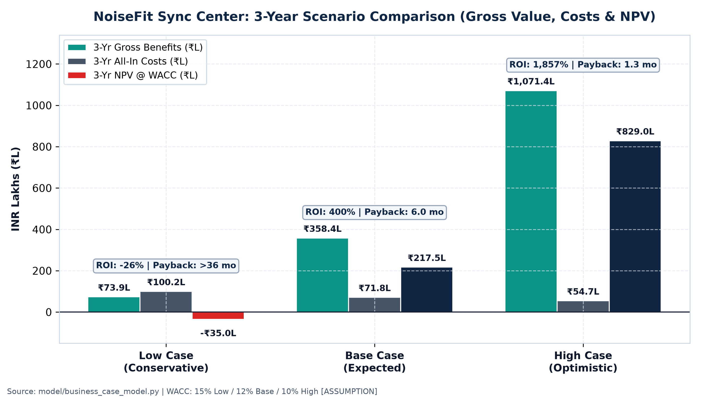

# Executive One-Pager: NoiseFit Sync Center Business Case

**Feature:** NoiseFit Sync Center (`Detect -> Explain -> Recover -> Confirm`) | **Sponsor Case:** Hardware Retention, Support Cost-Out & Compliance
**Full Analysis:** [`docs/BUSINESS_CASE.md`](./BUSINESS_CASE.md) · **Dynamic Model:** [`model/business_case_model.xlsx`](../model/business_case_model.xlsx)

---

## The Strategic Imperative
Despite leading India's smartwatch market with **26.6% share** (~7.69M watches in CY25, IDC), Noise faces a **-17.6% category contraction** and **-24% FY25 revenue decline to ₹1,048 Cr** (`1.67%` EBITDA margin, **-37%** cut in marketing spend to ₹180 Cr, Entrackr RoC FY25). Across **426 coded Google Play reviews** in our repository, **39.6% of NoiseFit reviews** and **42.9% of all 1–2★ complaints** stem from **Sync/Data and Connectivity failures** (`70.93%` sync success & `59.3%` sync/connectivity ticket share in the repo's **SYNTHETIC** dataset). Sync Center replaces silent BLE drops and opaque error states with a free 8-capability recovery flow validated via [`EXP-NF-001`](../experimentation/AB_TEST_PLAN.md).

---

## Headline 3-Year Financials (`INR Lakhs`, Discounted @ WACC `[ASSUMPTION]`)

| Scenario | Y0 CapEx | 3-Yr All-In Cost | 3-Yr Gross Benefits | 3-Yr Net Benefit | Lifecycle ROI | Payback Period | 3-Yr NPV |
|---|---|---|---|---|---|---|---|
| **Low Case** (`15%` WACC) | ₹58.18L | ₹100.18L | ₹73.92L | -₹26.26L | **-26.2%** | **>36 mo (N/A)** | **-₹34.98L** |
| **Base Case** (`12%` WACC) | **₹41.75L** | **₹71.75L** | **₹358.45L** | **+₹286.70L** | **+399.6%** | **6.0 months** | **+₹217.53L (`₹2.18 Cr`)** |
| **High Case** (`10%` WACC) | ₹32.10L | ₹54.75L | ₹1,071.38L | +₹1,016.63L | **+1,856.9%** | **1.3 months** | **+₹829.01L (`₹8.29 Cr`)** |

*Note: Base Net CapEx ROI (`Net Benefit / Y0 Investment`) is **686.7%**. Upfront Y0 effort = `45.0 person-weeks` across 8 functions (`₹33.75L`) + `₹8.00L` device lab/UX/legal (`[ASSUMPTION]`), plus `₹10.00L/yr` maintenance.*

---

## Key Chart: Scenario Value, Costs & NPV

---

## Value Driver Mix, Top Risks & Strategic Decisions

- **Where Base Value Comes From (`₹358.45L`):** **45.8%** Support Ticket Deflection (`₹164.03L`, `81K` steady-state tickets/yr @ `-25%` target), **28.7%** Repeat-Upgrade Retention (`₹102.88L`, `~10.9K` saved upgrades/yr), **20.3%** Prevented False 7-Day/Warranty RMAs (`₹72.65L`), and **5.3%** Rating Defense/Conversion (`₹18.90L` protecting Play Store `4.4★` & iOS `4.50★`).
- **Top 3 Most Sensitive Assumptions (1-Way NPV Swing):** `#1 Annual Sync Failure Prevalence` (`14%–22%`, **₹93.75L** swing), `#2 Support Ticket Deflection Rate` (`15%–32%`, **₹88.15L** swing), and `#3 Active NoiseFit User Base` (`10M–14M`, **₹70.32L** swing) — all measurable early in Phase 2–3.
- **Pricing & Packaging Decision:** **Ship 100% Free for All Users.** Paywalling core diagnostics inside NoiseFit Gold undermines ticket deflection (`KPI-05`), leaves false RMAs unsolved, and triggers the exact subscription backlash already seen in NoiseFit Play Store reviews.
- **Top Pre-Launch Gates:** (1) Complete **DPDP Act 2023 / Rules 2025** itemized consent notice, zero-PII redaction (`NFR-04`), & `<=90d` erasure automation + Android `neverForLocation` / iOS `Info.plist` audit (*not legal advice*); (2) Pass 14-day **`EXP-NF-001` A/B test** (`>= +10pp` `KPI-02` recovery lift) before `100%` GA rollout, or pivot to firmware-only fixes if lift `< +5pp`.
