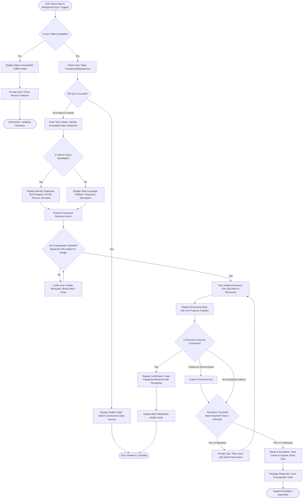
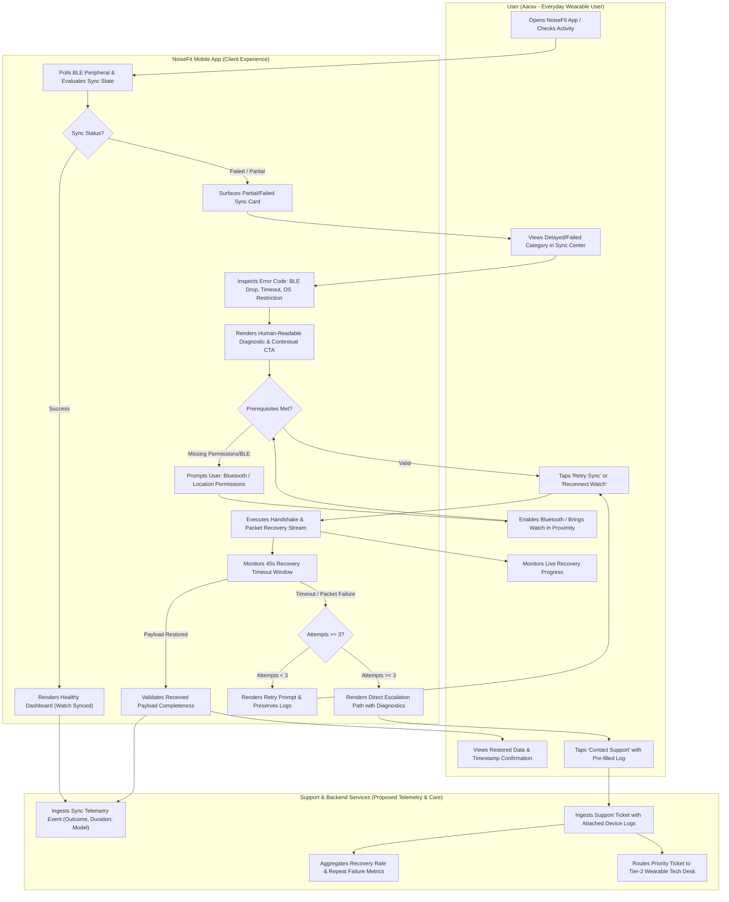

# Process Modeling & Workflows — NoiseFit Sync Center

> **DOCUMENT CONTROL & CLASSIFICATION**  
> **Project:** NoiseFit Sync Reliability — Sync Center  
> **Document ID:** PM-NF-004  
> **Version:** 1.0  
> **Classification:** Independent Portfolio Case Study  
> **Status:** Proposed Architecture & Process Specification  
> **Date:** October 16, 2026  
> **Note:** Backend and telemetry architectures described herein represent proposed design specifications and have not been validated against proprietary internal systems of Noise.

---

## 1. Overview & Architectural Principles

A core insight from the 426-review competitive analysis is that wearable companion applications frequently fail silently. When synchronization fails, users are left guessing whether their workout or sleep data was lost, leading to repetitive unpairing, app reinstalls, and negative App Store reviews.

The **NoiseFit Sync Center** replaces silent failure with a deterministic, four-stage user experience:

$$\text{Detect} \longrightarrow \text{Explain} \longrightarrow \text{Recover} \longrightarrow \text{Confirm}$$

This document provides two complementary process models:
1. **End-to-End Recovery Flow:** Granular decision logic covering healthy states, partial sync, root-cause diagnosis, retry limits, and escalation.
2. **Cross-Functional Swimlane Diagram:** Separation of responsibilities across the User, Mobile Companion App, and Support / Telemetry Backend.
3. **Miro / Lucidchart Reconstruction Guide:** Step-by-step manual reproduction instructions.

---

## 2. Deliverable A: End-to-End Recovery Flow

The flowchart models the complete state machine from the moment sync is triggered (background or foreground) through recovery and confirmation.

*Standalone Mermaid source file:* [`process-maps/sync_center_flow.mmd`](../process-maps/sync_center_flow.mmd)

---

## 3. Deliverable B: Cross-Functional Swimlane Diagram

This diagram clarifies handoffs and boundary responsibilities between the **User**, the **Client App**, and **Support / Telemetry Services**.

*Standalone Mermaid source file:* [`process-maps/sync_center_swimlanes.mmd`](../process-maps/sync_center_swimlanes.mmd)

---

## 4. Deliverable C: Miro & Lucidchart Manual Reproduction Guide

To recreate these diagrams in standard visual modeling tools (e.g., Miro, Lucidchart, Microsoft Visio, draw.io), follow these step-by-step instructions:

### A. Board Setup
1. Create a canvas with a grid size of **8px** or **10px**.
2. For the swimlane workflow, insert a **3-Lane Horizontal or Vertical Swimlane Container**:
   - **Lane 1 (Top / Left):** `User (Everyday Wearable User)`
   - **Lane 2 (Middle):** `NoiseFit Mobile App (Client Application)`
   - **Lane 3 (Bottom / Right):** `Support & Backend Services [PROPOSED]`

### B. Element Placement & Shapes
- **Terminal (Oval / Pill):** Start and End states.
- **Process (Rectangle):** System processes and user actions.
- **Decision (Diamond):** Branching evaluations.
- **Data / Document (Parallelogram):** Telemetry payload or support ticket package.

### C. Step-by-Step Flow Instructions (Lucidchart / Miro)

1. **Start Node (Pill):** Label: `User Opens App or Background Sync Triggers`. Place in App Lane.
2. **Decision Diamond 1:** Label: `Is Sync Status Available?`. Connect Start to Diamond 1.
   - *Branch 'No':* Rectangle: `Display Status Unavailable / Offline Mode`. Connect to Pill: `Unresolved - Awaiting Telemetry`.
   - *Branch 'Yes':* Rectangle: `Detect Foreground/Background Sync State`.
3. **Decision Diamond 2:** Label: `Did Sync Succeed?`.
   - *Branch 'Yes':* Rectangle: `Display Healthy State: Watch Connected & Data Synced`. Arrow to Pill: `Sync Verified & Complete`. Connect event to Backend Lane: `Ingest Sync Telemetry Event`.
   - *Branch 'No (Failed or Partial)':* Rectangle: `Surface Incomplete Categories in Sync Center`. Place in App Lane, arrow pointing to User Lane: `Views Delayed/Failed Category`.
4. **Decision Diamond 3:** Label: `Is Failure Cause Identifiable?`. Place in App Lane.
   - *Branch 'Yes':* Rectangle: `Diagnose Specific Cause (BLE Disconnect, OS Kill, Timeout, Firmware)`.
   - *Branch 'No':* Rectangle: `Display Plain-Language Fallback (Temporary Interruption)`.
   - Both merge into Rectangle: `Present Contextual Recovery Action (Retry or Reconnect)`.
5. **Decision Diamond 4:** Label: `Are Prerequisites Satisfied? (Bluetooth ON & Proximity)`. Place in App Lane.
   - *Branch 'No':* Rectangle: `Prompt User: Turn on Bluetooth / Bring Watch Close`. Arrow to User Lane: `Enables Bluetooth / Fixes Proximity`. Arrow loops back to Diamond 4.
   - *Branch 'Yes':* Arrow to User Lane: `Taps 'Retry Sync' or 'Reconnect Watch'`.
6. **Process Rectangle:** Label: `Execute Handshake & Packet Recovery Stream`. Place in App Lane.
   - Connect simultaneously to User Lane: `Monitors Live Recovery Progress` and App Lane timer: `45s Recovery Timeout Window`.
7. **Decision Diamond 5:** Label: `Is Recovery Outcome Confirmed?`. Place in App Lane.
   - *Branch 'Yes':* Rectangle: `Display Confirmation (Data Restored + Timestamp)`. Arrow to User Lane: `Views Restored Data & Timestamp Confirmation`. App Lane sends success payload to Backend Lane: `Ingest Sync Telemetry Event`. Arrow to End Pill: `Sync Verified & Complete`.
   - *Branch 'No' or 'Timeout':* Rectangle: `Capture Timeout / Packet Failure Event`.
8. **Decision Diamond 6:** Label: `Has Retry Threshold Been Reached? (Attempts >= 3)`. Place in App Lane.
   - *Branch 'No (<3 Attempts)':* Rectangle: `Prompt User: Retry Sync with State Preservation`. Arrow loops back to User Lane: `Taps 'Retry Sync'`.
   - *Branch 'Yes (>=3 Attempts)':* Rectangle: `Display Help Center & Support Escalation Path`. Arrow to User Lane: `Taps 'Contact Support' with Pre-filled Log`.
9. **Support Handoff:**
   - User Lane arrow connects to Backend Lane: `Ingest Support Ticket with Attached Device Logs`.
   - Backend Lane: `Route Priority Ticket to Tier-2 Wearable Tech Desk` and `Aggregate Recovery Rate & Repeat Failure Metrics`.
   - Arrow terminates at End Pill: `Support Escalation Submitted`.

---

## 5. Architectural Boundaries & Validation Considerations

1. **Client-Side Autonomy:** Sync Center recovery operations (retry logic, local BLE polling) run locally within the mobile client to ensure recovery functions even during intermittent internet connectivity.
2. **Deterministic State Transitions:** At no point may the app display a successful sync message if checksums, packet headers, or category payloads are unverified.
3. **Engineering Validation Gate:** Exact Bluetooth LE reconnection timeouts (recommended: 45s) and retry back-off intervals require validation against specific smartwatch hardware chipsets and OS battery policies.
