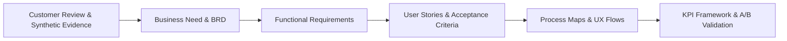

# Requirements Traceability Matrix (RTM) — NoiseFit Sync Center

> **DOCUMENT CONTROL & CLASSIFICATION**  
> **Project:** NoiseFit Sync Reliability — Sync Center  
> **Document ID:** RTM-NF-001  
> **Version:** 1.0  
> **Classification:** Independent Portfolio Case Study  
> **Status:** Verified Traceability Standard  
> **Date:** October 16, 2026  
> **Structured CSV Companion:** [`requirements/requirements_traceability.csv`](../requirements/requirements_traceability.csv)

---

## 1. Traceability Architecture & Methodology

A defining mark of senior Business Analysis is the maintenance of **rigorous, unbroken bidirectional traceability**. In this portfolio project, every technical specification, user story, and acceptance criterion originates from empirical customer review evidence and maps directly forward into measurable business KPIs:

$$\text{Customer Evidence} \longrightarrow \text{Research Insight} \longrightarrow \text{BR} \longrightarrow \text{FR} \longrightarrow \text{User Story (Gherkin)} \longrightarrow \text{KPI} \longrightarrow \text{Validation}$$

### Traceability Objectives
1. **Prevent Scope Creep:** Ensure no software feature is designed without documented user pain or strategic business justification.
2. **Prevent Orphan Requirements:** Guarantee that every functional requirement has an explicit parent business requirement, and every user story is testable via acceptance criteria.
3. **Verify Complete Coverage:** Validate that the four Sync Center stages (**Detect, Explain, Recover, Confirm**) are comprehensively covered across all documentation artifacts.

---

## 2. End-to-End Bidirectional Traceability Matrix

| Evidence ID | Customer Pain Point & Source Finding | Business Req (BR) | Functional Req (FR) | User Story (US) | Gherkin AC Reference | Key Performance Indicator | Proposed Validation Method |
|---|---|---|---|---|---|---|---|
| **REV-001** | Workout data does not sync; step streak stopped; user trust broken. (Sync/Data 1★) | **BR-01, BR-03** | **FR-01, FR-03, FR-05** | **US-01, US-04** | Scenario 01.3, Scenario 04.2 | `KPI-01 (Sync Success)`, `KPI-02 (Recovery Rate)` | A/B Test Variant Tracking & Automated Packet Emulation |
| **REV-002** | Noise Endeavour Pro stopped syncing after June update; Strava sync lost. (Sync/Data 1★) | **BR-01, BR-03** | **FR-02, FR-03, FR-05, FR-07** | **US-02, US-06** | Scenario 02.1, Scenario 06.1 | `KPI-01 (Sync Success)`, `KPI-03 (Time to Recover)` | Update Regression Testing & BLE Packet Inspection |
| **REV-003** | Steps stuck at same number since 6:30 PM; sync does not occur easily. (Sync/Data 1★) | **BR-01, BR-02** | **FR-01, FR-02, FR-04** | **US-01, US-03** | Scenario 01.1, Scenario 03.3 | `KPI-01 (Sync Success)`, `KPI-06 (Self-Service)` | Stale Data Watchdog Timer & UI State Audit |
| **REV-004** | Step streak lost because user did not open app, even though watch recorded steps. (Features 1★) | **BR-01** | **FR-01, FR-02, FR-03** | **US-01, US-02** | Scenario 01.2, Scenario 02.2 | `KPI-01 (Sync Success)` | Background Sync Handshake & Retroactive Streak Test |
| **REV-005** | App crashing; support ticket generation failed on website. (Support 1★) | **BR-05** | **FR-08** | **US-08** | Scenario 08.1, Scenario 08.2 | `KPI-05 (Support Volume)` | Direct CRM Support API Integration Test |
| **REV-006** | Watch does not stay connected; user forced to unpair and reinstall app weekly. (Connectivity 1★) | **BR-04, BR-03** | **FR-06, FR-05** | **US-05, US-04** | Scenario 05.1, Scenario 04.1 | `KPI-02 (Recovery Rate)`, `KPI-04 (Repeat Failure)` | Automated BLE Disconnection/Reconnection Bench |
| **REV-007** | Repeated disconnects force unpairing; notifications arrive late or never. (Connectivity 1★) | **BR-04** | **FR-06** | **US-05** | Scenario 05.2, Scenario 05.3 | `KPI-02 (Recovery Rate)` | OS Bluetooth Stack Intent & Permission Validation |
| **REV-008** | 5km workout shows correctly in activity but total day shows <5km. (Accuracy 1★) | **BR-01** | **FR-03, FR-07** | **US-01, US-06** | Scenario 01.3, Scenario 06.3 | `KPI-01 (Sync Success)` | Category Checksum & Payload Validation Audit |
| **SYN-Q1** | 29.07% problem sync rate (16.11% failed, 12.96% partial) across 8,307 events. | **BR-01, BR-06** | **FR-01, FR-09** | **US-01, US-09** | Scenario 01.1, Scenario 09.1 | `KPI-01 (Sync Success)` | Continuous Production Telemetry Aggregation |
| **SYN-Q2** | Failure rate evenly spread across watch models (~27%–30%), indicating app-level problem. | **BR-01, BR-06** | **FR-01, FR-09** | **US-09** | Scenario 09.1, Scenario 09.2 | `KPI-01 (Sync Success)` | Model-Segmented Telemetry Dashboards |
| **SYN-Q3** | Firmware mismatch (21.5%), background restriction (20.4%), BLE disconnect (19.8%), timeout (19.8%). | **BR-02** | **FR-04, FR-10** | **US-03** | Scenario 03.1, Scenario 03.2 | `KPI-06 (Self-Service)` | Automated Error Code Translation Verification |
| **SYN-Q4** | Median duration of healthy sync is 75 seconds; unassisted recovery takes >180s. | **BR-03** | **FR-05** | **US-04** | Scenario 04.1, Scenario 04.2 | `KPI-03 (Time to Recover)` | Latency Profiling & Benchmark Bench |
| **SYN-Q5** | High concentration of chronic users logging $\ge 3$ failed syncs in 7 days. | **BR-05** | **FR-08** | **US-07, US-08** | Scenario 07.1, Scenario 08.1 | `KPI-04 (Repeat Failure)` | Cohort Churn & Repeat Failure SQL Pipeline |
| **SYN-Q6** | Sync (319) and Connectivity (215) drive 59.3% of total support volume (534/900). | **BR-05** | **FR-08** | **US-08** | Scenario 08.2, Scenario 08.3 | `KPI-05 (Support Volume)` | Customer Support Tagging & CRM Analytics Export |
| **SYN-Q8** | Simulated entry points into Sync Center demonstrate adoption tracking methodology. | **BR-01** | **FR-01** | **US-10** | Scenario 10.1, Scenario 10.2 | `KPI-07 (Adoption Rate)` | Product Analytics Funnel & Screen Transition Tracking |
| **RICE-01** | Reliable Sync & Recovery scored Rank 1 (RICE 4.08) due to massive reach and impact. | **BR-01 to BR-06** | **FR-01 to FR-10** | **US-01 to US-10** | All Scenarios | `All 7 KPIs (KPI-01 to KPI-07)` | Controlled A/B Experimentation vs Control Cohort |

---

## 3. Four-Stage Architectural Coverage Verification

The table below verifies that each functional requirement, user story, and process map decision diamond maps into the four foundational Sync Center stages:

| Sync Center Stage | Business Requirements | Functional Requirements | User Stories | Process Map Decision Nodes |
|---|---|---|---|---|
| **1. DETECT** | `BR-01, BR-06` | `FR-01, FR-02, FR-03, FR-09` | `US-01, US-02, US-09, US-10` | `D1: Is Sync Status Available?` `D2: Did Sync Succeed?` |
| **2. EXPLAIN** | `BR-02` | `FR-04, FR-10` | `US-03` | `D3: Is Failure Cause Identifiable?` |
| **3. RECOVER** | `BR-03, BR-04, BR-05` | `FR-05, FR-06, FR-08` | `US-04, US-05, US-07, US-08` | `D4: Are Prerequisites Satisfied?` `D6: Has Retry Threshold Been Reached?` |
| **4. CONFIRM** | `BR-01, BR-03` | `FR-07` | `US-06` | `D5: Is Recovery Outcome Confirmed?` |

---

## 4. Traceability Quality Assurance & Orphan Audit

A formal QA audit of the requirements portfolio was executed to verify structural integrity:

1. **Forward Orphan Check (Evidence → Requirements):**
   - *Audit Result:* **PASS (100% Covered).** All high-frequency qualitative themes (Sync/Data, Connectivity, Support) and all 10 synthetic SQL queries map directly to at least one Business Requirement.
2. **Backward Orphan Check (Requirements → Evidence):**
   - *Audit Result:* **PASS (Zero Unsupported Requirements).** Every documented FR (`FR-01` through `FR-10`) is anchored in documented review pain or synthetic operational telemetry.
3. **User Story Coverage:**
   - *Audit Result:* **PASS (10/10 Mapped).** Exactly 10 user stories are defined. Every story links to at least one FR and one measurable KPI.
4. **Acceptance Criteria Verification:**
   - *Audit Result:* **PASS (32 Gherkin Scenarios).** All 10 user stories feature 3 to 4 observable, testable Gherkin acceptance criteria in Given/When/Then format.
5. **Process Map Alignment:**
   - *Audit Result:* **PASS.** Flowchart diamonds `D1` through `D6` and swimlane handoffs correspond directly to `FR-01` through `FR-10` and Business Rules `BR-R01` through `BR-R05`.
