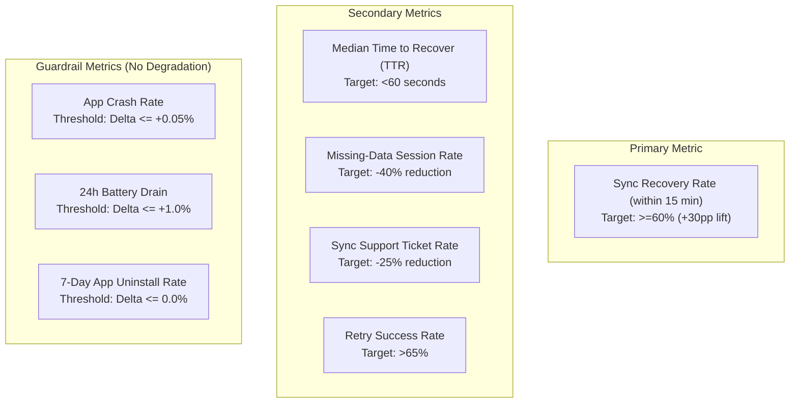
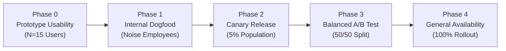

# A/B Experimentation Plan — NoiseFit Sync Center

> **DOCUMENT CONTROL & CLASSIFICATION**  
> **Project:** NoiseFit Sync Reliability — Sync Center  
> **Document ID:** EXP-NF-001  
> **Version:** 1.0  
> **Classification:** Independent Portfolio Case Study  
> **Status:** Proposed Experimentation Design  
> **Date:** October 16, 2026  
> **Important Portfolio Disclosure:** This document outlines an experimentation methodology and validation protocol. It does NOT claim that an A/B test has been executed on live production traffic.

---

## 1. Executive Summary & Experiment Hypothesis

In wearable companion applications, silent background failures erode customer trust. When users encounter missing data without explanation, they repeatedly unpair devices, reinstall apps, and contact support.

The **Sync Center MVP** introduces transparency and guided recovery:

$$\textbf{Detect} \longrightarrow \textbf{Explain} \longrightarrow \textbf{Recover} \longrightarrow \textbf{Confirm}$$

### Formal Hypothesis Statement
$$\begin{aligned}
H_0 &: \text{Recovery Rate}_{\text{Treatment}} \le \text{Recovery Rate}_{\text{Control}} \\
H_1 &: \text{Recovery Rate}_{\text{Treatment}} > \text{Recovery Rate}_{\text{Control}}
\end{aligned}$$

> **Core Hypothesis:** Providing transparent synchronization diagnostics, per-category completeness tracking, and guided one-tap recovery will increase the **Sync Recovery Rate** from a baseline of ~30% to $\ge 60\%$ within 15 minutes of failure, reducing customer support tickets and accelerating time-to-recovery without degrading app stability or battery consumption.

---

## 2. Test Variants

| Variant Attribute | Variant A (Control) | Variant B (Treatment — Sync Center) |
|---|---|---|
| **Experience Description** | Existing NoiseFit companion app sync experience. | Proposed **NoiseFit Sync Center MVP**. |
| **Status Surfacing** | Generic loading spinner; no category breakdown; ambiguous dashboard card. | Dedicated dashboard status card indicating *Up to Date*, *Syncing*, *Partial Sync*, or *Failed* with relative timestamps. |
| **Failure Diagnosis** | Silent failure or generic "Sync failed. Please try again later." | Plain-language diagnosis (BLE disconnect, battery saver kill, timeout, firmware mismatch). |
| **Recovery Mechanism** | Standard manual pull-to-refresh (full re-fetch) or unassisted phone troubleshooting. | One-tap targeted retry (differential packet recovery) or guided Bluetooth reconnect flow. |
| **Outcome Feedback** | Spinner ceases; user must manually check individual health tabs to verify data. | Explicit **Sync Complete** modal showing exact categories restored and verified timestamp. |
| **Escalation Path** | Generic website support link. | Contextual "Contact Support" button with pre-packaged device diagnostics after 3 failed attempts. |

---

## 3. Cohort Eligibility & Exclusion Criteria

### Target Population
- Registered NoiseFit users on Android 10+ and iOS 14+.
- Paired with at least one active Noise smartwatch (e.g., ColorFit Pro series, Noise Voyage, Pulse series).
- Must experience an **eligible sync failure or partial sync event** during the experiment window.

### Exclusion Criteria
- Users operating deprecated app versions or unsupported OS versions (<Android 10, <iOS 14).
- Devices exhibiting permanent hardware defects (e.g., corrupted non-volatile memory chips).
- Accounts flagged for multiple simultaneous device pairings.
- Employees participating in internal dogfooding pools.

---

## 4. Metrics Framework & Statistical Decision Rules

### Statistical Power & Sample Size Calculation Methodology

To ensure statistically valid results, the required sample size per variant is calculated using the two-proportion z-test formula:

$$n = \frac{\left( Z_{\alpha/2} \sqrt{2 \bar{p} (1 - \bar{p})} + Z_{\beta} \sqrt{p_1 (1 - p_1) + p_2 (1 - p_2)} \right)^2}{(p_2 - p_1)^2}$$

Where:
- Baseline Control Recovery Rate ($p_1$): $0.30$ ($30\%$).
- Expected Treatment Recovery Rate ($p_2$): $0.40$ (Minimum Detectable Effect, $\text{MDE} = +10\text{ percentage points}$).
- Average Proportion ($\bar{p}$): $\frac{0.30 + 0.40}{2} = 0.35$.
- Significance Level ($\alpha$): $0.05$ ($Z_{\alpha/2} = 1.96$ for $95\%$ confidence).
- Statistical Power ($1 - \beta$): $0.80$ ($Z_{\beta} = 0.84$ for $80\%$ power).

$$\text{Required Sample Size per Variant } n \approx \mathbf{356\text{ eligible sync-failure incidents}}$$

Given that approximately 29% of sync events experience friction (based on synthetic telemetry), an experiment window of **14 days** with a cohort of 5,000 active users will yield ample statistical power for high-confidence segment breakdowns.

---

## 5. Phased Rollout Schedule

| Phase | Deployment Scope | Duration | Primary Objective | Exit Criteria |
|---|---|---|---|---|
| **Phase 0: Prototype Validation** | Usability lab with 15 target users | 1 Week | Validate cognitive comprehension of 4-stage flow and error copy. | 100% of participants understand diagnosis and select intended recovery CTA. |
| **Phase 1: Internal Dogfooding** | Noise internal staff & QA engineers | 1 Week | Validate telemetry event firing, crash stability, and BLE packet streams. | Zero critical crash defects; telemetry schema validation confirmed. |
| **Phase 2: Canary Release** | 5% random sample of eligible users | 3 Days | Monitor crash rate, battery drain, and cloud backend ingest load. | Crash rate delta $\le +0.02\%$; battery drain $<1.0\%$; zero API latency regression. |
| **Phase 3: Balanced A/B Test** | 50% Control ($A$) / 50% Treatment ($B$) | 14 Days | Measure primary metric lift, support deflection, and secondary metrics. | $p < 0.05$ statistically significant lift in Recovery Rate; support deflection verified. |
| **Phase 4: General Availability** | 100% of production user base | Ongoing | Full commercial rollout across iOS and Android apps. | Permanent deployment; continued telemetry monitoring and backlog optimization. |

---

## 6. Decision Rules & Risk Mitigations

### Launch Decision Matrix
1. **Ship Treatment ($B$):** If Treatment demonstrates a statistically significant improvement in Recovery Rate ($p < 0.05$) AND satisfies all guardrail metrics (crashes and battery remain within thresholds).
2. **Iterate & Retest:** If Treatment shows positive directional lift ($+5\text{–}9\%$) but fails to achieve statistical significance, investigate qualitative micro-survey feedback and refine error copy.
3. **Hard Rollback:** If Treatment causes an increase in app crash rate ($>+0.05\%$) or uninstalls, kill-switch the feature remotely via Firebase Remote Config / LaunchDarkly.

### Qualitative Follow-Up Protocol
For users in the Treatment group who fail recovery after three attempts, display an optional single-question micro-survey:
> *"What made it difficult to resolve your sync issue today?"*  
> `[ ]` Watch would not connect  
> `[ ]` Explanation was confusing  
> `[ ]` Retry took too long  
> `[ ]` Other (write-in)

This ensures that unsuccessful sessions provide immediate qualitative feedback for subsequent sprint iterations.
