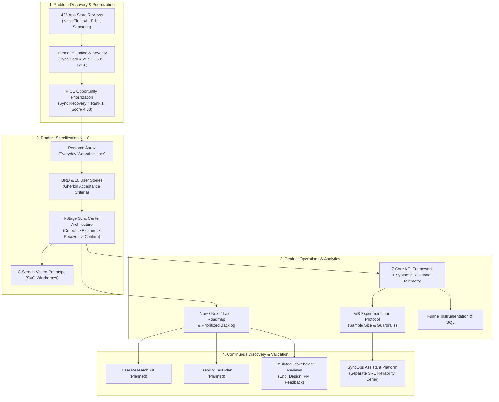

# Product Management Deliverable Suite — NoiseFit Sync Reliability & SyncOps

> **PORTFOLIO DISCLOSURE & CLASSIFICATION**  
> **Project:** NoiseFit Sync Reliability Case Study & Linked SyncOps Assistant  
> **Target Role:** Product Management Intern / Associate Product Manager (APM)  
> **Classification:** Independent Product Management Portfolio Case Study  
> **Date:** October 2026  
> **Baseline Telemetry:** Synthetic SQL Telemetry (`noisefit_synthetic.db`, 8,307 events, 900 tickets)  
> **Status:** Upgrade completed on branch `feature/pm-artifacts`

---

## 1. Executive Overview

This directory (`/product/`) houses the complete, interview-ready **Product Management (PM) Portfolio Suite** for the NoiseFit Sync Reliability case study and its linked engineering platform, **SyncOps Assistant**.

The portfolio demonstrates end-to-end product thinking across the entire product lifecycle:
1. **Problem Discovery & Evidence Mining:** Mining and qualitative coding of 426 Google Play store reviews across four competing wearable ecosystems to pinpoint synchronization and Bluetooth disconnection as the most concentrated theme among low-rating complaints.
2. **Quantitative Opportunity Prioritization:** Applying an auditable RICE prioritization model to rank reliable sync as the top strategic priority over cosmetic and non-critical feature expansions.
3. **Rigorous Product Definition:** Structuring a comprehensive Business Requirements Document ([`docs/BRD.md`](../docs/BRD.md)), 10 Gherkin user stories ([`docs/USER_STORIES.md`](../docs/USER_STORIES.md)), an 8-screen UX prototype ([`prototype/prototype_reference.md`](../prototype/prototype_reference.md)), and a bidirectional requirements traceability matrix ([`docs/TRACEABILITY_MATRIX.md`](../docs/TRACEABILITY_MATRIX.md)).
4. **Product Operations & Governance:** Codifying decision trade-offs, an enterprise risk and blocker register, a Now/Next/Later roadmap, and a prioritized product backlog.
5. **Continuous Discovery Kits:** Reusable research and usability test kits ready to deploy for primary user interviews and task-based testing.
6. **Analytics & Experimentation:** A rigorous 21-section statistical A/B test plan, five-stage product analytics funnel event definitions, and verified SQLite queries.
7. **Quality Assurance & Delivery:** PM/QA defect reporting standards, user acceptance testing (UAT) protocol, verified SyncOps release notes, and a 3-minute executive video demo script.
8. **Product Sense & Case Mastery:** An empirical teardown of commercial wearable sync mechanics, five end-to-end product case interview frameworks, and ten interview defense questions.
9. **Strategic Fit Scaffold:** A targeted statement scaffold articulating how consumer IoT reliability principles transfer to construction-technology field synchronization.

---

## 2. Distinction: NoiseFit Sync Center vs. SyncOps Assistant

To maintain complete credibility during interviews, it is essential to distinguish between the two complementary projects in this portfolio:

| Dimension | NoiseFit Sync Center (Consumer Feature) | SyncOps Assistant (Engineering Platform) |
|---|---|---|
| **Context** | Independent mobile companion app feature proposal for NoiseFit smartwatch users. | Standalone customer-experience reliability and AI operations platform. |
| **Target User** | Everyday wearable user (**Aarav**) seeking reliable health and workout data. | Site Reliability Engineers (SREs), Data Platform Leads, and Technical PMs. |
| **Status** | **Proposed design concept & requirements specification.** Includes an 8-screen UI prototype, but is NOT implemented in the production NoiseFit app. | **Functional software platform.** Implemented with FastAPI, SQLite, Pandera ETL, TF-IDF RAG triage, and Streamlit/React dashboards. |
| **Core Workflow** | $\textbf{Detect} \longrightarrow \textbf{Explain} \longrightarrow \textbf{Recover} \longrightarrow \textbf{Confirm}$ in mobile UI. | Same 4-stage reliability mental model applied to server-side incident detection, runbook triage, and recovery. |
| **Primary Artifacts** | PRD, BRD, User Stories, SVG Prototype, A/B Test Plan. | Python codebase, REST API, Streamlit dashboard, RAG retrieval engine, automated test suite. |

---

## 3. Master Deliverable Navigation Matrix

The table below maps all deliverables across the repository:

| Deliverable Group | Artifact Path | Core Purpose | Status |
|---|---|---|---|
| **Roadmap & Backlog** | [`roadmap-and-backlog.md`](./roadmap-and-backlog.md) | Now/Next/Later roadmap linked to the 7 KPIs; prioritized backlog table with MoSCoW, RICE, and story links. | Proposed Architecture |
| **Trade-Off Log** | [`trade-off-log.md`](./trade-off-log.md) | 6 structured product decisions analyzing context, options, rationale, sacrifices, and reversal conditions. | Proposed Decisions |
| **Risks & Blockers** | [`risks-and-blockers.md`](./risks-and-blockers.md) | Enterprise risk register detailing 16 technical, research, data, privacy, and UX risks with mitigations and triggers. | Active Governance |
| **User Research Kit** | [`research/research-plan-and-recruiting.md`](./research/research-plan-and-recruiting.md) | Screener, recruitment message, consent framework, and participant tracker for 5–8 wearable users. | Ready for Execution |
|  | [`research/interview-guide.md`](./research/interview-guide.md) | 8 open-ended, non-leading behavioral questions with neutral probes, consent wording, and skip protocols. | Ready for Execution |
|  | [`research/research-notes-template.md`](./research/research-notes-template.md) | Standardized note-taking template separating direct quotes from researcher interpretations. | Reusable Template |
|  | [`research/affinity-mapping-template.md`](./research/affinity-mapping-template.md) | Synthesis template mapping observations to themes, evidence counts, and PRD implications. | Reusable Template |
|  | [`research/research-summary-template.md`](./research/research-summary-template.md) | One-page executive research summary template with honest participant accounting. | Reusable Template |
| **Usability Test Kit** | [`usability/usability-test-plan.md`](./usability/usability-test-plan.md) | Test plan with think-aloud script and 5 realistic tasks covering the 4-stage recovery flow on the prototype. | Ready for Execution |
|  | [`usability/usability-results-template.md`](./usability/usability-results-template.md) | Standardized task observation logging sheet and metrics summary table. | Reusable Template |
| **Experimentation** | [`experimentation/ab-test-plan.md`](./experimentation/ab-test-plan.md) | Comprehensive 21-section A/B test plan: hypothesis, sample size derivation, guardrails, rollout, and decision rules. | Proposed Experiment |
| **Analytics & Funnel** | [`analytics/funnel-and-events.md`](./analytics/funnel-and-events.md) | 5-stage funnel telemetry specifications, deduplication logic, drop-off questions, and synthetic disclosures. | Telemetry Spec |
|  | [`analytics/funnel-queries.sql`](./analytics/funnel-queries.sql) | Runnable SQLite queries over synthetic telemetry and proposed event-level schema queries. | Verified SQL |
| **Release & Demo** | [`release/release-notes.md`](./release/release-notes.md) | Sample release notes for SyncOps Assistant documenting verified backend, API, RAG, and UI capabilities. | Verified Platform |
|  | [`release/demo-script.md`](./release/demo-script.md) | 3-minute time-boxed presentation script connecting portfolio discovery, SyncOps live demo, and UX prototype. | Presentation Script |
| **QA & UAT** | [`qa/bug-report-template.md`](./qa/bug-report-template.md) | Standard PM/QA bug report template with defined severity levels and an illustrative non-defect example. | Reusable Template |
|  | [`qa/uat-plan.md`](./qa/uat-plan.md) | Comprehensive User Acceptance Testing plan covering 6 test scenarios, pass/fail rules, and sign-off criteria. | Planned Protocol |
| **Simulated Reviews** | [`reviews/simulated-stakeholder-review.md`](./reviews/simulated-stakeholder-review.md) | AI-simulated critiques from Staff Mobile Engineer, Product Designer, and Senior PM on PRD and 10 user stories. | Simulated Review |
|  | [`reviews/changelog.md`](./reviews/changelog.md) | Traceable changelog tracking created artifacts, proposed requirement updates, and governance approval gates. | Active Log |
| **Product Sense** | [`product-sense/sync-experience-teardown.md`](./product-sense/sync-experience-teardown.md) | One-page product teardown of commercial wearable synchronization mechanics based on public documentation. | Product Teardown |
| **Interview Prep** | [`interview-prep/product-case-practice.md`](./interview-prep/product-case-practice.md) | 5 full product-case interview prompts with clarifying questions, metric models, trade-offs, and model answers. | Interview Prep |
|  | [`interview-prep/project-interview-questions.md`](./interview-prep/project-interview-questions.md) | 10 tough defense questions covering review mining, RICE, synthetic data, A/B testing, and research limitations. | Interview Prep |
| **Company Fit** | [`company-fit/construction-tech-pm-statement.md`](./company-fit/construction-tech-pm-statement.md) | 200–300-word statement scaffold connecting wearable sync reliability principles to construction jobsite tech. | Reusable Scaffold |

---

## 4. Beginner-Friendly Explainer

### What this artifact does
This directory provides a cohesive, structured portfolio index that connects all business analysis, product requirements, UX designs, statistical tests, analytics queries, and operational tools into a single navigable system.

### Why it matters
In Product Management interviews, recruiters and hiring managers look for clarity, systems thinking, and structured documentation. Having an organized repository index allows an interviewer to immediately evaluate candidate competencies across user research, product strategy, technical fluency, and data-driven prioritization.

### How to use it
- Use this file as your master index when screen-sharing during portfolio walkthroughs.
- Navigate to individual artifacts using the relative Markdown links in the table above.
- Review the beginner-friendly explainer section at the end of each document before your interviews.

### What I can honestly claim in an interview
- **Can claim:** You independently analyzed 426 public reviews, prioritized sync reliability using RICE, authored a formal BRD and 10 Gherkin user stories, modeled an 8-screen UX prototype, designed a statistical A/B test plan, wrote SQL analytics over a synthetic database, and structured continuous discovery templates.
- **Cannot claim:** You cannot claim you ran live A/B tests on production users, interviewed customers, conducted completed usability tests, or that Noise officially reviewed or adopted these documents. All claims must respect the factual baseline established in [`docs/ASSUMPTIONS_AND_OPEN_QUESTIONS.md`](../docs/ASSUMPTIONS_AND_OPEN_QUESTIONS.md).
