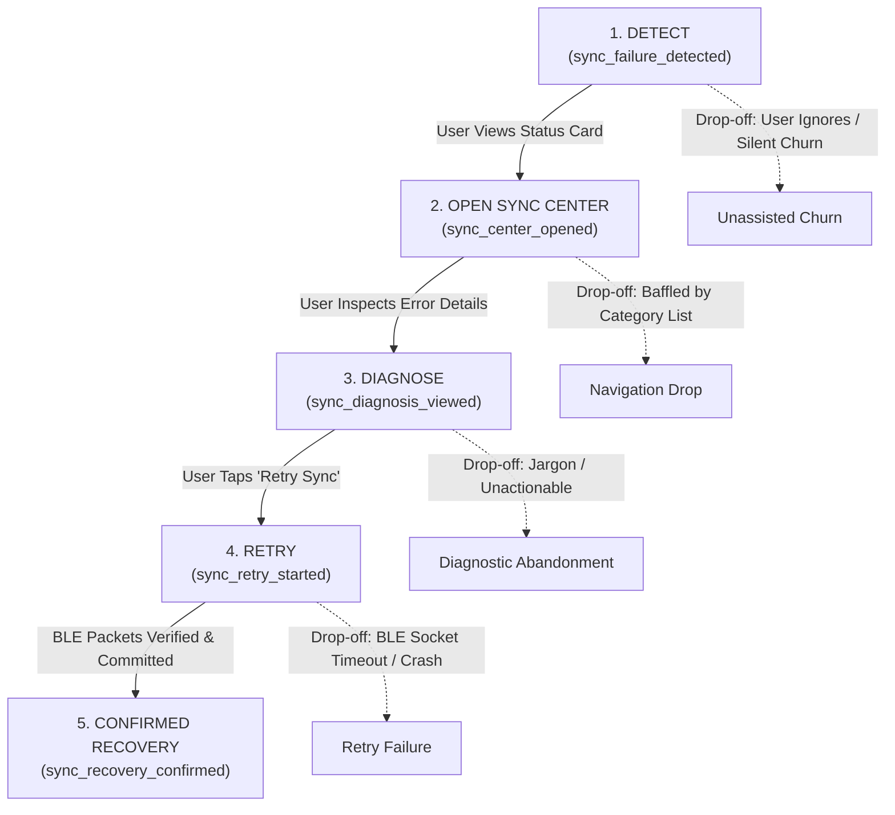

# Product Analytics Funnel Specification & Event Tracking Model

> **DOCUMENT CONTROL & ANALYTICS GOVERNANCE**  
> **Project:** NoiseFit Sync Reliability — Sync Center  
> **Artifact:** Post-Launch Health & Funnel Instrumentation Architecture  
> **Status:** Proposed Event Tracking Specification — Not Yet Implemented in Mobile App  
> **Governing Mental Model:** $\textbf{Detect} \longrightarrow \textbf{Explain} \longrightarrow \textbf{Recover} \longrightarrow \textbf{Confirm}$  
> **Companion SQL Script:** [`product/analytics/funnel-queries.sql`](./funnel-queries.sql)  
> **Linked Artifacts:** [KPI Data Dictionary](../../metrics/KPI_data_dictionary.md) · [7 Core KPIs](../../docs/KPI_AND_METRICS.md) · [A/B Test Plan](../experimentation/ab-test-plan.md)

---

## 1. Executive Summary & Telemetry Principles

Product instrumentation is the sensory nervous system of a digital product. To measure whether the proposed **NoiseFit Sync Center** successfully resolves wearable synchronization friction, we must instrument a granular, deterministic **five-stage analytics funnel**:

$$\text{Stage 1: Detect} \longrightarrow \text{Stage 2: Open Sync Center} \longrightarrow \text{Stage 3: Diagnose} \longrightarrow \text{Stage 4: Retry} \longrightarrow \text{Stage 5: Confirmed Recovery}$$

> **Important Disclosure:** The event names, JSON schemas, and drop-off questions below represent the **proposed telemetry model** designed for the companion mobile app. They must not be conflated with the existing backend telemetry emitted by the separate **SyncOps Assistant** platform.

---

## 2. Five-Stage Conceptual Funnel Architecture



---

## 3. Granular Funnel Event Specifications

---

### Stage 1: Detect (`sync_failure_detected`)
- **Event Name:** `sync_failure_detected`
- **Definition:** Fired immediately by the client synchronization engine when a scheduled background sync or manual pull-to-refresh handshake terminates in an incomplete, partial, or failed status.
- **Trigger Condition:** BLE transaction socket terminates with incomplete packet checksums or a non-zero error code.
- **Required Properties:**
  ```json
  {
    "event_name": "sync_failure_detected",
    "sync_id": "UUID (Primary Key)",
    "user_id": "STRING (Anonymized User ID)",
    "device_id": "STRING (Unique Peripheral ID)",
    "device_model": "STRING (e.g., 'Noise ColorFit Pro 4')",
    "platform": "STRING ('android' | 'ios')",
    "os_version": "STRING (e.g., '14.0')",
    "app_version": "STRING (e.g., 'v4.2.0')",
    "failure_type": "STRING ('failed' | 'partial')",
    "failed_categories": ["ARRAY of STRING ('steps' | 'sleep' | 'heart_rate' | 'workouts')"],
    "raw_ble_error_code": "INTEGER (e.g., 133)",
    "timestamp": "ISO8601 UTC"
  }
  ```
- **Deduplication Logic:** Deduplicate on `sync_id`. If multiple socket reconnects occur within a single sync attempt, emit exactly one `sync_failure_detected` event when the overarching sync session fails.
- **Potential Failure Cases:** App is terminated by OS battery killer before event is flushed to disk queue.
- **Core Drop-Off Question:** *What percentage of users experience a failure but never notice it because they don't open the app within 2 hours?*

---

### Stage 2: Open Sync Center (`sync_center_opened`)
- **Event Name:** `sync_center_opened`
- **Definition:** Emitted when the user transitions from any surface (home dashboard, contextual push notification, or settings) into the dedicated Sync Center screen.
- **Trigger Condition:** `SyncCenterActivity` / `SyncCenterViewController` mounts and becomes interactive.
- **Required Properties:**
  ```json
  {
    "event_name": "sync_center_opened",
    "session_id": "UUID",
    "user_id": "STRING",
    "device_id": "STRING",
    "entry_point": "STRING ('dashboard_status_card' | 'push_notification' | 'settings_menu')",
    "time_since_failure_seconds": "INTEGER",
    "timestamp": "ISO8601 UTC"
  }
  ```
- **Deduplication Logic:** Debounce screen visits within $\le 2\text{ seconds}$ to prevent double-counting rapid taps.
- **Potential Failure Cases:** Screen rendering delay ($>300\text{ms}$) causing user to back out before event fires.
- **Core Drop-Off Question:** *Why do 60% of failure-affected users ignore the dashboard status card? Is the banner too subtle or perceived as an ad?*

---

### Stage 3: Diagnose (`sync_diagnosis_viewed`)
- **Event Name:** `sync_diagnosis_viewed`
- **Definition:** Emitted when the user opens the "Sync Details" view or expands a delayed category card to read the plain-language explanation of why synchronization failed.
- **Trigger Condition:** Diagnostic bottom-sheet or detailed failure screen renders on the device viewport.
- **Required Properties:**
  ```json
  {
    "event_name": "sync_diagnosis_viewed",
    "sync_id": "UUID",
    "user_id": "STRING",
    "device_id": "STRING",
    "diagnostic_category": "STRING ('bluetooth_off' | 'out_of_range' | 'battery_restricted' | 'timeout' | 'unmapped')",
    "displayed_copy_key": "STRING (e.g., 'diag_copy_ble_disconnect_v1')",
    "timestamp": "ISO8601 UTC"
  }
  ```
- **Deduplication Logic:** Log once per unique `sync_id` per app session.
- **Potential Failure Cases:** User taps "Retry" immediately on the summary screen without expanding detailed diagnostics.
- **Core Drop-Off Question:** *Do users read the plain explanation, or do they immediately bounce to phone settings or exit the app?*

---

### Stage 4: Retry (`sync_retry_started`)
- **Event Name:** `sync_retry_started`
- **Definition:** Emitted when the user explicitly triggers a recovery action (tapping "Retry Sync" or "Reconnect Watch").
- **Trigger Condition:** User interacts with primary recovery CTA button.
- **Required Properties:**
  ```json
  {
    "event_name": "sync_retry_started",
    "sync_id": "UUID",
    "user_id": "STRING",
    "device_id": "STRING",
    "action_type": "STRING ('one_tap_retry' | 'guided_bluetooth_reconnect')",
    "attempt_number": "INTEGER (1, 2, or 3)",
    "requested_categories": ["ARRAY of STRING"],
    "is_differential": "BOOLEAN (true if requesting only failed categories)",
    "timestamp": "ISO8601 UTC"
  }
  ```
- **Deduplication Logic:** Button is immediately disabled in UI upon first tap; subsequent taps during active recovery are ignored.
- **Potential Failure Cases:** Bluetooth radio remains locked; retry attempt times out immediately.
- **Core Drop-Off Question:** *How often does a user tap retry, experience a timeout, and abandon rather than attempting a second retry?*

---

### Stage 5: Confirmed Recovery (`sync_recovery_confirmed`)
- **Event Name:** `sync_recovery_confirmed`
- **Definition:** Emitted when a previously failed or partial session successfully receives 100% of missing data packets, commits records to the local database, and displays the "Sync Complete" confirmation modal.
- **Trigger Condition:** Local SQLite transaction commits successfully AND Screen 07 renders.
- **Required Properties:**
  ```json
  {
    "event_name": "sync_recovery_confirmed",
    "sync_id": "UUID",
    "user_id": "STRING",
    "device_id": "STRING",
    "total_recovery_duration_seconds": "INTEGER (Time from initial failure to confirmation)",
    "retry_duration_seconds": "INTEGER (Duration of active retry socket)",
    "attempt_number": "INTEGER",
    "restored_categories": ["ARRAY of STRING"],
    "verified_checksum": "BOOLEAN (true)",
    "timestamp": "ISO8601 UTC"
  }
  ```
- **Deduplication Logic:** Exactly one confirmed recovery event per resolved `sync_id`.
- **Potential Failure Cases:** Data commits to database, but user dismisses app before the confirmation modal mounts.
- **Core Drop-Off Question:** *What percentage of recovered users dismiss the confirmation modal vs. tapping into health charts to double-check their step count?*

---

## 4. Cohort Rules, Attribution Windows & Complex Edge Cases

1. **The 15-Minute Recovery Window:** To be attributed as a successful recovery ([`KPI-02`](../../docs/KPI_AND_METRICS.md#kpi-02-recovery-rate)), `sync_recovery_confirmed` must occur within $\le 15\text{ minutes}$ (900 seconds) of `sync_failure_detected`. Any success occurring after 15 minutes is treated as an unrelated subsequent session.
2. **Handling Repeat Failures (Chronic Friction):** If a user attempts recovery twice and fails, the attempt counter increments (`attempt_number = 2`). If a 3rd attempt fails, the app transitions to `US-08` (Escalation with Diagnostics), emitting `support_escalation_initiated`.
3. **Multi-Category Partial Sync:** If Steps and Heart Rate sync, but Sleep is delayed, `is_differential` must be set to `true`. The retry payload must request *only* Sleep packets, preventing unnecessary BLE bandwidth consumption.
4. **Offline Queueing & Resilient Telemetry:** Mobile devices frequently sync in airplane mode or rural areas without mobile data. All telemetry events must be stored in a local SQLite client buffer and flushed in batches upon network re-establishment (`US-09`).
5. **Deduplication of Rapid Retries:** To prevent inflated retry counts, the client UI enforces a 3-second throttle on recovery CTAs, disabling the button while the BLE socket is establishing a handshake.

---

## 5. SYNTHETIC DATA — ILLUSTRATIVE ANALYSIS ONLY

> **IMPORTANT PORTFOLIO DISCLOSURE:**  
> The baseline conversion figures, failure rates, and support correlations referenced in this portfolio derive from the **synthetic SQLite dataset** (`noisefit_synthetic.db`) created to demonstrate data engineering and product analytics methods.  
> - **What these values show:** They illustrate how a Product Manager writes SQL window functions, computes stage-to-stage conversion drops, links support burden to telemetry, and models user cohorts.  
> - **What they CANNOT establish:** They do NOT represent real consumer behavior, genuine Noise production telemetry, or empirical proof of causality. Target benchmarks (e.g., 60% recovery rate) are proposed hypotheses (`[ASSUMPTION]`) awaiting live production experimentation.

---

## 6. Beginner-Friendly Explainer

### What this artifact does
This document specifies the five-stage product analytics funnel for NoiseFit Sync Center. For every stage (Detect, Open, Diagnose, Retry, Confirm), it defines event names, JSON properties, trigger moments, deduplication rules, and key drop-off analysis questions.

### Why it matters
A Product Manager cannot improve what they cannot measure. Defining clean, unambiguous event schemas before engineering begins ensures that data pipelines capture exactly what is needed to evaluate user conversion, identify where users get stuck, and calculate core KPIs.

### How to use it
- Hand this document to mobile developers and data engineers during sprint planning as the official tracking specification.
- Use the drop-off questions during weekly product health reviews to analyze where users abandon recovery.
- Cross-reference with [`funnel-queries.sql`](./funnel-queries.sql) to run conversion queries over telemetry data.

### What I can honestly claim in an interview
- **Can claim:** You designed the full 5-stage funnel telemetry architecture, drafted JSON event schemas, codified deduplication and attribution rules, and defined post-launch health monitoring protocols.
- **Cannot claim:** You cannot claim that the production NoiseFit mobile app currently emits these events. This is a proposed analytics architecture.
