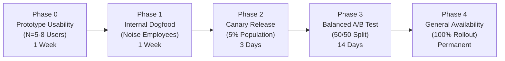
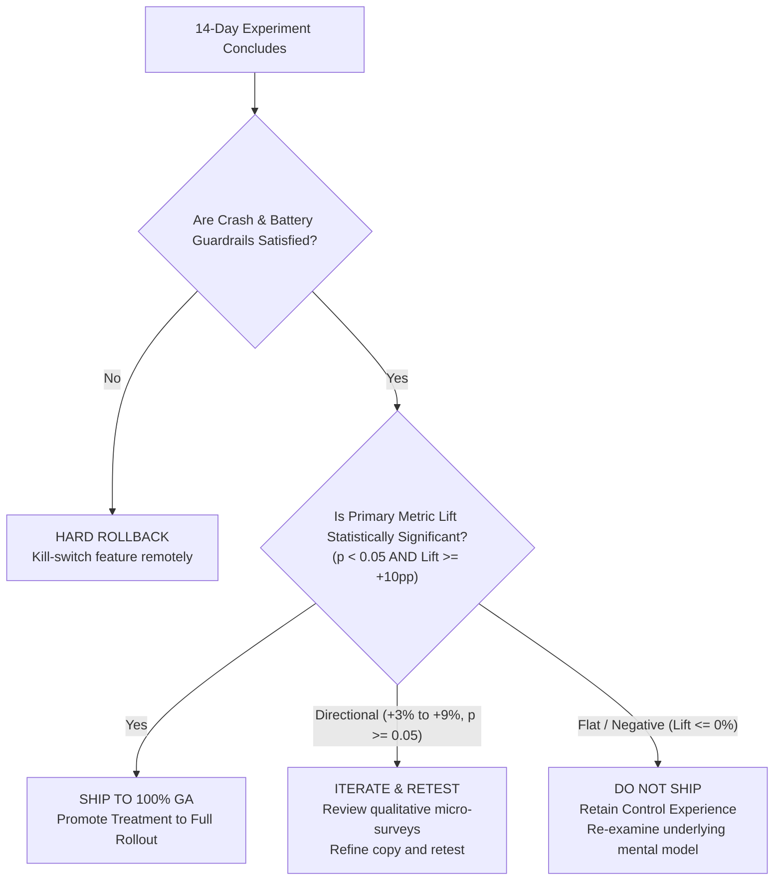

# A/B Experimentation Plan — NoiseFit Sync Center MVP

> **DOCUMENT CONTROL & GOVERNANCE**  
> **Project:** NoiseFit Sync Reliability — Sync Center  
> **Document ID:** EXP-NF-002 (Upgraded Master Specification)  
> **Version:** 2.0  
> **Classification:** Independent Product Management Portfolio Case Study  
> **Status:** **PROPOSED EXPERIMENT PLAN — NOT EXECUTED. NO EXPERIMENTAL RESULTS EXIST.**  
> **Date:** October 2026  
> **Baseline Telemetry Reference:** Synthetic SQLite Dataset (`06_SQL/NoiseFit_SQL_Portfolio.zip` / `sql/analysis_queries.sql`)  
> **Original Experiment Foundation:** Preserved at [`experimentation/AB_TEST_PLAN.md`](../../experimentation/AB_TEST_PLAN.md)

---

## 1. Problem Statement

Wearable fitness trackers depend fundamentally on dependable, asynchronous data synchronization between a Bluetooth Low Energy (BLE) peripheral and a companion smartphone application. When data synchronization fails or stalls—due to operating system battery saver kills, transient packet drops, or radio disconnection—traditional companion apps fail silently. 

Users open their app, discover missing step streaks or absent sleep records, receive zero diagnostic explanation, and assume their hardware is defective. This silent friction drives repeated unassisted troubleshooting, high customer support ticket volumes (accounting for **59.3% of total support contacts** in synthetic baseline telemetry), and elevated 30-day customer churn.

---

## 2. Research and Product Rationale

Empirical review mining of **426 coded Google Play reviews** across four major wearable ecosystems (**NoiseFit, boAt Crest, Google Health / Fitbit, and Samsung Health**) proved that synchronization and Bluetooth disconnection are the primary drivers of severe customer dissatisfaction. Within the NoiseFit sample, **Sync/Data issues represented 22.9% of all feedback, with 50.0% of those reviews reflecting 1-star or 2-star ratings** ([`01_Research/`](../../01_Research/)).

In an auditable RICE prioritization framework ([`02_Prioritization/`](../../02_Prioritization/)), **Reliable Sync & Recovery ranked #1 with a score of 4.08**. Rather than relying on blind background retries that drain device battery, the proposed **NoiseFit Sync Center** introduces a deterministic, four-stage cognitive recovery flow:

$$\textbf{Detect} \longrightarrow \textbf{Explain} \longrightarrow \textbf{Recover} \longrightarrow \textbf{Confirm}$$

Before deploying this architectural modification to 100% of the production user base, a controlled, randomized A/B experiment is required to validate that in-app transparency and guided recovery materially improve recovery rates and reduce support overhead without degrading app stability.

---

## 3. Formal Hypothesis Statement

### Statistical Formulation
$$\begin{aligned}
H_0 &: \text{Recovery Rate}_{\text{Treatment}} \le \text{Recovery Rate}_{\text{Control}} \\
H_1 &: \text{Recovery Rate}_{\text{Treatment}} > \text{Recovery Rate}_{\text{Control}}
\end{aligned}$$

### Product Narrative Hypothesis
> **Core Hypothesis:** Providing transparent synchronization state surfacing, category-level completeness inspection, plain-language root-cause diagnosis, and guided one-tap differential recovery (**Treatment B**) will increase the **Sync Recovery Rate within 15 minutes** from an estimated unguided baseline of $\sim 30.0\%$ to $\ge 60.0\%$ ($+30\text{pp lift}$ `[ASSUMPTION]`), reduce sync-related customer support tickets by $\ge 25.0\%$ `[ASSUMPTION]`, and decrease median time-to-recovery to $<60.0\text{ seconds}$ `[ASSUMPTION]`, while satisfying non-negotiable guardrails on application crashes ($\Delta \le +0.05\%$) and 24-hour device battery drain ($\Delta \le +1.0\%$).

---

## 4. Control Experience (Variant A)

Variant A represents the **existing production NoiseFit companion application**:
- **Home Dashboard:** Generic pull-to-refresh mechanism. Displays an indeterminate circular loading spinner when sync is initiated.
- **Status Feedback:** Ambiguous connection indicator ("Connected"). If a sync fails or drops packets, the spinner ceases silently without displaying error copy or failure badges.
- **Category Granularity:** Monolithic all-or-nothing presentation. Users cannot see whether Steps synced while Sleep failed; categories simply display stale data from the previous successful session.
- **Troubleshooting:** No in-app diagnostics. Users are forced to invent unguided workarounds (e.g., repeatedly pulling to refresh, toggling phone Bluetooth, or force-quitting the app).
- **Escalation:** Generic "Help & Feedback" link buried in account settings pointing to an external web form.

---

## 5. Treatment Experience (Variant B — Sync Center MVP)

Variant B introduces the **NoiseFit Sync Center MVP** ([`prototype/prototype_reference.md`](../../prototype/prototype_reference.md)):
- **Home Dashboard:** Persistent sync status card surfacing real-time state: *Up to Date*, *Syncing*, *Partial Sync*, or *Failed* with relative timestamps (e.g., "Synced 15 min ago") (`US-01`, `US-02`).
- **Category-Level Transparency:** Dedicated Sync Center screen showing individual status badges for Steps, Sleep, Heart Rate, and Workouts (`FR-03`).
- **Plain-Language Diagnosis:** Maps low-level BLE/OS error codes into actionable explanations (e.g., *"Bluetooth connection was interrupted during sleep packet transfer"*) (`US-03`).
- **Targeted One-Tap Recovery:** One-tap **[Retry Sync]** button executing differential packet recovery (re-requesting only missing categories rather than full payload refetch) (`US-04`).
- **Guided Reconnect:** Modal providing direct OS Bluetooth settings deep-links if radio is turned off (`US-05`).
- **Explicit Outcome Confirmation:** Success modal displaying verified restored categories and timestamp with green checkmarks (`US-06`).
- **Smart Escalation:** Adaptive secondary guidance after 2 failed retries (`US-07`), and automated support ticket compilation with sanitized diagnostic logs after 3 failed attempts (`US-08`).

---

## 6. Eligible Population & Exclusion Criteria

### Target Eligible Population
To enter the experiment cohort, a user must satisfy all of the following preconditions:
1. Registered NoiseFit user on Android 10+ or iOS 14+.
2. Paired with at least one active, supported Noise smartwatch model (e.g., ColorFit Pro 4, Noise Voyage, Pulse 2, Force Plus).
3. **Trigger Event:** Must initiate a synchronization attempt (background or manual foreground) that terminates in an eligible **failed** or **partial** outcome during the active experiment window.

### Exclusion Criteria
- Users running deprecated companion app versions (<v4.0.0).
- Users operating developer/beta OS preview builds (e.g., Android 16 Developer Preview).
- Accounts flagged for multiple simultaneous device pairings (e.g., user pairing two watches simultaneously to one phone).
- Hardware units exhibiting permanent non-volatile memory or hardware battery faults.
- Internal employees participating in internal dogfooding pools.

---

## 7. Randomization Unit & Hash Salting

- **Randomization Unit:** Unique User Account ID (`user_id`).
- **Rationale:** Randomizing at the `sync_event_id` level would cause severe user-experience contamination: a single user experiencing three sync hiccups in one afternoon would alternate between Control and Treatment interfaces, creating cognitive chaos. Randomizing at the `device_id` level introduces edge-case leakage if a user unpairs and repairs their watch.
- **Deterministic Assignment Algorithm:**
  $$\text{Bucket} = \text{MurmurHash3}\big(\text{user\_id} + \text{"\_salt\_exp\_sync\_center\_v1"}\big) \pmod{100}$$
  - Buckets $0\text{--}49 \longrightarrow \text{Variant A (Control)}$
  - Buckets $50\text{--}99 \longrightarrow \text{Variant B (Treatment)}$
- **Integrity Audit:** Real-time Sample Ratio Mismatch (SRM) chi-square test ($\chi^2$, $p > 0.01$) monitored hourly to ensure traffic splits remain exactly 50/50 without upstream gateway routing bias.

---

## 8. Primary Metric Specification

- **Metric Identifier:** [`KPI-02: Recovery Rate`](../../docs/KPI_AND_METRICS.md#kpi-02-recovery-rate) (Sync Recovery Rate).
- **Core Business Question:** *How effectively does the proposed experience enable users to recover from an initial synchronization failure?*
- **Operational Definition:** The proportion of failed or partial sync sessions that achieve a verified successful synchronization resolution within **15 minutes** of the initial failure timestamp.
- **Mathematical Formula:**
  $$\text{Recovery Rate (\%)} = \left( \frac{\sum \text{Failed Sessions with Successful Sync within } 15\text{ min}}{\text{Total Sessions Experiencing an Initial Sync Failure}} \right) \times 100$$
- **Measurement Attribution Window:** 15 minutes post-initial failure.
- **Assumed Control Baseline ($p_1$):** $30.0\%$ ($0.30$) `[ASSUMPTION]`.
- **Minimum Detectable Effect (MDE):** $+10.0\text{ percentage points}$ relative to control (Target Treatment Rate $p_2 \ge 40.0\%$).
- **Strategic Target Rate:** $\ge 60.0\%$ `[ASSUMPTION]`.

---

## 9. Comprehensive 7 Core KPI Framework Alignment

The experiment evaluates and reports on all seven existing project KPIs codified in [`docs/KPI_AND_METRICS.md`](../../docs/KPI_AND_METRICS.md):

| KPI ID | KPI Metric Name | Formal Role in Experiment | Baseline (Synthetic / Estimated) | Proposed Target | Statistical Test Type |
|---|---|---|---|---|---|
| **KPI-01** | **Sync Success Rate** | Secondary Outcome Metric | 70.93% (synthetic portfolio baseline) | $>85.0\%$ `[ASSUMPTION]` | Two-proportion z-test |
| **KPI-02** | **Sync Recovery Rate** | **Primary Decision Metric** | ~30.0% (estimated unguided control) | $\ge 60.0\%$ `[ASSUMPTION]` | Two-proportion z-test (1-tailed) |
| **KPI-03** | **Median Time to Recover (TTR)** | Secondary Velocity Metric | 75s (healthy), >180s (manual unguided) | $<60.0\text{ seconds}$ `[ASSUMPTION]` | Mann-Whitney U test (non-parametric) |
| **KPI-04** | **Repeat Failure Rate** | Secondary Quality Metric | High concentration across models | $<15.0\%$ `[ASSUMPTION]` | Two-proportion z-test |
| **KPI-05** | **Sync Support Ticket Rate** | Secondary Operational Metric | 59.3% of support queue (534/900 tickets) | $-25.0\%$ relative reduction `[ASSUMPTION]` | Difference-in-Differences / Poisson z-test |
| **KPI-06** | **Self-Service Resolution Rate** | Secondary Diagnostic Metric | <20.0% (estimated unguided) | $>70.0\%$ `[ASSUMPTION]` | Two-proportion z-test |
| **KPI-07** | **Sync Center Adoption Rate** | Secondary Engagement Metric | 0.0% (pre-launch baseline) | $>40.0\%$ among affected `[ASSUMPTION]` | Descriptive cohort percentage |

---

## 10. Guardrail Metrics & Non-Negotiable Thresholds

Guardrail metrics protect foundational application performance. Any statistically significant degradation in guardrail metrics halts the rollout regardless of Primary Metric lift:

| Guardrail ID | Metric Name | Definition & Data Source | Maximum Acceptable Degradation | Action Upon Breach |
|---|---|---|---|---|
| **GR-01** | **Crash-Free Session Rate** | Firebase Crashlytics: \% of app sessions terminating without uncaught exception. | $\Delta \le +0.05\%$ crash rate increase | Immediate automated kill-switch rollback. |
| **GR-02** | **24-Hour Battery Discharge** | Android Battery Historian / iOS Energy Diagnostics: \% of battery consumed by app over 24h. | $\Delta \le +1.0\%$ total battery discharge | Pause experiment; profile BLE polling loops. |
| **GR-03** | **7-Day App Uninstall Rate** | Google Play Console / App Store Connect: \% of cohort uninstalling app within 7 days. | $\Delta \le 0.0\%$ (Zero statistically significant increase) | Halt rollout; qualitative exit interview survey. |
| **GR-04** | **Analytics Telemetry Drop Rate** | Server-side pipeline ingestion: \% of client event packets dropped due to buffer overload. | $\le 0.1\%$ packet drop rate | Throttle non-critical telemetry pings. |

---

## 11. Instrumentation & Telemetry Requirements

Both variants must emit standardized JSON event payloads conforming to [`metrics/KPI_data_dictionary.md`](../../metrics/KPI_data_dictionary.md) via the client analytics SDK:

```json
{
  "event_name": "sync_recovery_completed",
  "properties": {
    "sync_id": "f81d4fae-7dec-11d0-a765-00a0c91e6bf6",
    "user_id": "usr_94821",
    "experiment_variant": "variant_b_sync_center",
    "device_model": "Noise ColorFit Pro 4",
    "platform": "android",
    "os_version": "14.0",
    "trigger_type": "user_tap_retry",
    "attempt_number": 1,
    "initial_failure_reason": "bluetooth_disconnected",
    "outcome": "success",
    "duration_seconds": 38,
    "recovered_categories": ["sleep", "steps"],
    "timestamp": "2026-10-26T14:32:10Z"
  }
}
```

---

## 12. Sample Size Derivation & Statistical Methodology

### Statistical Framework
For a binary outcome metric (Recovery Success vs. Failure within 15 minutes), the minimum required sample size per variant is derived using the standard **two-proportion z-test sample size formula**:

$$n = \frac{\left( Z_{\alpha/2} \sqrt{2 \bar{p} (1 - \bar{p})} + Z_{\beta} \sqrt{p_1 (1 - p_1) + p_2 (1 - p_2)} \right)^2}{(p_2 - p_1)^2}$$

Where:
- $p_1$: Baseline Control Recovery Rate.
- $p_2$: Target Treatment Recovery Rate ($p_1 + \text{MDE}$).
- $\bar{p}$: Pooled proportion across variants, $\bar{p} = \frac{p_1 + p_2}{2}$.
- $\alpha$: Type I error rate (Significance level).
- $1 - \beta$: Statistical power (Probability of detecting a true effect).
- $Z_{\alpha/2}$: Critical value from standard normal distribution for two-tailed $\alpha$.
- $Z_{\beta}$: Critical value from standard normal distribution for power $1 - \beta$.

---

## 13. Worked Sample Size Calculation (Explicitly Labelled Assumptions)

> **STATISTICAL MODELING PARAMETERS (`[ASSUMPTION]`):**
> - Assumed Baseline Recovery Rate ($p_1$): $\mathbf{0.30}$ ($30.0\%$).
> - Minimum Detectable Effect ($\text{MDE}$): $\mathbf{+0.10}$ ($+10.0\text{ percentage points}$).
> - Assumed Treatment Recovery Rate ($p_2$): $0.30 + 0.10 = \mathbf{0.40}$ ($40.0\%$).
> - Average Proportion ($\bar{p}$): $\frac{0.30 + 0.40}{2} = \mathbf{0.35}$.
> - Significance Level ($\alpha$): $\mathbf{0.05}$ ($95\%$ confidence level, two-tailed test $\rightarrow Z_{\alpha/2} = \mathbf{1.96}$).
> - Statistical Power ($1 - \beta$): $\mathbf{0.80}$ ($80\%$ power $\rightarrow Z_{\beta} = \mathbf{0.8416}$).

### Step-by-Step Calculation
1. **Numerator Component A (Significance Term):**
   $$Z_{\alpha/2} \sqrt{2 \bar{p} (1 - \bar{p})} = 1.96 \times \sqrt{2 \times 0.35 \times 0.65} = 1.96 \times \sqrt{0.455} = 1.96 \times 0.6745 = \mathbf{1.3221}$$

2. **Numerator Component B (Power Term):**
   $$p_1 (1 - p_1) = 0.30 \times 0.70 = 0.2100$$
   $$p_2 (1 - p_2) = 0.40 \times 0.60 = 0.2400$$
   $$Z_{\beta} \sqrt{p_1 (1 - p_1) + p_2 (1 - p_2)} = 0.8416 \times \sqrt{0.2100 + 0.2400} = 0.8416 \times \sqrt{0.4500} = 0.8416 \times 0.6708 = \mathbf{0.5646}$$

3. **Numerator Sum & Square:**
   $$\text{Numerator} = (1.3221 + 0.5646)^2 = (1.8867)^2 = \mathbf{3.5595}$$

4. **Denominator Square:**
   $$\text{Denominator} = (p_2 - p_1)^2 = (0.40 - 0.30)^2 = (0.10)^2 = \mathbf{0.0100}$$

5. **Sample Size per Variant ($n$):**
   $$n = \frac{3.5595}{0.0100} = \mathbf{355.95} \implies \mathbf{356\text{ eligible sync failure incidents per variant}}$$

6. **Total Required Sample Size Across Both Variants:**
   $$N_{\text{total}} = 2 \times n = 2 \times 356 = \mathbf{712\text{ eligible sync failure incidents}}$$

*(Note: Calculation verified via Python 3.12 statsmodels / scipy distribution functions: `scipy.stats.norm.ppf` confirms exact ceil value of 356).*

---

## 14. Experiment Duration & Usage Cycle Seasonality

To ensure external validity, the experiment duration cannot be based purely on the time required to collect 712 incidents:
1. **Day-of-Week Seasonality:** Wearable synchronization habits exhibit massive weekly cycles: step syncing peaks during Monday–Friday work commutes, while outdoor workout and sleep tracking peak on Saturday and Sunday mornings.
2. **Full Cycle Coverage:** The experiment must run for a minimum of **two full 7-day business cycles (14 calendar days)** to balance weekday vs. weekend behaviors and prevent day-of-week selection bias.
3. **Traffic Feasibility:** In synthetic telemetry, $\sim 29.07\%$ of sync events experience friction. In an active production population of 5,000 daily active users generating ~15,000 sync attempts daily, 712 failure events will be logged within 2–3 days. Running for 14 days will accumulate $\sim 3,500\text{--}4,000$ failure events, providing ample statistical power ($>99\%$) for deep multi-dimensional segment analysis.

---

## 15. Pre-Specified Segmentation Strategy

To prevent Simpson's Paradox and identify localized failure modes, results will be sliced across pre-specified dimensions:
1. **Smartphone Operating System:** Android (further split by OEM: Xiaomi HyperOS, OnePlus OxygenOS, Samsung OneUI, Stock Android) vs. iOS.
2. **Smartwatch Hardware Model:** Flagship / Modern (Noise Voyage, ColorFit Pro 4) vs. Legacy / High-Volume (Pulse 2, Force Plus).
3. **User Tenure Cohort:** New users ($\le 30\text{ days}$ since activation) vs. Established users ($>30\text{ days}$).
4. **Failure Diagnostic Mode:** BLE Radio Disconnected vs. OS Background Battery Restriction vs. Timeout.

---

## 16. Phased Rollout Schedule & Canary Ramp



| Phase | Deployment Scope | Duration | Primary Objective | Exit / Promotion Criteria |
|---|---|---|---|---|
| **Phase 0: Usability** | 5–8 targeted wearable users | 1 Week | Validate cognitive clarity of vector screens and diagnostic copy. | $\ge 85\%$ unassisted task completion on prototype ([`usability-test-plan.md`](../usability/usability-test-plan.md)). |
| **Phase 1: Dogfooding** | Noise staff & QA engineers | 1 Week | Verify telemetry JSON schema firing and BLE packet stability. | Zero critical crash defects; telemetry schema validation confirmed. |
| **Phase 2: Canary Release** | 5% random production sample | 3 Days | Monitor crash rate, battery drain, and backend analytics ingestion. | Crash rate delta $\le +0.02\%$; zero API latency regression. |
| **Phase 3: Balanced A/B** | 50% Control / 50% Treatment | 14 Days | Measure Primary Metric lift, secondary support deflection, and KPIs. | Statistically significant lift in Recovery Rate ($p < 0.05$); guardrails satisfied. |
| **Phase 4: General Availability** | 100% full commercial release | Ongoing | Full commercial rollout across iOS and Android app stores. | Permanent deployment; continued telemetry monitoring in **SyncOps Assistant**. |

---

## 17. Monitoring & Operational Dashboards

Real-time telemetry monitoring during the active 14-day experiment:
- **Health Cockpit:** Hourly Prometheus scrapes tracking API response times, client crash rates, and telemetry ingestion latency.
- **SRM Diagnostic Card:** Chi-square goodness-of-fit test updated hourly to detect assignment imbalance.
- **Guardrail Alarm Thresholds:** PagerDuty alerts configured to ping the on-call SRE and Mobile QA Lead if crash rate increases by $>0.03\%$ over any rolling 4-hour window.

---

## 18. Statistical Decision Rules & Pre-Determined Actions

Before launching the test, explicit decision boundaries are established to prevent post-hoc rationalization:



1. **Ship Decision:** If Treatment demonstrates a statistically significant improvement in Recovery Rate ($p < 0.05$) AND satisfies all crash and battery guardrails $\rightarrow$ Roll out to 100% General Availability.
2. **Iterate & Retest Decision:** If Treatment shows positive directional lift ($+3\text{--}9\%$) but fails to achieve $p < 0.05$ due to variance, inspect qualitative feedback, refine diagnostic translations, and execute a follow-up test.
3. **Hard Rollback Decision:** If Treatment causes a statistically significant increase in crash rate ($>+0.05\%$) or uninstalls $\rightarrow$ Trigger immediate remote kill-switch.

---

## 19. Ethical & Privacy Safeguards

- **Non-Interference with Critical Alerts:** Sync Center recovery operations must NEVER block incoming phone calls, SMS emergency alerts, or vital high-heart-rate notifications.
- **Privacy Compliance:** Diagnostic log attachments compiled for support tickets (`US-08`) must strictly strip all user health readings, step numbers, and location data, transmitting only hardware UUIDs, OS builds, and technical BLE error strings.
- **Fair Allocation:** Treatment group must not receive privileged cloud server bandwidth that artificially degrades Control group performance.

---

## 20. Methodological Limitations & Statistical Traps

To maintain senior scientific integrity, this experiment protocol explicitly guards against common statistical errors:
1. **Peeking Problem (Repeated Significance Testing):** Continuously monitoring p-values and stopping the test the instant $p < 0.05$ inflates true False Positive rates from $5\%$ to $>30\%$. P-values will be evaluated ONLY at the pre-scheduled 14-day mark using fixed-horizon testing.
2. **Novelty & Priming Effects:** Early engagement with Sync Center may be inflated because users notice a new UI card. Running for 14 full days allows the novelty effect to stabilize.
3. **Non-Significant Result $\ne$ Proof of No Effect:** If $p \ge 0.05$, we conclude that the data does not provide sufficient evidence to reject the null hypothesis; we do NOT falsely assert that the feature has zero impact.
4. **Synthetic Telemetry Baseline Boundary:** The 30% baseline and +10pp MDE are modeled assumptions (`[ASSUMPTION]`). When deploying in production, internal telemetry must be observed for 7 days to establish the true historical baseline prior to launch.

---

## 21. Rollback Criteria & Emergency Kill-Switch Protocol

A remote kill-switch managed via Firebase Remote Config / LaunchDarkly (`flag_enable_sync_center_v1`) provides instantaneous reversion capability:
- **Emergency Trigger 1:** Companion app crash rate spikes by $>0.05\%$ within any 2-hour window.
- **Emergency Trigger 2:** Device battery discharge reports exceed $>2.0\%$ above baseline across $>5\%$ of canary devices.
- **Emergency Trigger 3:** Bleed of PII or health data detected in analytics telemetry streams.
- **Rollback SLA:** Upon trigger activation, remote config toggle propagates to 99% of connected clients within $\le 15\text{ minutes}$, silently restoring the stable Control UI without requiring an emergency app store binary hotfix.

---

## 22. Beginner-Friendly Explainer

### What this artifact does
This document is a comprehensive, production-ready A/B Experimentation Plan. It defines the formal scientific hypothesis, control vs. treatment experiences, randomization mechanics, 7-KPI metric hierarchy, sample-size mathematical derivation ($n=356$ per variant), phased rollout schedule, guardrail protections, and decision rules.

### Why it matters
Product Managers must validate their ideas with scientific rigor before launching them to millions of users. Proving that you understand power analysis, sample sizing, day-of-week seasonality, and the peeking problem demonstrates that you make product decisions based on statistical proof rather than wishful thinking.

### How to use it
- In PM interviews, reference the worked sample-size example to demonstrate quantitative fluency.
- Explain the difference between primary metrics (Recovery Rate), secondary metrics (TTR, Support volume), and guardrail metrics (Crashes, Battery).
- Walk through the decision flowchart when asked: *"How would you decide whether to ship this feature?"*

### What I can honestly claim in an interview
- **Can claim:** You authored this rigorous 21-section statistical experimentation plan, mathematically derived sample size requirements using two-proportion power formulas, and established guardrail criteria and kill-switch protocols.
- **Cannot claim:** You cannot claim that this A/B test has been run on live production users or that the proposed +30pp lift has been measured. The document is prominently marked as an unexecuted proposal.
