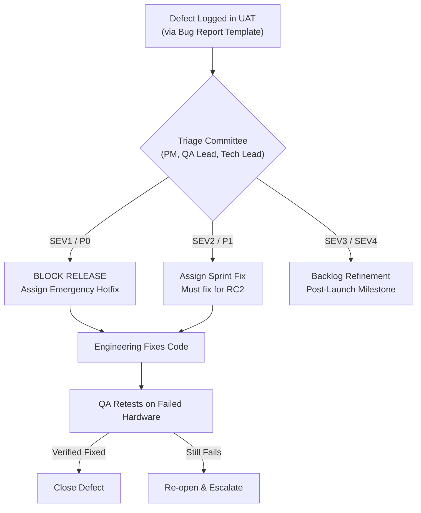

# User Acceptance Testing (UAT) Plan — NoiseFit Sync Center

> **DOCUMENT CONTROL & QA GOVERNANCE**  
> **Project:** NoiseFit Sync Reliability — Sync Center  
> **Artifact:** User Acceptance Testing (UAT) Master Plan  
> **Status:** Planned Quality Assurance Protocol — Not Yet Executed in Production  
> **Target Release:** Sync Center MVP (Release Candidate `v4.2.0-rc1`)  
> **Linked Artifacts:** [10 User Stories](../../docs/USER_STORIES.md) · [BRD](../../docs/BRD.md) · [Bug Template](./bug-report-template.md)

---

## 1. UAT Scope & Objectives

User Acceptance Testing (UAT) is the final verification gateway before commercial deployment. The objective is to validate that **NoiseFit Sync Center** satisfies business requirements ([`docs/BRD.md`](../../docs/BRD.md)) and user expectations under real-world operating conditions.

### In-Scope for UAT
- End-to-end verification of the 4-stage synchronization experience: **Detect $\rightarrow$ Explain $\rightarrow$ Recover $\rightarrow$ Confirm**.
- Verification of all 10 user stories (`US-01` to `US-10`) and their 32 Gherkin acceptance scenarios ([`docs/USER_STORIES.md`](../../docs/USER_STORIES.md)).
- Hardware fault injection: simulating out-of-range BLE drops, manual OS Bluetooth toggles, aggressive Android battery kills, and network offline conditions.
- Diagnostic payload sanitization and customer support escalation verification (`US-08`).

### Out-of-Scope for UAT
- Smartwatch hardware circuit board rework or battery chemical degradation testing.
- Third-party cloud API synchronization (Apple HealthKit / Google Health Connect).
- Multi-watch concurrent synchronization to a single phone.

---

## 2. Test Environment & Prerequisites

### Test Hardware & Operating Systems
- **Mobile Hardware Fleet:**
  - Android Tier 1: Samsung Galaxy S23 / S22 (OneUI 6.0, Android 14)
  - Android Tier 2: Xiaomi Redmi Note 12 / HyperOS (Aggressive OEM battery manager)
  - Android Tier 3: Google Pixel 7 (Stock Android 14)
  - iOS Tier: iPhone 14 / iPhone 13 (iOS 17.4)
- **Wearable Hardware Devices:**
  - 3 × Noise ColorFit Pro 4 (Firmware v2.1.8)
  - 2 × Noise Voyage (Firmware v1.0.4)
  - 2 × Noise Pulse 2 (Firmware v1.4.2)
- **Preconditions:**
  - All test devices enrolled in internal Firebase App Distribution / Apple TestFlight UAT tracks.
  - Test user accounts populated with realistic activity history (steps, sleep records, heart rate logs).
  - RF-shielded testing enclosure available to simulate Bluetooth packet attenuation.

---

## 3. Comprehensive UAT Test Scenarios

---

### Scenario UAT-01: Healthy Sync State & Relative Timestamp Verification
- **Mapped Stories:** `US-01 (Scenario 01.1)`, `US-02 (Scenario 02.1)`
- **Initial Setup:** Watch connected via BLE; completed sync 5 minutes prior.
- **Action Steps:**
  1. Open NoiseFit app on Android and iOS devices.
  2. Inspect the home dashboard status card.
- **Expected Result:**
  - Status card displays: *"Watch connected • Synced 5 min ago"* with a green checkmark icon.
  - Tapping status card opens Sync Center displaying all four categories (Steps, Sleep, Heart Rate, Workouts) marked with green `✓ Synced` badges.
- **Pass / Fail Criterion:** Card renders accurate relative timestamp within $\pm 1\text{ minute}$ of actual event; zero layout clipping.

---

### Scenario UAT-02: Partial Sync Detection & Category Completeness Breakdown
- **Mapped Stories:** `US-01 (Scenario 01.3)`, `US-02 (Scenario 02.2)`, `FR-03`
- **Initial Setup:** Using BLE packet injector, simulate successful transmission of Steps and Heart Rate packets, but drop Sleep data packets.
- **Action Steps:**
  1. Trigger synchronization cycle.
  2. Observe home dashboard and navigate into Sync Center.
- **Expected Result:**
  - Dashboard card updates to amber badge: *"Partial Sync — Some data is delayed"*.
  - Sync Center displays: Steps (`✓ Synced`), Heart Rate (`✓ Synced`), Sleep (`⚠ Delayed`).
  - Sleep category header displays timestamp of previous successful sleep sync.
- **Pass / Fail Criterion:** Amber warning displays; categories render correct individual states without corrupting step count.

---

### Scenario UAT-03: Bluetooth Disconnection Diagnosis & Guided Reconnection
- **Mapped Stories:** `US-03 (Scenario 03.1)`, `US-05 (Scenario 05.1, 05.3)`
- **Initial Setup:** Turn off Bluetooth on smartphone OS settings before triggering sync.
- **Action Steps:**
  1. Tap "View sync status" from dashboard.
  2. Observe failure diagnosis on Screen 04.
  3. Tap **[Reconnect Watch]** CTA button.
- **Expected Result:**
  - Screen 04 displays: *"Bluetooth is turned off. Turn on Bluetooth so NoiseFit can communicate with your watch."*
  - Tapping "Reconnect Watch" surfaces the OS system permission dialog requesting to enable Bluetooth.
  - Upon granting permission, Bluetooth enables and app automatically re-attempts device connection without manual navigation.
- **Pass / Fail Criterion:** Correct diagnosis displayed; native OS Bluetooth intent fires successfully without crashing app.

---

### Scenario UAT-04: One-Tap Targeted Differential Retry & Confirmation Closure
- **Mapped Stories:** `US-04 (Scenario 04.1, 04.2)`, `US-06 (Scenario 06.1, 06.2)`
- **Initial Setup:** Device in partial sync state (Sleep delayed, Steps synced); Bluetooth connected.
- **Action Steps:**
  1. In Sync Center, tap primary **[Retry Sync]** button.
  2. Observe transition to Screen 06 ("Recovering").
  3. Allow transfer to complete.
- **Expected Result:**
  - Button disables immediately upon tap; spinner renders: *"Transferring remaining sleep packets..."*.
  - Differential packet recovery requests *only* Sleep packets (verified via BLE packet sniffer).
  - Upon completion within 45s, app transitions to Screen 07 ("Sync Complete").
  - Displays: *"All data categories are up to date"* with restored timestamp.
  - Tapping **[Done]** returns user to dashboard, which now shows healthy green state.
- **Pass / Fail Criterion:** Recovery completes within $\le 45\text{ seconds}$; sleep charts populate with restored records.

---

### Scenario UAT-05: Second Failure Adaptive Guidance (Loop Prevention)
- **Mapped Stories:** `US-07 (Scenario 07.1, 07.2)`
- **Initial Setup:** Watch powered off (simulating dead battery or lost hardware).
- **Action Steps:**
  1. Tap "Retry Sync" (Attempt 1) $\rightarrow$ Fails after 45s timeout.
  2. Tap "Retry Sync" (Attempt 2) $\rightarrow$ Fails after 45s timeout.
  3. Observe failure screen copy and primary CTA.
- **Expected Result:**
  - After 2nd consecutive failure, primary CTA changes from "Retry Sync" to **[Advanced Troubleshooting]**.
  - Screen copy updates to: *"Sync is taking longer than usual. Try toggling Bluetooth or restarting your watch."*
  - Exiting to dashboard and re-entering Sync Center preserves the retry counter at 2.
- **Pass / Fail Criterion:** Counter persists across screen transitions; CTA adapts dynamically to prevent endless loops.

---

### Scenario UAT-06: Third Failure Escalation & Sanitized Diagnostic Package
- **Mapped Stories:** `US-08 (Scenario 08.1, 08.2, 08.3)`, `NFR-04`
- **Initial Setup:** User triggers a 3rd consecutive recovery attempt that fails.
- **Action Steps:**
  1. Allow 3rd attempt to time out.
  2. Observe escalation modal.
  3. Tap **[Contact Support with Diagnostics]**.
  4. Inspect generated support payload in network proxy.
- **Expected Result:**
  - App displays: *"We couldn't resolve the sync issue. Our support team is ready to help."*
  - Support form auto-populates with device model, app version, OS build, and last BLE error code (`GATT_133`).
  - **Privacy Audit:** Payload contains ZERO user names, step numbers, heart rate readings, or GPS coordinates.
  - Submitting ticket returns reference ID (e.g., `#NF-98214`) and SLA expectation (<24 hours).
- **Pass / Fail Criterion:** Diagnostic payload compiled without PII; ticket submitted via API successfully.

---

## 4. Defect Triage & Retest Workflow

---

## 5. Exit Criteria & Formal Sign-Off Template

### Mandatory Release Exit Criteria
1. **100% Pass Rate on P0 / Must-Have Scenarios:** Scenarios `UAT-01` through `UAT-04` must pass on all 4 hardware test tiers with zero exceptions.
2. **Zero Open SEV1 / SEV2 Defects:** All Critical and Major defects must be resolved, verified, and closed.
3. **Guardrail Compliance:** Battery profiling confirms background sync consumes $<1.0\%$ battery discharge per 24 hours.
4. **Privacy Audit Passed:** Formal security sign-off confirming zero PII or health data in diagnostic payloads.

### Formal Sign-Off Matrix (Template)

| Role | Name | Organization / Department | UAT Recommendation | Signature & Date |
|---|---|---|---|---|
| **QA Lead** | `[Hypothetical: Mobile QA Lead]` | Mobile Quality Engineering | `[ ] Approved  [ ] Conditional  [ ] Rejected` | `[TO SIGN UPON UAT EXECUTION]` |
| **Product Manager** | `[Independent Portfolio Author]` | Product Management | `[ ] Approved  [ ] Conditional  [ ] Rejected` | `[TO SIGN UPON UAT EXECUTION]` |
| **Engineering Lead** | `[Hypothetical: Mobile Tech Lead]` | Core Mobile Engineering | `[ ] Approved  [ ] Conditional  [ ] Rejected` | `[TO SIGN UPON UAT EXECUTION]` |
| **Customer Support Ops** | `[Hypothetical: Support Ops Lead]` | Customer Operations | `[ ] Approved  [ ] Conditional  [ ] Rejected` | `[TO SIGN UPON UAT EXECUTION]` |

---

## 6. Beginner-Friendly Explainer

### What this artifact does
This User Acceptance Testing (UAT) Plan defines the formal testing protocol used by product managers, QA testers, and business analysts to verify that the software meets business requirements and user needs before commercial release. It covers test hardware, preconditions, six detailed test scenarios, defect triage workflows, and exit criteria.

### Why it matters
Writing requirements is futile if you cannot prove that the built software actually works. UAT bridges the gap between written stories and released code, ensuring that edge cases (like walking out of Bluetooth range or rapid retrying) are thoroughly tested before customers encounter them.

### How to use it
- Execute scenarios `UAT-01` through `UAT-06` systematically with test devices.
- Log any discrepancies using [`bug-report-template.md`](./bug-report-template.md).
- Use the exit criteria checklist to decide whether a release candidate is ready for launch.

### What I can honestly claim in an interview
- **Can claim:** You authored this comprehensive UAT test plan, designed realistic hardware edge-case scenarios covering the 4-stage flow, established non-negotiable exit criteria, and structured the sign-off matrix.
- **Cannot claim:** You cannot claim that real devices have executed these UAT tests or that cross-functional leads signed off on the release. The sign-off table is explicitly marked as a planned template.
