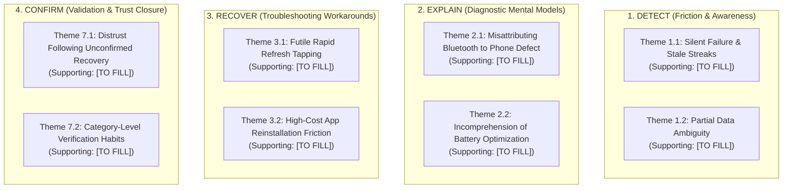

# Qualitative Affinity Mapping & Thematic Synthesis Framework

> **DOCUMENT CONTROL & RESEARCH GOVERNANCE**  
> **Project:** NoiseFit Sync Reliability Case Study  
> **Artifact:** Thematic Synthesis & Affinity Clustering Framework  
> **Status:** Synthesis Protocol Specification — Template Ready for Deployment  
> **Input Evidence Source:** Planned Semi-Structured Interviews ($N=5\text{--}8$, `P-01` to `P-08`)  
> **Linked Artifacts:** [Notes Template](./research-notes-template.md) · [Research Summary](./research-summary-template.md) · [10 User Stories](../../docs/USER_STORIES.md)

---

## 1. Synthesis Methodology & Thematic Clustering Rules

Affinity mapping is the inductive process of clustering granular qualitative observations into higher-order behavioral patterns, pain point clusters, and actionable product requirements.

### Methodological Safeguards Against Anecdotal Bias
To prevent a single vocal participant's anecdote from being mistaken for a universal user need, the following synthesis rules must be enforced:
1. **Minimum Cluster Threshold:** A candidate pattern must be supported by observations from at least **three independent participants ($\ge 3$ Participants)** to qualify as a primary qualitative theme.
2. **Explicit Contradictory Evidence Audit:** For every identified theme, the researcher must actively search for and document disconfirming evidence (e.g., participants who experienced the same condition but did not express frustration).
3. **Traceability to Raw Notes:** Every clustered observation must retain its unique Note ID linking back to the raw, timestamped transcript in [`research-notes-template.md`](./research-notes-template.md).
4. **Separation of Evidence from Solutioning:** Cluster observations based on user behavior and emotional friction, NOT around pre-conceived features (e.g., group under *"Anxiety over missing workout data"* rather than *"Desire for a Sync Center"*).

---

## 2. Four-Stage Mental Model Affinity Board (Mermaid Schema)

---

## 3. Structured Affinity Mapping Table

> **SYNTHESIS TABLE STATUS:** All evidence fields remain blank or marked `[TO FILL AFTER REAL INTERVIEWS]`. They must only be populated when real customer interview notes are synthesized.

| Observation / Note ID | Raw Participant Evidence (Paraphrase or Quote) | Participant ID(s) | Candidate Thematic Cluster | Supporting Participant Count (N) | Contradictory / Non-Conforming Evidence | Severity / Importance (Low / Med / High / Critical) | Confidence (Low / Med / High) | Direct Product / PRD Implication | Open Stakeholder Question |
|---|---|---|---|---|---|---|---|---|---|
| `OBS-001` | `[TO FILL AFTER REAL INTERVIEWS]` | `[TO FILL]` | Silent Failure Detection | `[TO FILL]` | `[TO FILL]` | `[TO FILL]` | `[TO FILL]` | Validate dashboard status indicator (`US-01`) | `[TO FILL]` |
| `OBS-002` | `[TO FILL AFTER REAL INTERVIEWS]` | `[TO FILL]` | Partial Sync Anxiety | `[TO FILL]` | `[TO FILL]` | `[TO FILL]` | `[TO FILL]` | Validate category breakdown card (`US-01`, `FR-03`) | `[TO FILL]` |
| `OBS-003` | `[TO FILL AFTER REAL INTERVIEWS]` | `[TO FILL]` | Diagnostic Error Confusion | `[TO FILL]` | `[TO FILL]` | `[TO FILL]` | `[TO FILL]` | Validate plain-language translation (`US-03`) | `[TO FILL]` |
| `OBS-004` | `[TO FILL AFTER REAL INTERVIEWS]` | `[TO FILL]` | Manual Troubleshooting Fatigue | `[TO FILL]` | `[TO FILL]` | `[TO FILL]` | `[TO FILL]` | Validate one-tap differential retry (`US-04`) | `[TO FILL]` |
| `OBS-005` | `[TO FILL AFTER REAL INTERVIEWS]` | `[TO FILL]` | Bluetooth Unpairing Workarounds | `[TO FILL]` | `[TO FILL]` | `[TO FILL]` | `[TO FILL]` | Validate guided reconnect flow (`US-05`) | `[TO FILL]` |
| `OBS-006` | `[TO FILL AFTER REAL INTERVIEWS]` | `[TO FILL]` | Distrust of Silent Recovery | `[TO FILL]` | `[TO FILL]` | `[TO FILL]` | `[TO FILL]` | Validate explicit confirmation modal (`US-06`) | `[TO FILL]` |
| `OBS-007` | `[TO FILL AFTER REAL INTERVIEWS]` | `[TO FILL]` | Endless Retry Rage | `[TO FILL]` | `[TO FILL]` | `[TO FILL]` | `[TO FILL]` | Validate 2nd failure adaptive guide (`US-07`) | `[TO FILL]` |
| `OBS-008` | `[TO FILL AFTER REAL INTERVIEWS]` | `[TO FILL]` | Support Escalation Hesitation | `[TO FILL]` | `[TO FILL]` | `[TO FILL]` | `[TO FILL]` | Validate pre-packaged diagnostic submission (`US-08`) | `[TO FILL]` |

---

## 4. Post-Synthesis PRD Update Protocol

Once real interview data is mapped onto this framework, the Product Manager must follow this four-step decision tree to translate qualitative findings into requirements:
1. **Validate Existing Stories:** If a theme achieves $\ge 4$ supporting participants and aligns with an existing story (e.g., `US-03`), mark the story priority verified.
2. **Refine Acceptance Criteria:** If participants describe an edge case not covered in Gherkin scenarios (e.g., participant leaves Bluetooth off indefinitely), author a new scenario.
3. **Deprioritize Unsupported Scope:** If a proposed feature receives zero unprompted interest or participants indicate it adds unwanted complexity, downgrade its MoSCoW priority (e.g., from Must Have to Could Have).
4. **Draft New User Stories:** If a recurring theme surfaces an unaddressed friction point (e.g., desire to export data locally when cloud sync fails), create a new candidate story (`US-11`).

---

## 5. Beginner-Friendly Explainer

### What this artifact does
This template provides a rigorous qualitative synthesis method (affinity mapping) to convert raw interview notes into organized thematic clusters. It tracks supporting participant counts, actively documents contradictory evidence, and defines explicit product implications for each theme.

### Why it matters
The biggest mistake junior PMs make is treating a single customer's opinion as a product requirement ("One person told me they wanted X, so we must build X"). Affinity mapping forces you to quantify how many participants experienced the problem, look for contradictory opinions, and prioritize based on theme prevalence.

### How to use it
- After conducting 5–8 user interviews, transfer significant observations from [`research-notes-template.md`](./research-notes-template.md) into the rows of this table.
- Group similar observations into candidate themes.
- Tally supporting participant counts and note any participants who disagreed.
- Use the "Direct Product Implication" column to propose updates to your PRD.

### What I can honestly claim in an interview
- **Can claim:** You designed the affinity mapping methodology, clustering rules, contradiction safeguards, and PRD governance protocol for synthesizing qualitative interview data.
- **Cannot claim:** You cannot claim that the themes in this table represent completed qualitative findings. All evidence fields remain explicitly marked `[TO FILL AFTER REAL INTERVIEWS]`.
