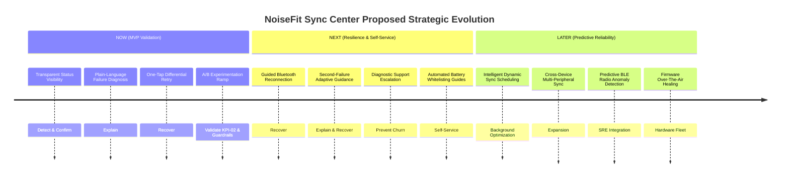

# Product Roadmap & Prioritized Backlog — NoiseFit Sync Center

> **DOCUMENT CONTROL & GOVERNANCE**  
> **Project:** NoiseFit Sync Reliability — Sync Center  
> **Artifact:** Product Roadmap & Backlog  
> **Status:** Proposed Product Planning Specification — Not Yet Implemented in Production  
> **Target Persona:** Aarav — Everyday Wearable User ([`docs/USER_STORIES.md`](../docs/USER_STORIES.md))  
> **Linked Artifacts:** [BRD](../docs/BRD.md) · [10 User Stories](../docs/USER_STORIES.md) · [7 Core KPIs](../docs/KPI_AND_METRICS.md) · [Prototype Reference](../prototype/prototype_reference.md) · [A/B Test Plan](../experimentation/AB_TEST_PLAN.md)

---

## 1. Executive Summary & Delivery Principles

This document establishes the strategic **Now / Next / Later Roadmap** and the operational **Prioritized Product Backlog** for the proposed **NoiseFit Sync Center**.

The roadmap is structured around the core 4-stage reliability mental model:

$$\textbf{Detect} \longrightarrow \textbf{Explain} \longrightarrow \textbf{Recover} \longrightarrow \textbf{Confirm}$$

All initiatives in this document represent **proposed product capabilities** designed to validate whether transparency and self-service troubleshooting can solve wearable synchronization failure. They are explicitly mapped to the project's **seven existing Key Performance Indicators** and **ten agile user stories**.

---

## 2. Now / Next / Later Strategic Roadmap

---

### Stage 1: NOW — Sync Center MVP & Experimentation

| Dimension | Specification |
|---|---|
| **Product Goal** | Deliver the foundational 4-stage synchronization experience to replace silent failures with actionable in-app status and recovery. |
| **User Problem Addressed** | Users open the companion app to find missing health metrics (steps, sleep, workouts) with no indication of whether a sync failed, paused, or dropped packets. |
| **Target User** | Active Noise wearable users (**Aarav**) on Android 10+ and iOS 14+ experiencing intermittent or partial synchronization failures. |
| **Proposed Capabilities** | 1. Persistent sync status card on the main dashboard (`US-01`). 2. Last successful sync timestamp display in relative and absolute formats (`US-02`). 3. Plain-language error translation for BLE drops, battery restrictions, and timeouts (`US-03`). 4. One-tap targeted retry requesting only missing/failed data categories (`US-04`). 5. Explicit recovery confirmation screen showing verified restored categories (`US-06`). 6. Telemetry instrumentation capturing sync events, durations, and outcomes (`US-09`). |
| **Workflow Stages Covered** | **Detect** (`US-01`, `US-02`) $\longrightarrow$ **Explain** (`US-03`) $\longrightarrow$ **Recover** (`US-04`) $\longrightarrow$ **Confirm** (`US-06`). |
| **Targeted Existing KPIs** | • [`KPI-01: Sync Success Rate`](../docs/KPI_AND_METRICS.md#kpi-01-sync-success-rate) (Baseline: 70.93% synthetic $\rightarrow$ Target: $>85.0\%$ `[ASSUMPTION]`) • [`KPI-02: Recovery Rate`](../docs/KPI_AND_METRICS.md#kpi-02-recovery-rate) (Baseline: ~30.0% unguided $\rightarrow$ Target: $\ge 60.0\%$ `[ASSUMPTION]`) • [`KPI-03: Time to Recover`](../docs/KPI_AND_METRICS.md#kpi-03-time-to-recover) (Baseline: 75s healthy, >180s unguided $\rightarrow$ Target: $<60.0\text{s}$ `[ASSUMPTION]`) |
| **Dependencies** | Mobile companion app BLE state callbacks; persistent local timestamp storage; offline telemetry event queue. |
| **Risks** | High battery consumption if retry triggers rapid reconnection loops; inaccurate error translation causing user confusion; BLE socket deadlock. |
| **Exit Criteria** | 1. Pass 100% of P0 functional test cases across Android and iOS test benches. 2. Complete 50/50 A/B test demonstrating statistically significant lift in Recovery Rate ($p < 0.05$). 3. Verify crash rate guardrail ($\Delta \le +0.05\%$) and 24h battery drain ($<1.0\%$). |
| **Evidence Needed to Advance** | A/B test results proving recovery rate exceeds 55% with positive qualitative feedback from usability testing. |

---

### Stage 2: NEXT — Advanced Troubleshooting & Support Escalation

| Dimension | Specification |
|---|---|
| **Product Goal** | Streamline complex connectivity failures and eliminate dead-end troubleshooting loops before they trigger brand abandonment. |
| **User Problem Addressed** | Repeated sync failures force users into endless manual retry attempts, leading to unpairing, app uninstallation, or frustration. |
| **Target User** | Users experiencing persistent hardware-level Bluetooth disconnection or aggressive OEM battery optimization kills. |
| **Proposed Capabilities** | 1. Guided Bluetooth troubleshooting flow with direct OS settings deep-links (`US-05`). 2. Adaptive secondary guidance after 2 consecutive retry failures (`US-07`). 3. Automated customer support ticket pre-population with sanitized device diagnostic logs after 3 failures (`US-08`). 4. In-app contextual onboarding tooltips introducing Sync Center upon first failure (`US-10`). |
| **Workflow Stages Covered** | **Explain** (`US-07`) $\longrightarrow$ **Recover** (`US-05`) $\longrightarrow$ **Escalate** (`US-08`). |
| **Targeted Existing KPIs** | • [`KPI-04: Repeat Failure Rate`](../docs/KPI_AND_METRICS.md#kpi-04-repeat-failure-rate) (Target: $<15.0\%$ `[ASSUMPTION]`) • [`KPI-05: Sync-Related Support Tickets`](../docs/KPI_AND_METRICS.md#kpi-05-sync-related-support-tickets) (Target: $-25.0\%$ relative reduction `[ASSUMPTION]`) • [`KPI-06: Self-Service Resolution Rate`](../docs/KPI_AND_METRICS.md#kpi-06-self-service-resolution-rate) (Target: $>70.0\%$ `[ASSUMPTION]`) • [`KPI-07: Sync Center Adoption Rate`](../docs/KPI_AND_METRICS.md#kpi-07-sync-center-adoption-rate) (Target: $>40.0\%$ `[ASSUMPTION]`) |
| **Dependencies** | CRM / Ticketing system API payload ingestion endpoint; Android intent deep-linking permissions; OEM battery whitelist permissions. |
| **Risks** | Support desk overload if automated ticket trigger threshold is set too low (e.g., after only 1 failure); privacy leakage in diagnostic logs. |
| **Exit Criteria** | 1. Measured reduction of $\ge 20\%$ in sync/connectivity ticket volume. 2. Verified privacy compliance showing zero PII or health biometric data in diagnostic payloads. 3. $>40\%$ adoption of Sync Center among affected users. |
| **Evidence Needed to Advance** | Quantitative reduction in 7-day repeat failure cohorts; customer support handle-time data validating diagnostic efficiency. |

---

### Stage 3: LATER — Intelligent Synchronization & Fleet Observability

| Dimension | Specification |
|---|---|
| **Product Goal** | Shift from reactive self-service recovery to predictive synchronization reliability and intelligent device-fleet management. |
| **User Problem Addressed** | Sync failures occur unexpectedly during high-stakes moments (e.g., right before opening the app to verify a marathon run or sleep score). |
| **Target User** | Long-tenured power users with extensive multi-year health data records and multiple paired fitness accessories. |
| **Proposed Capabilities** | 1. Predictive sync scheduling adapting to individual user workout patterns and waking hours. 2. Fleet-level telemetry anomaly detection integrating companion app telemetry with the server-side **SyncOps Assistant** platform. 3. Automated firmware compatibility validation and OTA update advisory. 4. Multi-device simultaneous background synchronization. |
| **Workflow Stages Covered** | **Predict** $\longrightarrow$ **Preempt** $\longrightarrow$ **Detect** $\longrightarrow$ **Heal**. |
| **Targeted Existing KPIs** | • [`KPI-01: Sync Success Rate`](../docs/KPI_AND_METRICS.md#kpi-01-sync-success-rate) (Target: $>95.0\%$ in production) • 30-Day Cohort User Retention ($+5.0\text{pp}$ target `[ASSUMPTION]`). |
| **Dependencies** | Machine learning inference engine on mobile client; firmware engineering collaboration; scalable real-time streaming backend. |
| **Risks** | Machine learning battery overhead; firmware flash memory corruption; unexpected background wakeups violating OS store policies. |
| **Exit Criteria** | Production deployment of proactive sync scheduling with $<0.5\%$ crash incidence across 1M+ active endpoints. |
| **Evidence Needed to Advance** | Longitudinal retention study connecting predictive sync to improved hardware repurchase rates. |

---

## 3. Prioritized Product Backlog Table

### Backlog Scoring & Governance Framework
- **Opportunity-Level RICE:** In the initial problem discovery phase ([`02_Prioritization/`](../02_Prioritization/) and [`README.md`](../README.md#02--opportunity-prioritization-rice)), the overall opportunity **"Reliable Sync & Recovery"** was prioritized against 6 other initiatives, scoring **Rank #1 with a RICE score of 4.08** (Reach: 8/10, Impact: 3.0/3, Confidence: 0.85, Effort: 5/10).
- **Story-Level RICE Scoring:** The individual user story scores below reflect provisional sprint prioritization estimates. Where granular story-level scoring parameters have not yet been calibrated via real engineering sprint estimation, they are explicitly marked `[TO FILL FROM MY DATA]`.
- **Status Definitions:**
  - `Proposed`: Requirement defined and documented; awaiting sprint planning and engineering review.
  - `Ready`: User story, acceptance criteria, and UX specs completed and approved for sprint intake.
  - `In Progress`: Engineering actively developing client or telemetry code.
  - `Blocked`: Implementation paused pending architectural dependency or stakeholder resolution.
  - `Done`: Implemented, tested, and verified in production (no proposed NoiseFit Sync Center story is marked Done).

---

### Backlog Table

| Backlog ID | User Story Summary | Story Link | Priority (MoSCoW) | Reach (1–10) | Impact (0.25–3) | Conf. (0–1) | Effort (1–10) | Provisional RICE Score | Status | Key Dependencies | Primary Risks | Acceptance Criteria Summary |
|---|---|---|---|---|---|---|---|---|---|---|---|---|
| **BL-01** | Viewing real-time sync status card on dashboard | [`US-01`](../docs/USER_STORIES.md#us-01-viewing-real-time-sync-status) | **Must Have** | 9 | 2.0 (High) | 0.90 | 3 | **5.40** | `Ready` | BLE connection callback | State lag causing inaccurate status badges | 3 Gherkin scenarios: Healthy, Syncing, and Partial Sync states |
| **BL-02** | Viewing last successful sync timestamp | [`US-02`](../docs/USER_STORIES.md#us-02-viewing-last-successful-sync-timestamp) | **Must Have** | 9 | 1.0 (Med) | 0.90 | 2 | **4.05** | `Ready` | Local device persistent timestamp store | Clock drift or timezone mismatches | 3 Gherkin scenarios: Relative time, Absolute time, >24h stale state |
| **BL-03** | Plain-language failure diagnosis | [`US-03`](../docs/USER_STORIES.md#us-03-understanding-synchronization-failures) | **Must Have** | 8 | 3.0 (Massive) | 0.85 | 4 | **5.10** | `Ready` | Android/iOS BLE error code translation matrix | Unmapped vendor error codes defaulting to technical jargon | 3 Gherkin scenarios: BLE off, Battery saver restriction, Unmapped code fallback |
| **BL-04** | One-tap targeted retry action | [`US-04`](../docs/USER_STORIES.md#us-04-one-tap-synchronization-retry) | **Must Have** | 8 | 3.0 (Massive) | 0.85 | 5 | **4.08** | `Ready` | Differential packet recovery support in firmware | BLE socket lockup during rapid retry taps; battery drain | 3 Gherkin scenarios: Tap trigger, Successful differential recovery, 45s timeout |
| **BL-05** | Guided Bluetooth reconnection flow | [`US-05`](../docs/USER_STORIES.md#us-05-guided-bluetooth-connectivity-troubleshooting) | **Should Have** | 7 | 2.0 (High) | 0.80 | 4 | **2.80** | `Proposed` | Native OS Bluetooth intent URL deep-linking | OS permission denials preventing automatic Bluetooth toggle | 3 Gherkin scenarios: Bluetooth disabled prompt, Out of range guide, OS deep-link |
| **BL-06** | Explicit recovery outcome confirmation | [`US-06`](../docs/USER_STORIES.md#us-06-confirming-successful-recovery) | **Must Have** | 8 | 2.0 (High) | 0.85 | 3 | **4.53** | `Ready` | Local database transaction commit verification | Showing confirmation when packets were dropped (false positive) | 3 Gherkin scenarios: Full restoration breakdown, Dismissal, Checksum integrity guardrail |
| **BL-07** | Adaptive guidance after repeated failures | [`US-07`](../docs/USER_STORIES.md#us-07-handling-repeated-failures) | **Should Have** | 5 | 2.0 (High) | 0.75 | 3 | **2.50** | `Proposed` | Session-scoped retry attempt counter in app memory | Counter reset bug trapping users in endless loops | 2 Gherkin scenarios: 2nd failure troubleshooting change, State persistence |
| **BL-08** | Automated customer support escalation | [`US-08`](../docs/USER_STORIES.md#us-08-escalating-unresolved-problems-to-support) | **Should Have** | 4 | 2.0 (High) | 0.80 | 5 | **1.28** | `Proposed` | CRM API payload ingestion endpoint (Zendesk / Freshdesk) | Inadvertent PII / health data leakage in diagnostic payloads | 3 Gherkin scenarios: 3rd failure trigger, Diagnostic compilation, Ticket submission |
| **BL-09** | Telemetry and KPI event instrumentation | [`US-09`](../docs/USER_STORIES.md#us-09-telemetry--kpi-instrumentation) | **Must Have** | 10 | 3.0 (Massive) | 0.95 | 4 | **7.13** | `Ready` | Analytics SDK offline batching and flush pipeline | Telemetry packet loss; analytics server burst congestion | 3 Gherkin scenarios: Initiation event, Recovery event, PII privacy compliance |
| **BL-10** | Contextual feature discovery tooltip | [`US-10`](../docs/USER_STORIES.md#us-10-feature-discovery--adoption) | **Could Have** | 6 | 1.0 (Med) | 0.70 | 2 | **2.10** | `Proposed` | In-app notification / tooltip design system component | User annoyance if banner triggers repeatedly | 2 Gherkin scenarios: First-failure banner render, Dismissal persistence |
| **BL-11** | Smartwatch firmware differential packet buffer | `[Proposed NFR]` | **Should Have** | `[TO FILL FROM MY DATA]` | `[TO FILL FROM MY DATA]` | `[TO FILL FROM MY DATA]` | `[TO FILL FROM MY DATA]` | `[TO FILL FROM MY DATA]` | `Blocked` | Firmware engineering team roadmap alignment | Smartwatch flash memory exhaustion; legacy chipset constraints | Smartwatch firmware maintains category-level packet offsets |
| **BL-12** | Offline recovery mode with queued cloud upload | `[Proposed FR-10]` | **Must Have** | `[TO FILL FROM MY DATA]` | `[TO FILL FROM MY DATA]` | `[TO FILL FROM MY DATA]` | `[TO FILL FROM MY DATA]` | `[TO FILL FROM MY DATA]` | `Proposed` | SQLite local sync commit before cloud sync attempt | Cloud conflict resolution when local data overrides server state | Watch-to-phone sync succeeds with zero cellular/Wi-Fi connection |

---

## 4. Beginner-Friendly Explainer

### What this artifact does
This document bridges high-level product strategy and day-to-day sprint execution. It organizes future work into a three-horizon **Now / Next / Later Roadmap** and provides a granular, prioritized **Product Backlog** linking every user story to business metrics, RICE estimates, dependencies, and risks.

### Why it matters
Product Managers must demonstrate how individual sprint tasks connect to broad business outcomes. A roadmap shows *why* features are sequenced the way they are, while a backlog proves *how* the team will build them without scope creep or missed dependencies.

### How to use it
- In interviews, reference the **Now** column to explain your MVP scope.
- Point to the **Next** and **Later** columns when asked: *"How would you evolve this product after launch?"*
- Use the backlog table to demonstrate how you prioritize features using MoSCoW and RICE rather than personal opinion.

### What I can honestly claim in an interview
- **Can claim:** You authored the Now/Next/Later roadmap, sequenced capabilities across the 4-stage reliability flow, mapped every story to the seven project KPIs, and structured a MoSCoW/RICE backlog.
- **Cannot claim:** You cannot claim that an engineering team has estimated these stories in sprint poker, that BL-01 through BL-12 are currently being coded, or that the feature has launched.
