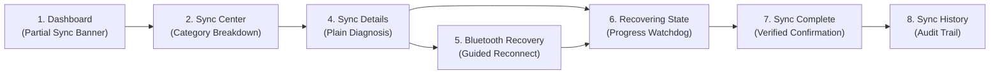

# Usability Test Plan — NoiseFit Sync Center Prototype

> **DOCUMENT CONTROL & UX GOVERNANCE**  
> **Project:** NoiseFit Sync Reliability — Sync Center  
> **Artifact:** Task-Based Prototype Usability Test Plan  
> **Target Prototype:** 8-Screen Vector SVG Prototype ([`prototype/prototype_reference.md`](../../prototype/prototype_reference.md))  
> **Target Cohort:** 5–8 Wearable Smartwatch Users  
> **Status:** Usability Protocol Specification — Test Not Yet Executed ($N = 0$)  
> **Prototype Nature Disclosure:** The evaluated prototype is a **semi-interactive vector design mockup** ([`05_UX/SVG_Screens/`](../../05_UX/SVG_Screens/)). It is NOT a compiled, functional mobile build connected to live Bluetooth smartwatch hardware.

---

## 1. Usability Objectives & Research Scope

The purpose of this usability study is to evaluate the cognitive clarity, discoverability, and ease of recovery of the **NoiseFit Sync Center** prototype before committing mobile and firmware engineering resources to code development.

### Specific Evaluation Goals
1. **Detectability:** Can users immediately identify that their smartwatch has experienced a sync delay or partial sync without guidance?
2. **Comprehension:** Do users understand plain-language failure explanations (e.g., *"Bluetooth connection was interrupted during sleep packet transfer"*) without getting confused?
3. **Actionability:** Can users intuitively select the appropriate recovery action (targeted retry vs. guided Bluetooth reconnect) based on the diagnosed issue?
4. **State Transparency:** Does the 45-second animated recovery state provide sufficient feedback to prevent anxiety and repeated button clicking?
5. **Trust Closure:** Does the explicit confirmation screen provide convincing closure that missing data has been safely restored to their daily dashboard?

---

## 2. Prototype Specifications & Asset References

The usability test evaluates the complete 8-screen recovery journey codified in the design system:

### Evaluated Prototype Assets
- **Vector Screen Assets:** Standalone scalable SVG screens in [`05_UX/SVG_Screens/`](../../05_UX/SVG_Screens/):
  - Screen 01: [`screen_01_Dashboard.svg`](../../05_UX/SVG_Screens/screen_01_Dashboard.svg) (Dashboard with partial sync badge)
  - Screen 02: [`screen_02_Sync_Center.svg`](../../05_UX/SVG_Screens/screen_02_Sync_Center.svg) (Syncing progress)
  - Screen 03: [`screen_03_Partial_Sync.svg`](../../05_UX/SVG_Screens/screen_03_Partial_Sync.svg) (Category breakdown)
  - Screen 04: [`screen_04_Sync_Details.svg`](../../05_UX/SVG_Screens/screen_04_Sync_Details.svg) (Plain diagnosis)
  - Screen 05: [`screen_05_Reconnect_Watch.svg`](../../05_UX/SVG_Screens/screen_05_Reconnect_Watch.svg) (Guided reconnect)
  - Screen 06: [`screen_06_Recovering.svg`](../../05_UX/SVG_Screens/screen_06_Recovering.svg) (Recovery progress)
  - Screen 07: [`screen_07_Sync_Complete.svg`](../../05_UX/SVG_Screens/screen_07_Sync_Complete.svg) (Restoration confirmation)
  - Screen 08: [`screen_08_Sync_History.svg`](../../05_UX/SVG_Screens/screen_08_Sync_History.svg) (Audit trail)
- **High-Resolution Composite Mockup:** [`05_UX/NoiseFit_Sync_Center_Prototype_Visual.png`](../../05_UX/NoiseFit_Sync_Center_Prototype_Visual.png)
- **Interactive Slide Walkthrough:** [`05_UX/NoiseFit_Sync_Center_Editable_Prototype.pptx`](../../05_UX/NoiseFit_Sync_Center_Editable_Prototype.pptx)
- **Figma Design Specifications:** [`05_UX/Figma_Wireframe_Spec.xlsx`](../../05_UX/Figma_Wireframe_Spec.xlsx)

---

## 3. Participant Profile & Sample Size Rationale

- **Target Sample Size:** $N = 5\text{ to }8$ participants.
- **Methodological Rationale (Nielsen-Norman Group):** In formative qualitative usability testing, a sample of 5 representative users uncovers approximately **85% of all core usability defects and cognitive stumbling blocks**. Testing beyond 8 users yields diminishing returns while exponentially increasing logistical overhead.
- **Participant Screening Criteria:**
  - Active wearable tracker users on Android 10+ or iOS 14+.
  - Checks health/activity metrics at least once daily.
  - Has experienced at least one synchronization hiccup, delay, or disconnected state in the past 6 months.
  - Zero professional affiliation with Noise or competitor product design teams.

---

## 4. Test Environment, Setup & Ethics

### 4.1. Remote Moderated Testing Setup
- **Platform:** Google Meet or Zoom with desktop/mobile screen sharing.
- **Display Mode:** Facilitator displays the vector SVG prototype via interactive browser frame or Figma viewer; participant shares their screen and controls the mouse/touch cursor.
- **Recording:** Video and audio recorded with explicit verbal consent for internal QA analysis.

### 4.2. Ethics & Think-Aloud Instructions (Facilitator Script)
> *"Welcome [Participant Name]! Thank you for helping us test a proposed new mobile companion experience.  
> Today, I will ask you to look at a few interactive mobile screens and complete some typical everyday activities.  
> As you navigate, I ask that you **think out loud**. Tell me what you are looking at, what you expect to happen when you click something, and if anything feels confusing or surprising.  
> Please remember: **we are testing the product design, NOT you**. You cannot make a mistake. If something feels awkward or difficult, that is 100% a design flaw on our end.  
> You can stop the test or take a break at any point. Do you have any questions before we look at the first screen?"*

---

## 5. Five Core Usability Test Tasks

> **Facilitator Rule:** Present the task scenario neutrally. Never instruct the participant where to click, and never use solution terms like *"Click on Sync Center"* or *"Tap Retry"*.

---

### Task 1: Recognizing Sync Status & Identifying Partial Sync
- **Scenario:** *"Imagine it is 8:30 PM. You've had a busy day and you open your NoiseFit companion app to check how many steps you walked and review your sleep score from last night."*
- **Task Prompt:** *"Looking at your home dashboard, please tell me what you notice about your watch and your health data."*
- **Success Criteria:**
  - Participant notices the amber "Partial Sync" badge or status card within $\le 10\text{ seconds}$ without prompting.
  - Correctly identifies that some data is up to date, but another category is delayed.
- **Target Completion Time:** $<20\text{ seconds}$.

---

### Task 2: Navigating to Detailed Failure Diagnosis
- **Scenario:** *"You see that your sleep data hasn't updated yet, and you want to understand what is going on."*
- **Task Prompt:** *"Show me how you would find out why your sleep data is delayed."*
- **Success Criteria:**
  - Participant taps the "View sync status" CTA on the status card.
  - Inspects the category list on Screen 03 (Steps: ✓, Heart Rate: ✓, Sleep: ⚠ Delayed).
  - Taps into the delayed category or taps "Sync Details" to view the plain-language explanation (Screen 04).
- **Target Completion Time:** $<30\text{ seconds}$.

---

### Task 3: Evaluating Diagnostic Copy & Selecting Recovery Action
- **Scenario:** *"You are now reading the explanation of what caused the synchronization interruption."*
- **Task Prompt:** *"In your own words, please explain what went wrong and show me what you would do next to fix it."*
- **Success Criteria:**
  - Participant reads the diagnosis (*"Bluetooth connection was interrupted during sleep packet transfer"*) and correctly articulates that Bluetooth dropped before finishing sleep records.
  - Identifies the primary recovery button **[Retry Sync]** and selects it.
- **Target Completion Time:** $<45\text{ seconds}$.

---

### Task 4: Monitoring Active Recovery & Comprehending Progress State
- **Scenario:** *"You have initiated the recovery process and the screen begins updating."*
- **Task Prompt:** *"Tell me what is happening on this screen right now, and what you would expect to happen next."*
- **Success Criteria:**
  - Participant comprehends the progress spinner and status text (*"Transferring remaining sleep packets..."*).
  - Does NOT aggressively tap the screen or attempt to force-kill the app during the 45-second recovery window.
- **Target Completion Time:** Observational monitor ($\sim 10\text{--}20\text{ seconds}$).

---

### Task 5: Verifying Recovery Outcome & Returning to Dashboard
- **Scenario:** *"The recovery sequence has finished and a new screen appears."*
- **Task Prompt:** *"How do you know whether your sleep data was successfully restored? What would you do now to get back to your main app?"*
- **Success Criteria:**
  - Participant identifies the green checkmark and "All data categories are up to date" confirmation.
  - Verifies that Sleep now shows "Restored" alongside Steps, Heart Rate, and Workouts.
  - Taps the **[Done]** CTA button to return to the healthy dashboard.
- **Target Completion Time:** $<25\text{ seconds}$.

---

## 6. Facilitator Assistance Hierarchy & Severity Definitions

### Facilitator Assistance Scale
To maintain standardized measurement across all test sessions, the facilitator must strictly adhere to this four-tier escalation hierarchy:
- **Level 1 (No Assistance):** Facilitator remains silent; participant completes task independently.
- **Level 2 (General Non-Directive Probe):** If participant hesitates for $>15\text{ seconds}$, ask: *"What are you looking for right now?"* or *"What do you think that button means?"*
- **Level 3 (Specific Prompt):** If participant remains stuck for $>30\text{ seconds}$, provide directional guidance: *"Is there anywhere on this card that looks interactive?"*
- **Level 4 (Direct Instruction / Task Fail):** If participant cannot proceed after 45 seconds, navigate to the next screen for them and mark the task outcome as **Fail**.

### Usability Issue Severity Classification
- **Critical (Blocker):** Usability flaw prevents task completion for $\ge 30\%$ of participants; causes severe frustration or task drop-off. (Must fix before engineering sprint).
- **Major (High):** Usability flaw causes significant delay, error, or confusion, but participant eventually completes task via workarounds. (High priority for design revision).
- **Minor (Medium):** Slight hesitation or cosmetic misinterpretation that does not impede task success. (Backlog refinement).
- **Cosmetic (Low):** Minor visual polish, spacing, or micro-copy suggestion.

---

## 7. Accessibility & Test Stop Conditions

### Accessibility Standards Audit (WCAG 2.1 Level AA)
- **Contrast Ratios:** All status badges must satisfy minimum 4.5:1 contrast against background fills:
  - Green Success: `#0F9D58` on `#E6F4EA` ($5.2:1$).
  - Amber Warning: `#D97706` on `#FEF3C7` ($4.8:1$).
  - Red Alert: `#DC2626` on `#FEE2E2` ($5.1:1$).
- **Color-Independence:** Statuses must never rely on color alone; every card pairs color with explicit text labels: `✓ Synced`, `⚠ Delayed`, `✕ Failed`.
- **Target Size:** Primary CTA touch targets maintain minimum $48 \times 48\text{ dp}$ hit area.

### Explicit Test Stop Conditions
The facilitator must immediately terminate the usability test if:
1. The participant expresses acute discomfort, anxiety, or asks to end the session.
2. Technical screen-sharing or video connection fails irreparably.
3. The participant encounters severe frustration on two consecutive tasks requiring Level 4 intervention.

---

## 8. Beginner-Friendly Explainer

### What this artifact does
This Usability Test Plan is an actionable blueprint for evaluating the 8-screen Sync Center prototype with 5–8 target users. It specifies testing goals, prototype asset links, participant criteria, think-aloud scripts, five task scenarios, facilitator assistance rules, accessibility benchmarks, and stop conditions.

### Why it matters
Writing requirements is only half the battle; if users cannot find or understand the feature, the engineering effort is wasted. A usability plan tests whether real people can navigate your 4-stage flow (*Detect $\rightarrow$ Explain $\rightarrow$ Recover $\rightarrow$ Confirm*) without being taught how to use it.

### How to use it
- Share your screen with the vector SVG prototype loaded in a browser.
- Read the think-aloud instructions word-for-word to the participant.
- Present each task scenario without giving away the answer.
- Record task completion times, hesitation, and errors in [`usability-results-template.md`](./usability-results-template.md).

### What I can honestly claim in an interview
- **Can claim:** You authored this end-to-end task-based usability testing protocol, established standardized facilitator escalation levels, and designed realistic tasks testing the 4-stage mental model against vector prototype assets.
- **Cannot claim:** You cannot claim that you have executed these usability tests or that participants completed these tasks. The results sheet remains a blank template.
