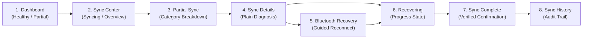

# Prototype Specification & Screen Reference — NoiseFit Sync Center

> **DOCUMENT CONTROL & CLASSIFICATION**  
> **Project:** NoiseFit Sync Reliability — Sync Center  
> **Document ID:** UX-NF-001  
> **Version:** 1.0  
> **Classification:** Independent Portfolio Case Study  
> **Status:** Proposed UI/UX Concept & Prototype Specifications  
> **Date:** October 16, 2026  
> **Disclaimer:** These screens represent a proposed portfolio design concept. They are not official screenshots of the production NoiseFit mobile application.

---

## 1. Prototype Overview & Core User Journey

The **NoiseFit Sync Center** prototype models an 8-screen end-to-end recovery journey designed to replace ambiguous spinners with a transparent, actionable user experience:

$$\textbf{Detect} \longrightarrow \textbf{Explain} \longrightarrow \textbf{Recover} \longrightarrow \textbf{Confirm}$$

---

## 2. Vector Screen Catalog (SVG Assets)

All 8 high-fidelity prototype screens are preserved as standalone vector graphics in [`05_UX/SVG_Screens/`](../05_UX/SVG_Screens/):

| Screen # | Screen Title | Primary Purpose | Key UI Elements & Copy | Asset Reference |
|---|---|---|---|---|
| **Screen 01** | **NoiseFit Dashboard — Healthy** | Main app entry point; establishes device connection and sync recency. | • Header: *"Good evening, Aarav"* • Status Card: *"Watch connected • Synced 2 min ago"* • CTA: *"View sync status"* | [`screen_01_Dashboard.svg`](../05_UX/SVG_Screens/screen_01_Dashboard.svg) |
| **Screen 02** | **Sync Center — Syncing** | Displays active data transfer and category-level progress. | • Title: *"Syncing your watch data..."* • Progress: *"3 of 4 data types synced"* • Active category list | [`screen_02_Sync_Center.svg`](../05_UX/SVG_Screens/screen_02_Sync_Center.svg) |
| **Screen 03** | **Sync Center — Partial Sync** | Surfaces delayed or incomplete categories transparently. | • Title: *"Almost there"* • Badge: *"3 of 4 data types synced"* • List: Steps (✓), Heart Rate (✓), Sleep (⚠ Delayed) • CTA: **[Retry Sync]** | [`screen_03_Partial_Sync.svg`](../05_UX/SVG_Screens/screen_03_Partial_Sync.svg) |
| **Screen 04** | **Sync Details — Failure** | Explains the root cause in plain language without jargon. | • Title: *"Sync Details"* • Diagnosis: *"Bluetooth connection was interrupted during sleep packet transfer."* • CTA: **[Retry Sync]** / **[Reconnect Watch]** | [`screen_04_Sync_Details.svg`](../05_UX/SVG_Screens/screen_04_Sync_Details.svg) |
| **Screen 05** | **Bluetooth Recovery** | Step-by-step guidance to restore device connectivity. | • Title: *"Reconnect Watch"* • Guidance: *"Keep watch within 1 meter and ensure Bluetooth is enabled."* • CTA: **[Reconnect]** / **[Open Settings]** | [`screen_05_Reconnect_Watch.svg`](../05_UX/SVG_Screens/screen_05_Reconnect_Watch.svg) |
| **Screen 06** | **Sync Center — Recovering** | Real-time visual feedback during recovery handshake. | • Title: *"Recovering data..."* • Animated spinner: *"Transferring remaining sleep packets..."* • 45s recovery watchdog | [`screen_06_Recovering.svg`](../05_UX/SVG_Screens/screen_06_Recovering.svg) |
| **Screen 07** | **Sync Complete — Success** | Explicit confirmation of restored categories and timestamp. | • Title: *"Sync Complete"* • Checkmark: *"All data categories are up to date"* • Restored timestamp display • CTA: **[Done]** | [`screen_07_Sync_Complete.svg`](../05_UX/SVG_Screens/screen_07_Sync_Complete.svg) |
| **Screen 08** | **Sync History** | Historical audit trail of previous sync events and outcomes. | • Title: *"Sync History"* • Chronological list of sync events, durations, and status badges | [`screen_08_Sync_History.svg`](../05_UX/SVG_Screens/screen_08_Sync_History.svg) |

A composite high-resolution mockup visual is accessible at [`05_UX/NoiseFit_Sync_Center_Prototype_Visual.png`](../05_UX/NoiseFit_Sync_Center_Prototype_Visual.png), and editable presentation slides are available in [`05_UX/NoiseFit_Sync_Center_Editable_Prototype.pptx`](../05_UX/NoiseFit_Sync_Center_Editable_Prototype.pptx).

---

## 3. UI/UX Design System Specifications

Detailed component specifications are codified in [`05_UX/Figma_Wireframe_Spec.xlsx`](../05_UX/Figma_Wireframe_Spec.xlsx):

- **Frame Dimension:** Standard mobile companion viewport: **$390 \times 844\text{ pt}$** (iPhone 14 / mid-tier Android flagship equivalent).
- **Grid & Spacing:** Strict **8pt spacing system** ($8\text{px}, 16\text{px}, 24\text{px}, 32\text{px}$) ensuring consistent card paddings and visual rhythm.
- **Typography Hierarchy:** Clean sans-serif system font (Inter / Roboto / SF Pro):
  - Screen Titles: Semi-bold $20\text{pt}$ / $24\text{pt}$ line-height.
  - Section Headers: Medium $16\text{pt}$ / $20\text{pt}$ line-height.
  - Body Text: Regular $14\text{pt}$ / $18\text{pt}$ line-height.
  - Captions & Timestamps: Regular $12\text{pt}$ / $16\text{pt}$ line-height.
- **Status Color Palette & Accessibility:**
  - *Healthy / Success:* Dark Green (`#0F9D58` on `#E6F4EA`, contrast ratio $>5.2:1$).
  - *Warning / Partial:* Dark Amber (`#D97706` on `#FEF3C7`, contrast ratio $>4.8:1$).
  - *Failure / Alert:* Carmine Red (`#DC2626` on `#FEE2E2`, contrast ratio $>5.1:1$).
  - *Status Labels:* Never rely on color alone; always pair iconography with explicit text labels: `✓ Synced`, `⚠ Delayed`, `✕ Failed`.
- **Button Architecture:** One dominant primary CTA per state (e.g., `[Retry Sync]`), with ghost/secondary styling for secondary actions (e.g., `[View Troubleshooting]`) to eliminate visual friction.
